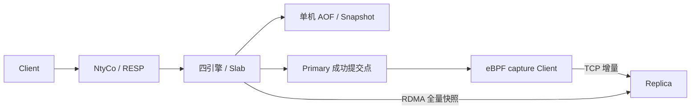
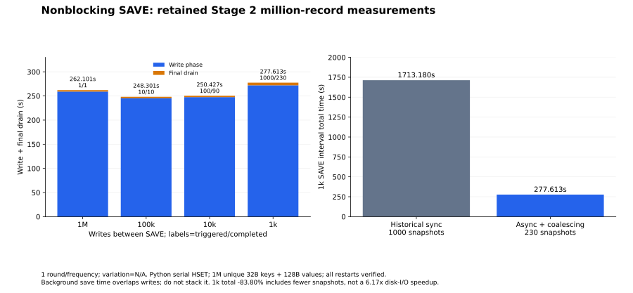
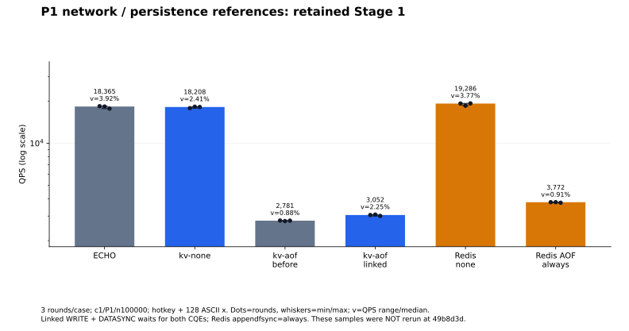
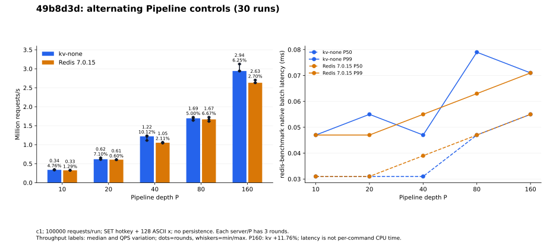
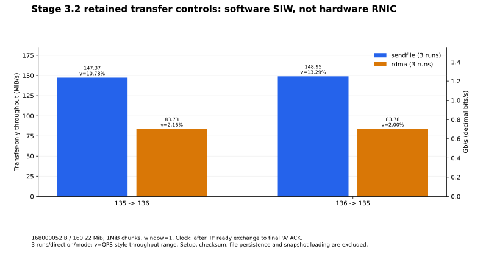
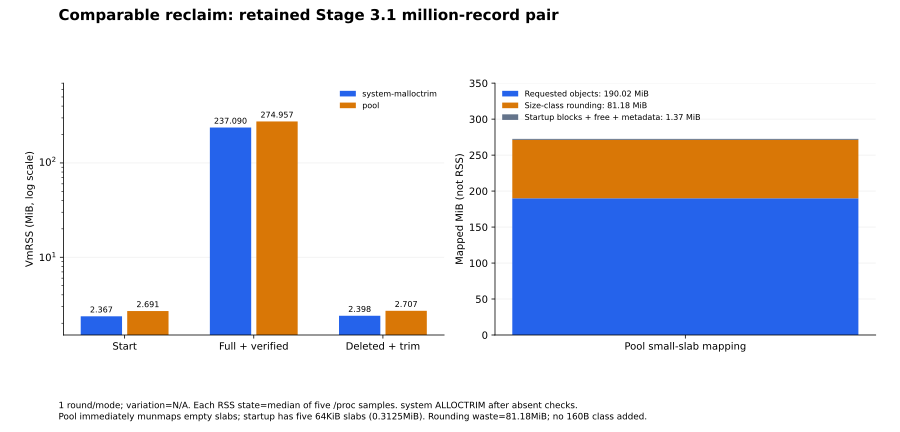

<p align="center">
  
</p>

# 91kvstore

**用 C 实现从存储引擎、持久化到主从复制的键值数据库。**

GNU C11 · Linux · NtyCo · io_uring · RDMA · eBPF · [MIT License](LICENSE)

## 1. 项目简介与架构

91kvstore 用于学习和实验数据库系统。Array、Hash、Red-Black Tree 和 Skip List 沿用基础教学骨架。项目在此基础上实现了统一 Slab 分配、基于 NtyCo 的 RESP 收发与解析、AOF 和后台快照、主从复制及其验证工具。

| 组件 | 实现 |
|---|---|
| 四种引擎 | Array、Hash（32位 FNV-1a）、Red-Black Tree、Skip List |
| Slab 内存池 | 16–4096B 规格、64KiB slab；空 slab 立即 munmap，大对象独立映射 |
| 网络与协议 | NtyCo 协程、输入缓冲游标、64KiB 批量读取、RESP 请求与回复 |
| 持久化 | io_uring AOF（LINK WRITE+DATASYNC）、fork+COW 后台 Snapshot |
| 主从复制 | RDMA 全量；普通 socket 增量或 eBPF 采集器主动 TCP 推流 |



eBPF 旁路采集和软件 SIW RDMA 属于实验性技术探索。第 4 节分别列出双机增量复制与 SIW 全量传输的实测对照。eBPF 保留成功提交点探针，直接引用原始 RESP 切片；Replica 全量完成后触发独立就绪事件，由采集器主动连入从机。完整握手、快照边界 S、资源清理与方案取舍见 **[主从时序与架构](docs/REPLICATION.md)**。

## 2. 环境依赖与编译步骤

需要 Linux、GCC、GNU Make、Python 3，以及 NtyCo 子模块。Ubuntu/Debian 对应依赖包：

- 服务端：`build-essential`、`git`、`liburing-dev`、`librdmacm-dev`、`libibverbs-dev`。
- eBPF 构建：`clang`、`libbpf-dev`、`libelf-dev`、`zlib1g-dev`。
- 客户端与设备检查：`redis-tools`、`rdmacm-utils`、`ibverbs-utils`、`iproute2`。

在仓库根目录构建，默认 `OPT=-O2`：

```bash
git submodule update --init --recursive
make -B OPT=-O2 all ebpf-capture benchmark-tools
```

生成 `bin/kvstore`、`bin/ebpf_capture`（采集器入口）、`build/ebpf_capture.bpf.o`，以及 ECHO/传输对照工具。普通服务无需 root；运行环境需允许 io_uring，真实 RDMA 测试还需 ACTIVE iWARP 设备。

启动单机服务，每个实例使用独立工作目录：

```bash
REPO="$PWD"
RUN_DIR=$(mktemp -d)
cd "$RUN_DIR"
"$REPO/bin/kvstore" "$REPO/config/standalone.conf"
```

默认监听 `127.0.0.1:29002`，数据留在 `RUN_DIR`。另开终端：

```bash
redis-cli -h 127.0.0.1 -p 29002 SET greeting hello
redis-cli -h 127.0.0.1 -p 29002 GET greeting
redis-cli -h 127.0.0.1 -p 29002 HSET 中文键 value
redis-cli --raw -h 127.0.0.1 -p 29002 HGET 中文键
```

`SET/RSET/HSET/SSET` 分别选择四种引擎，键存在时覆盖；`MOD/RMOD/HMOD/SMOD` 只修改已有键。对应读取为 `GET/RGET/HGET/SGET`。本项目 `HSET key value` 不是 Redis 的哈希字段命令。

## 3. 测试方案与可行性

先完成构建，再在仓库根目录运行：

```bash
make test-unit
python3 -B tests/test_standalone.py
make test-background-save test-persistence-100k
```

Hash 单测已固定启用 **`-fsanitize=address,undefined -fsigned-char`**，即使 ARM64 默认无符号 char，也覆盖中文、高位字节和碰撞链：

```bash
make -B OPT=-O2 test-hash-memory-pool
```

具备 ACTIVE SIW 设备时，可运行真实 RDMA 和不需 BPF 权限的增量替身测试；将 IP 换成设备上的本机 IPv4：

```bash
RDMA_TEST_IP=172.16.145.135 python3 -B tests/test_rdma_replication.py .
make bin/test_capture_mock
RDMA_TEST_IP=172.16.145.135 python3 -B tests/test_capture_replication.py . \
  --mock-collector "$PWD/bin/test_capture_mock"
```

| 测试范围 | 跑法与要求 |
|---|---|
| 单机协议/引擎 | `make test-unit`、`test_standalone.py`；含 Pipeline、半包、大 value、非法命令 |
| 持久化 | `test-background-save`、`test-persistence-100k`；验证 SAVE 接力、退出等待和 Snapshot/AOF 重启读回 |
| 真实 RDMA | 上述 `test_rdma_replication.py`；无 ACTIVE 设备不能计作通过 |
| 真实 eBPF | [RDMA/BPF 验收步骤](tests/README_RDMA.md)；需 sudo/BPF 权限，替身通过不能代替真实挂载 |
| 135↔136 双机 | [双机验收入口](tests/run_two_vm_acceptance.py)与[固定性能对照工具](docs/performance/STAGE5-REPRODUCING.md)；两端版本/ELF一致、端口可达、独立运行目录 |

用 `make testcase` 构建 `bin/testcase`。每次运行汇报实际尝试执行的命令数量（`attempted`）、通过数（`passed`）、总耗时（`seconds`，秒）和 QPS（`qps`，通过数除以总耗时）。

详细命令、判据和历史通过范围见 [测试方案](docs/performance/TESTING.md)；手动操作见 [演示流程](docs/MANUAL_DEMO.md)。

### 已知边界 / Known Limitations

- **固定结构规模**：Hash 为 1024 桶链表，不自动扩桶；Array 容量 1024；Skip List 最大 level=6（另含 level 0）。
- **协议子集**：key/value 为 C-string，不支持嵌入 `\0`；支持已列 RESP 场景，不完整实现 Redis 命令与语义，默认 benchmark inline PING 不能视为兼容。
- **SAVE 是后台保存**：`+OK` 仅表示接受 fork+COW 任务，语义类似 Redis BGSAVE；必须用 `SAVEINFO` 确认完成。重复请求可能合并，AOF 逐写同步和 Primary 复制快照生成仍可能阻塞。
- **软件 RDMA 环境**：开发验收使用 SIW，不代表硬件 RNIC 的吞吐、时延或 CPU 卸载性能。
- **复制边界**：当前面向单 Replica；异步复制，8MiB 用户态缓存内可续传，缺口/溢出或5秒接入超时重全量。eBPF 单命令事件上限4KiB；没有持久化复制 backlog 或自动故障转移。
- 尚未提供认证、访问控制或 TLS；本项目不承诺生产环境可用性。

## 4. 核心性能数据

以下为 `-O2` 历史测量。Pipeline 和复制采用 `49b8d3d`，其余保留各自阶段的成绩。三轮的各项指标分别取中位数，QPS 波动率为 `(最大值 − 最小值) / 中位数 × 100%`。单轮仅列实测值。完整命令和各轮结果见 [性能报告](docs/performance/REPORT.md)、[原始数据](docs/performance/data/measurements-2026-11-26.json)及[复现步骤](docs/performance/STAGE5-REPRODUCING.md)。

### 表 1　全量持久化 SAVE 频率对比（100 万条）

Stage 2 工作区（后归入 `02805d7`），每档 1 轮。串行 Python 客户端写入 100 万条 HSET，唯一键 32 B、值 128 B，使用 pool 和 `snapshot_checksum=file`。写入计时包括生成数据、HSET 往返和 SAVE 接受回复；收尾计时到 `SAVEINFO` 显示无活动、无待处理任务。总耗时为两者之和，重启和校验单独计时。HSET 延迟仅计单次命令往返（含编码）。四档重启前后快照 SHA-256 均相同，逐条校验均为零失败。

| 每写入多少条触发 SAVE | 写入（秒） | 收尾（秒） | 总耗时（秒） | 写入 QPS | HSET P50 / P99（ms） | triggered / completed | 重启一致性 |
| --- | --- | --- | --- | --- | --- | --- | --- |
| 1,000,000 | 259.103 | 2.998 | 262.101 | 3,859.47 | 0.210 / 0.691 | 1/1 | 100%（1,000,000/1,000,000） |
| 100,000 | 245.394 | 2.907 | 248.301 | 4,075.08 | 0.186 / 0.691 | 10/10 | 100%（1,000,000/1,000,000） |
| 10,000 | 247.619 | 2.807 | 250.427 | 4,038.46 | 0.183 / 0.735 | 100/90 | 100%（1,000,000/1,000,000） |
| 1,000 | 272.119 | 5.494 | 277.613 | 3,674.86 | 0.206 / 0.792 | 1000/230 | 100%（1,000,000/1,000,000） |



### 表 2　单请求与严格 AOF 对比

Stage 1 工作区（后归入 `e9584bb`），每项 3 轮。`redis-benchmark 7.0.15` 在本机以 `-c 1 -P 1 -n 100000` 运行。SET 使用固定 `hotkey` 和 128 个 ASCII `x`，ECHO 使用 128 B 负载。`none` 档关闭持久化，AOF 各轮从空目录启动。`kv-aof` 等待 WRITE 和 DATASYNC 均完成，`redis-aof` 使用 `appendfsync always`。

| 场景 | QPS 中位数 | P50 / P99（ms） | QPS 波动率 |
| --- | --- | --- | --- |
| `ECHO` | 18,365.47 | 0.055 / 0.071 | 3.92% |
| `kv-none` | 18,208.30 | 0.055 / 0.071 | 2.41% |
| `kv-aof` | 3,052.04 | 0.311 / 0.551 | 2.25% |
| `redis-none` | 19,286.40 | 0.047 / 0.071 | 3.77% |
| `redis-aof` | 3,771.73 | 0.263 / 0.343 | 0.91% |



### 表 3　Pipeline 批处理对比 Redis

`49b8d3d` 与 Redis 7.0.15 均关闭持久化。单连接 `-c 1`，每轮 100,000 次 SET，固定 `hotkey`、128 个 ASCII `x`，每个深度两端各 3 轮并交替执行，共 30 轮。该成绩用于验证单连接热点负载下的网络收发与 RESP 解析链路表现。相对差异以 Redis QPS 中位数为基准。

| Pipeline 深度 P | kv-none QPS 中位数 | redis-none QPS 中位数 | kv 相对 Redis |
| --- | --- | --- | --- |
| 10 | 337,837.84 | 325,732.88 | 3.72% |
| 20 | 617,283.94 | 606,060.56 | 1.85% |
| 40 | 1,219,512.12 | 1,052,631.62 | 15.85% |
| 80 | 1,694,915.25 | 1,666,666.75 | 1.69% |
| 160 | 2,941,176.25 | 2,631,579.00 | 11.76% |



### 表 4　主从同步实时性能对比

`49b8d3d`，Primary 135 → Replica 136，`-c 8 -P 1 -n 100000`，每模式 3 轮。每轮正式 HSET 负载包含 50,000 次覆盖和 50,000 条新增，唯一键 32 B、值为 128 个 ASCII `x`。QPS 按成功回复计，排除建连、全量、预热和校验。CPU 依次为 Primary、采集器、Replica，100% 代表一个逻辑核。可见性单独测量，每轮 1,000 次 HMOD/HGET 探测，8 条并发链，从收到 Primary 写入 ACK 计到 Replica 首次读回新值，包含查询 RTT。

| 模式 | Primary QPS 中位数 | QPS 波动率 | 可见性 P50 / P99（ms） | CPU P / C / R（%） | Primary 与 Replica 一致性 |
| --- | --- | --- | --- | --- | --- |
| `none` | 122,849.88 | 1.68% | — | 98.28 / — / — | —（无 Replica） |
| `ebpf-capture-only` | 106,097.99 | 1.20% | — | 98.90 / 1.06 / — | —（无 Replica） |
| `socket` | 122,241.66 | 0.69% | 0.939 / 1.230 | 98.70 / — / 25.41 | 100%（每轮 100,000/100,000） |
| `ebpf` | 98,863.36 | 0.34% | 1.994 / 2.304 | 98.77 / 6.91 / 60.82 | 100%（每轮 100,000/100,000） |

同版本 `-c 1 -P 1` 每模式也各 3 轮。该组可见性探测为串行，Primary CPU 利用率也随模式变化，两种并发口径分别统计。


### 表 5　已有数据的双机传输对比

Stage 3.2（`d7f3547`），135 与 136 双向。原生传输各方向每模式 3 轮，使用 168,000,052 B 的热缓存快照、1 MiB 分块、window=1，从就绪到最后一块 ACK 计时，排除建连、CRC、落盘和加载。RDMA 使用软件 SIW。`iperf3 3.16` 在同一虚拟网卡路径单独测量连续 TCP，默认窗口取 3 轮，`-w 131072` 各组合为单轮诊断。原生传输列快照传输阶段吞吐，`iperf3` 以“发送端 / 接收端”列吞吐。

| 方向 | 模式与负载 | 轮次 | MiB/s | Gb/s |
| --- | --- | --- | --- | --- |
| 135→136 | `sendfile` | 3 | 147.37 | 1.236237 |
| 135→136 | RDMA/SIW | 3 | 83.73 | 0.702351 |
| 135→136 | `iperf3` 默认窗口，1 流 / 30 秒 | 3 | 54.41 / 54.37 | 0.456460 / 0.456056 |
| 135→136 | `iperf3 -w 131072`，1 流 / 30 秒 | 1 | 136.27 / 136.32 | 1.143145 / 1.143528 |
| 135→136 | `iperf3 -w 131072`，1 流 / 10 秒 | 1 | 138.16 / 138.38 | 1.158935 / 1.160808 |
| 135→136 | `iperf3 -w 131072 -P 4`，4 流 / 10 秒 | 1 | 186.22 / 185.45 | 1.562165 / 1.555649 |
| 135→136 | `iperf3 -w 131072`，1 流 / 固定 168,000,052 B | 1 | 80.04 / 80.09 | 0.671416 / 0.671821 |
| 136→135 | `sendfile` | 3 | 148.95 | 1.249501 |
| 136→135 | RDMA/SIW | 3 | 83.78 | 0.702833 |
| 136→135 | `iperf3` 默认窗口，1 流 / 30 秒 | 3 | 52.58 / 52.60 | 0.441086 / 0.441268 |
| 136→135 | `iperf3 -w 131072`，1 流 / 30 秒 | 1 | 136.71 / 137.06 | 1.146781 / 1.149735 |
| 136→135 | `iperf3 -w 131072`，1 流 / 10 秒 | 1 | 137.00 / 136.91 | 1.149203 / 1.148519 |
| 136→135 | `iperf3 -w 131072 -P 4`，4 流 / 10 秒 | 1 | 188.10 / 187.54 | 1.577917 / 1.573177 |
| 136→135 | `iperf3 -w 131072`，1 流 / 固定 168,000,052 B | 1 | 80.06 / 80.04 | 0.671558 / 0.671426 |



### 表 6　百万条内存池 RSS 对比

Stage 3.1（后归入 `d7f3547`）。四引擎共使用 100 万条记录，键 32 B、值 128 B，Array 1,024 条，其余三种引擎各 332,992 条。各模式各 1 轮，每个状态的 RSS 取 `/proc` 五次采样的中位数。写满列在逐条读回核对后采样，删除列在逐条确认键已移除后采样。

| 实验组 | 模式 | 起始 RSS（MiB） | 写满核对后 RSS（MiB） | 删除核对后 RSS（MiB） | trim 后 RSS（MiB） | 结束 − 起始（MiB） |
| --- | --- | --- | --- | --- | --- | --- |
| 常规分配器组 | `system` | 2.371094 | 237.093750 | 237.093750 | — | 234.722656 |
| 常规分配器组 | `pool` | 2.695312 | 274.960938 | 2.710938 | — | 0.015625 |
| 常规分配器组 | `jemalloc` | 4.769531 | 245.535156 | 6.863281 | — | 2.093750 |
| 常规分配器组 | `jemalloc-decay0` | 4.773438 | 245.539062 | 6.867188 | — | 2.093750 |
| 同轮公平回收组 | `system-malloctrim` | 2.367188 | 237.089844 | — | 2.398438 | 0.031250 |
| 同轮公平回收组 | `pool` | 2.691406 | 274.957031 | 2.707031 | — | 0.015625 |

同轮公平回收组中，`system-malloctrim` 在删除核对后执行 `ALLOCTRIM`（调用 `malloc_trim(0)`），归档只提供 trim 后的结束采样。`pool` 随空 slab 释放映射，两组各有独立测量。表中“—”表示该采样未归档或该步骤不适用，差额按各行自己的结束采样计算。

`ALLOCINFO` 显示 pool 起始有 **5 个 64 KiB slab，合计 0.3125 MiB 映射空间**。写满时，工作负载占用的规格块合计 284,370,560 B，实际请求 199,250,104 B，规格取整差额为 **81.18 MiB 内碎片**。映射空间、内碎片与表中的 RSS 分别计量。


