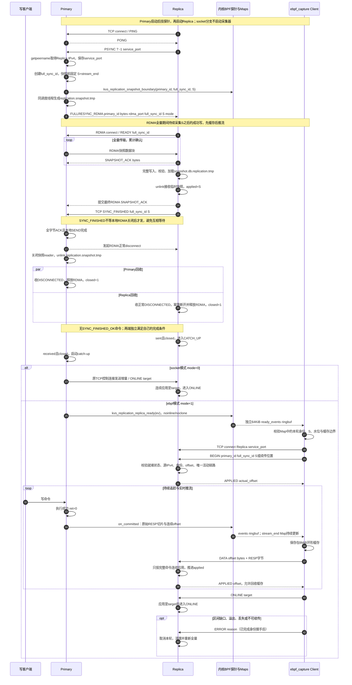
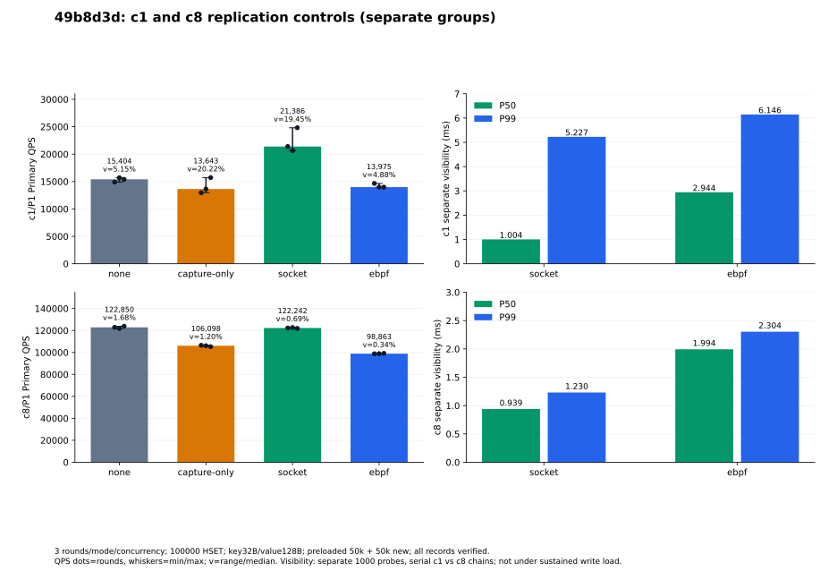

<p align="center">
  
</p>

**A persistent key-value store in C, built from engines to replication.**

`Linux` · `GNU C11` · `4 storage engines` · `NtyCo networking` · `AOF + Snapshot` · `Primary-Replica`

91kvstore 是一个用于学习数据库系统的键值存储项目。它不只实现单个数据结构，而是将 **TCP 字节流 → 命令解析 → 存储引擎 → 持久化 → 主从复制** 接成一条可运行、可测试的链路。

> 本项目用于学习和实验，不建议用于生产环境。它接受 RESP 风格的长度前缀**请求**，已验证 `redis-cli`、hiredis 与 redis-benchmark 的明确支持场景；它不是完整 Redis 实现，默认 `redis-benchmark -t ping` 仍未支持。详见[测试方案](docs/performance/TESTING.md)。

## 一分钟体验

### 1. 构建并启动

普通版需要 Linux、GCC、GNU Make、liburing、librdmacm/libibverbs，以及 NtyCo 子模块。以下是供复现的命令，本次文档整理没有执行安装或编译；全新安装流程未在本阶段重测。Ubuntu/Debian 依赖：

```bash
sudo apt update
sudo apt install -y build-essential git python3 liburing-dev netcat-openbsd \
    librdmacm-dev libibverbs-dev rdmacm-utils ibverbs-utils iproute2
```

```bash
git clone https://github.com/JasperStonnne/91kvstore.git
cd 91kvstore
git submodule update --init --recursive
make all

REPO="$PWD"
RUN_DIR=$(mktemp -d)
cd "$RUN_DIR"
"$REPO/bin/kvstore" "$REPO/config/standalone.conf"
```

服务在前台运行，示例配置监听 `127.0.0.1:29002`，使用独立 Snapshot 模式；另开终端发送命令。数据文件写入**进程工作目录**，所以每个实例使用独立目录。普通单机运行不需 root，但内核须允许所用 io_uring 系统调用。

已有仓库缺少子模块时，运行 `git submodule update --init --recursive`。

### 可选 eBPF 增量采集

Ubuntu/Debian 先安装可选采集程序的编译依赖：

```bash
sudo apt install -y clang libbpf-dev libelf-dev zlib1g-dev
make ebpf-capture
```

生成 `bin/kvstore-ebpf-capture`、兼容入口 `bin/ebpf_capture` 和 `build/ebpf_capture.bpf.o`，启动参数见下方主从复制配置。

性能复现使用 `-O2 -g`，在仓库根目录强制重编译项目、NtyCo 和对照工具，避免复用默认构建的旧对象：

```bash
make -B -j4 OPT=-O2 all ebpf-capture benchmark-tools
```

### 2. 写入与读取

旧的行命令仍可使用：

```bash
printf 'HSET username jasper\r\n' | nc -N 127.0.0.1 29002
# OK

printf 'HGET username\r\n' | nc -N 127.0.0.1 29002
# jasper
```

长度前缀命令能保留字段中的空格。下面写入 key `user name` 和 value `hello world`：

```bash
printf '*3\r\n$4\r\nHSET\r\n$9\r\nuser name\r\n$11\r\nhello world\r\n' |
  nc -N 127.0.0.1 29002
# +OK
```

```bash
printf '*2\r\n$4\r\nHGET\r\n$9\r\nuser name\r\n' |
  nc -N 127.0.0.1 29002
# $11
# hello world
```

`$9` 和 `$11` 是后续字段的**字节长度**，不是命令语法中的固定数字；换成其他内容时也要相应修改。

## 系统如何工作

```text
                         TCP client
                             │
                             ▼
                    NtyCo TCP
                             │
                             ▼
                动态输入缓冲区
                             │
                             ▼
            行命令 / 长度前缀命令解析
                             │
                             ▼
                       命令执行
                  ┌──────────┴──────────┐
                  ▼                     ▼
          内存存储引擎          AOF 写入 / Snapshot
                  │                     │
                  └──────────┬──────────┘
                             ▼
                    动态输出缓冲区
                             │
                             ▼
                         TCP client

          Primary 临时快照 + 复制流
                    │
                    ▼
          Replica 全量同步 + 增量追赶
```

NtyCo 网络层负责连接、收发和缓冲区；长度前缀解析集中在协议模块。命令执行层根据命令前缀选择引擎，写命令按所选持久化模式保存。复制模块通过 RDMA 临时快照和内存增量流将 Primary 的状态传给 Replica。

| 层 | 位置 | 职责 |
| --- | --- | --- |
| 协议 | `src/protocol/` | 长度前缀命令解析与编码 |
| 网络 | `src/network/` | NtyCo 连接、动态缓冲区与 RDMA 传输 |
| 引擎 | `src/engines/` | Array、Hash、RBTree、Skip List |
| 持久化 | `src/persistence/` | AOF、Snapshot、启动恢复 |
| 复制 | `src/replication/` | 握手、全量同步、增量同步 |
| 内存池 | `src/memory/` | 统一分配入口、规格池与大对象映射 |

## 命令与协议

### 命令

命令前缀选择存储引擎。当前四个引擎的 `SET/RSET/HSET/SSET` 均为**键不存在则新增，已存在则覆盖 value**；`MOD/RMOD/HMOD/SMOD` **仅修改已有键**，未命中时不创建。

| 操作 | Array | Red-Black Tree | Hash Table | Skip List |
| --- | --- | --- | --- | --- |
| 新增或覆盖 | `SET` | `RSET` | `HSET` | `SSET` |
| 读取 | `GET` | `RGET` | `HGET` | `SGET` |
| 仅修改已有键 | `MOD` | `RMOD` | `HMOD` | `SMOD` |
| 删除 | `DEL` | `RDEL` | `HDEL` | `SDEL` |
| 判断存在 | `EXIST` | `REXIST` | `HEXIST` | `SEXIST` |

新增/覆盖、修改：`命令 key value`。读取、删除、判断存在：`命令 key`。`SAVE` 发起后台 Snapshot（fork+COW），`SAVEINFO` 查询是否完成；`ALLOCINFO` 查询池明细，`ALLOCTRIM` 显式触发system/glibc回收。

对 RESP 请求，重复 SET 成功返回 `+OK` 并覆盖旧值；MOD 未命中返回 `-ERR key not found`，不插入新键。插入测试使用不同 key，更新测试固定使用 MOD，这是负载分组约定，不是 SET 只能新增的协议限制。[实现与既有用例核对](docs/performance/REPORT.md#命令语义与测量约定)。

### 两种请求格式

**行命令**以换行结束，字段由现有文本命令处理器拆分：

```text
HSET username jasper\r\n
```

因此行命令不适合包含空格的 key/value。

**长度前缀命令**以 `*` 开头，每个字段携带字节长度：

```text
*3\r\n
$4\r\nHSET\r\n
$9\r\nuser name\r\n
$11\r\nhello world\r\n
```

解析器面对的是 TCP 字节流：一次 `recv` 可能只收到半条命令，也可能收到多条命令。它只在命令完整时交给执行层，并返回本次消费的字节数；未消费的字节继续留在连接的输入缓冲区。

**兼容性边界：** 已验证的子集包括 `redis-cli`、hiredis 的基本命令/特殊字符场景及 redis-benchmark 显式 RESP `PING`、`HGET`。默认 `-t ping` 的 inline 场景仍不兼容，不能标全兼容。四种 SET 命令均可新增或覆盖，MOD 只修改已有键。本项目 `HSET key value` 选择 Hash 引擎，不等同于 Redis 的哈希字段操作；支持这些场景不表示支持 Redis 全部语义。key/value 不支持嵌入 `\0`。详见[测试方案与可行性](docs/performance/TESTING.md)。

## 持久化

单机可选择 `snapshot`、`aof` 或 `none`。Primary 和 Replica 只接受 `none`。

| 配置 | 写入/恢复边界 |
| --- | --- |
| `none` | 从空引擎启动，不写本地 AOF，也不支持客户端 SAVE。主从全量仍使用复制专用临时快照。 |
| `snapshot` | 普通写入只更新内存；`SAVE`接受后由fork+COW子进程保存`snapshot.bin`，用`SAVEINFO`确认完成，重启只加载已完成快照，不创建AOF |
| `aof` | 成功写回复前完成 AOF 追加和同步；重启回放 `commands.aof`，不需要 SAVE，也不生成快照 |

### SAVE 是后台保存

本项目 `SAVE` **非阻塞**：fork()+COW子进程保存，语义等价于Redis **BGSAVE**，不是Redis同步SAVE。`+OK`表示已接受，不表示落盘已结束。已有保存时只设一个save_pending接力标记；重复请求会合并。以`SAVEINFO`确认completed增加、failed未增加且in_progress=0/pending=0，优雅退出会等待最后一轮。NtyCo的10ms后台协程用waitpid(WNOHANG)回收；[状态与失败边界](docs/REPLICATION.md#非阻塞-save)。

### v3 快照与校验模式

单机 `SAVE` 和 RDMA 临时快照统一写 v3，加载端兼容 v1/v2。
四种引擎固定按 Array、RBTree、Hash、Skiplist 分段，各段的记录数位于段表，
记录只保存键值及长度。所有整数使用大端序，CRC 使用 CRC32/ISO-HDLC。

```ini
# 仅 standalone 且 persistence_mode=snapshot 可配置，默认 file。
snapshot_checksum = file
# 需要尽量恢复完好记录时可改为 record。
```

v3 字节布局如下。模式编号为 `file=0`、`record=1`，空段记录数为 0。

```text
偏移 0   magic[8] = 91KVSNAP
偏移 8   version[u32] = 3
偏移 12  checksum_mode[u8] | reserved[3] = 0
偏移 16  array_count[u64] | rbtree_count[u64] | hash_count[u64] | skiplist_count[u64]
偏移 48  Array 记录 → RBTree 记录 → Hash 记录 → Skiplist 记录
文件尾   CRC32[u32]

file 每条记录
  key_len[u32] | value_len[u32] | key | value
record 每条记录
  body_len[u32] | key_len[u32] | value_len[u32] | key | value | record_crc32[u32]
```

`file` 的文件尾 CRC 覆盖此前所有字节，校验失败则拒绝整份加载。
`record` 的记录 CRC 覆盖从 `key_len` 到 `value` 末尾的 body，`body_len` 包含两个长度字段。
此模式的文件尾保存结构 CRC，覆盖前 48 字节及依次出现的全部 `body_len` 字段。
加载先校验结构，再逐条校验和恢复。坏记录会记录段编号（1～4）、段内记录序号（从 0 开始）
和文件偏移，跳过后继续恢复。结构、边界或结构 CRC 损坏则拒绝整份加载。
恢复过程中不改写输入文件，重复键和引擎插入失败仍使本次加载失败。

配置决定下一次 `SAVE` 的模式，读取已有文件时按文件头标记解释。
Primary/Replica 固定写入和严格加载 `file`，显式配置 `snapshot_checksum` 会报错。
Replica 校验和加载成功后才发全量完成确认，失败会清空引擎、清理临时文件并取消本轮复制。
升级为 v3 写入后，读取端需使用支持 v3 的版本。

### AOF 校验模式

`standalone + persistence_mode=aof` 可显式配置 `aof_checksum = none | file`，默认 `none`。
配置层把枚举传给 AOF 的打开和恢复入口，AOF 模块自行持有本次打开所需的模式和 CRC 状态。

```ini
role = standalone
bind_ip = 127.0.0.1
service_port = 29002
persistence_mode = aof
aof_checksum = file
```

`none` 延续纯 RESP 命令流，启动时按顺序解析并回放。
`file` 使用以下容器，整数采用大端序，CRC 使用 CRC32/ISO-HDLC。

```text
偏移 0   magic[8] = 91KVAOF1
偏移 8   version[u32] = 1
偏移 12  reserved[u32] = 0
偏移 16  RESP 命令 1 | RESP 命令 2 | ……
文件尾   command_bytes[u64] | file_crc32[u32]
```

CRC 覆盖头部、全部命令和 `command_bytes`，空容器为 28 字节。
恢复先检查完整头尾、长度和 CRC，全部通过后才按命令顺序回放。
语法错误和命令执行失败仍使恢复失败。

追加位置指向旧文件尾起点，每次写入一段连续的“新命令＋新文件尾”，同步成功后才推进
内存里的写入位置和 CRC。缓存的 CRC 只包含头部和命令区，追加时处理新命令与新尾部的
8 字节长度；重新打开时校验现有文件并重建该状态。

`file` 写入或同步失败后停止当前写入器，服务沿用报错退出的行为。
覆盖尾部期间失败可能留下损坏文件，重启整份拒绝；完整命令和正确尾部已写入而同步返回
错误时，普通重启仍可能恢复这条未确认命令。恢复不自动修剪、跳过或改写原日志。

配置与已有格式必须匹配。已有纯 RESP 日志用 `none`，带 `91KVAOF1` 头的日志用 `file`。
更改配置不会自动转换已有文件。`file` 仅在路径尚不存在时初始化新容器，已有零字节文件
按缺少头尾拒绝恢复。Primary/Replica 的配置中出现 `aof_checksum` 会报错。

现场手动演示使用 `make all testcase` 构建 C 客户端，每次单独执行写入、读取校验、修改、删除或 SAVE；服务启动、宕机和重启由操作者控制。具体命令见[手动演示流程（HTML）](docs/MANUAL_DEMO.html)，可直接用浏览器打开。旧 `bin/testcase` 的数字模式已改为具名操作，使用 `bin/testcase --help` 查看参数。

当前 Snapshot 是带版本、记录长度和校验的**二进制格式**，不是旧的 `AOF_OFFSET` 文本首行。SAVE 路径为临时文件 → io_uring 写入/文件同步 → rename → 父目录同步。rename 后目录同步失败时可能“返回错误但文件已替换”，不承诺自动回滚。AOF 错误不回复成功并停止；残缺日志拒绝恢复，不自动跳过或修剪。失败回复也不承诺相关命令绝不在重启后出现。

单机 AOF/SAVE 的文件写入使用 io_uring，恢复使用 mmap；**Replica 接收临时快照仍使用 `write/fsync`**，不能写成所有落盘路径都已使用 io_uring。成功写入内存、AOF 同步、客户端回复与 Replica 应用是不同时间点。SIGKILL 恢复只验证进程异常退出，不等于断电或真实磁盘故障测试。[失败契约与现有测试](docs/performance/TESTING.md)。

## Primary-Replica 复制

Primary 接收客户端写入；Replica 可处理客户端读取，但拒绝客户端写入。复制是**异步**的：Primary 不等待 Replica 确认即可向客户端返回。

```text
CONNECTING
    │ 建立连接
    ▼
HANDSHAKE       PING / PONG / PSYNC
    │
    ▼
FULL_SYNC       RDMA 传输临时快照，Replica 校验并加载后确认
    │
    ▼
CATCH_UP        TCP 从快照记录的复制 offset 补齐内存缓存中的增量
    │
    ▼
ONLINE          继续从同一复制 offset 发送实时增量
```

当前通过配置文件启动，在两个独立工作目录运行 Primary 与 Replica。具体配置和启动步骤见下文及[复现说明](docs/performance/REPRODUCING.md)。

### RDMA 现状

- 已有数据的全量快照只走 RDMA；握手、控制通知和增量仍走 TCP。
- RDMA 全量失败不续传半份快照；eBPF 增量支持缓存范围内的断线续传，等待采集接入超时会自动重做全量。
- 开发机使用 Soft-iWARP（`siw0`），已有软件环境下的功能验收和整阶段测量，不代表物理 RDMA 网卡性能。
- 构建需安装 `librdmacm-dev libibverbs-dev`；验收还需 `rdmacm-utils ibverbs-utils iproute2`。
- Primary 配置 `role=primary`、iWARP IPv4 的 `bind_ip`、`service_port` 和必填 `rdma_port`。
- Replica 配置 `role=replica`、自身 `service_port`、Primary 的 IPv4 和 TCP `primary_port`。
- `rdma_port` 必须不同于 Primary 的 `service_port`，Replica 从通知获取该端口。
- 两端在独立工作目录运行 `/仓库绝对路径/bin/kvstore /配置绝对路径/server.conf`，配置样例见 `config/`。
- 本机复现：`RDMA_TEST_IP=172.16.145.135 make test`（替换为自己的 iWARP IPv4）。
- 架构、完整启动配置、失败场景和双机命令见 [RDMA 验收说明](tests/README_RDMA.md)。

### 增量模式

Primary 和 Replica 都用 `bin/kvstore`。两端可配 `persistence_mode = none`。只在 Primary 的配置中选择增量来源：

- `replication_incremental_mode = socket` 是默认值，由 Primary 持有 8 MiB 缓存。
- `replication_incremental_mode = ebpf` 由独立采集进程持有 8 MiB 缓存，Primary 不分配自己的复制缓存。不再需要 `replication_capture_port`；Primary 的该旧字段仍可解析但不使用。旧的 `replication_capture_socket` 已移除，继续配置会明确报错。

先启动 Primary，再启动采集进程；看到探针挂载和 `capture push client ready` 后启动 Replica。采集端默认不监听端口，收到全量完成就绪事件后主动连接 Replica 的 service_port：

```sh
make all ebpf-capture
# PRIMARY_PID 为本次 Primary 进程的 PID。
sudo bin/kvstore-ebpf-capture "$PRIMARY_PID" build/ebpf_capture.bpf.o
```

若本机仅有一个 `kvstore` 实例，也可以用进程名替代 PID（与上面的命令任选其一）：

```sh
sudo bin/ebpf_capture kvstore build/ebpf_capture.bpf.o
```

进程名按 `/proc/<pid>/comm` 精确匹配，最多 15 字节，并跳过采集器自身。未找到或有多个匹配时明确报错，多个匹配会列出全部 PID；同机运行多个 `kvstore` 时请使用数字 PID。以数字开头的参数必须是合法的纯十进制 PID，不接受 `123abc` 这类混合输入。


Primary 和 Replica 必须使用同一版本的全量控制协议：
`FULLRESYNC_RDMA <repl_id> <snapshot_bytes> <rdma_port> <sync_id> <stream_offset> <incremental_mode>`。
末尾固定为 `0`（socket）或 `1`（ebpf）。Replica 发送 `PSYNC ? -1 <service_port>`；Primary 兼容无端口的旧 socket PSYNC。eBPF 模式必须提供 Replica service_port，地址从控制连接 getpeername 获取。



普通 socket 模式在同样的加载握手后，由 Primary 在原控制连接发送增量和 `ONLINE`。eBPF 模式的增量及 `ONLINE` 全部来自采集端；Primary 不回传增量，不创建 `.sock` 文件。网络层独占连接的关闭权，增量接入检查当前就绪状态、Primary 源 IP、两份同步 ID 和续传偏移，并拒绝第二条活动链路。

### 方案取舍与边界

- **RDMA角色**：Primary生命周期长、固定单端口接受Replica重连，控制TCP和RDMA均Replica主动建连，地址/防火墙方向一致，便于后续多从聚合；当前实现仍只管理一轮单Replica会话，不能声称已支持多从并行全量。
- **eBPF Client**：利用PSYNC携带的业务端口，删除默认采集监听端口；采集器主动连接Replica，代价是反向网络可达性与严格BEGIN校验。用户态8MiB缓存只保有限历史，持续写入超过追赶速率会溢出并要求重全量；它不是持久化backlog。
- **提交点不前移**：成功写ret=0后保留on_committed探针；标准RESP直接借用当前原始切片，inline回退编码，避免Primary重复编码/堆分配。nty_recv无法保证多协程执行顺序、过滤读/失败命令或对齐快照前固定S，不能简单改成收包探针。[完整正确性约束](docs/REPLICATION.md#提交点探针与原始resp切片)。
- **结束顺序**：Replica校验加载并删.tmp后发SYNC_FINISHED，不等RDMA关闭才发；两端独立回收正常RDMA资源后进入增量，无SYNC_FINISHED_OK。提前断连、最终ACK缺失、控制失效不进入ONLINE，5秒等待超时清理并重全量。

[完整新版时序、主动推流与异常分支](docs/REPLICATION.md)。

内核 BPF 在成功提交点更新 `stream_end`，在快照边界更新包含本轮身份、S 和丢失计数基线的 `snapshot_boundary` Map；采集端读取一致的 Map 状态核对 `BEGIN` 和追平目标。BPF ring buffer 只负责搬运事件，可靠范围由用户态的 8 MiB 字节缓存决定：连接前滚动淘汰，连接后只按 `APPLIED` 回收。单事件最多 4 KiB 编码命令。

采集端在独立 **64KiB** 的 `ready_events` ring buffer 中读取就绪事件，先以当前边界/水位校验，再发送 `BEGIN`。Replica 回传实际 `APPLIED`，包括 ACK 丢失时已执行但尚未被采集端确认的部分；采集端校验完整命令边界后继续发送，避免重复执行。瞬断采用 25–500ms 退避重连，未应用的半包从最近完整命令位置重传。

缓存淘汰/溢出、区间缺口、内核丢失计数变化等错误要求重新全量。Replica 等待首次接入或断线恢复超过 5 秒、接收到 ERROR 时，清理本轮并自动重新 PSYNC；控制连接失效始终取消增量，不提供旧数据。采集端重启丢失缓存，须等待新全量边界，不能续用旧会话。`--listen IPv4:PORT` 仅保留作旧协议诊断与细粒度兼容测试。

具备 iWARP 的开发机可验证真实 BPF → 独立 TCP → 真实 Replica，以及无采集端、控制断开和缓存丢失后重新全量：

```sh
make all ebpf-capture
sudo -v
RDMA_TEST_IP=172.16.145.135 python3 -u -B tests/test_capture_replication.py . --output /tmp/91kv-direct-bpf-$(date +%Y%m%d-%H%M%S)
```

无需 sudo 的事件替身验收使用同样的采集端 TCP 和 Replica 生产代码：

```sh
RDMA_TEST_IP=172.16.145.135 make test-capture-faults test-capture-server
```


## 网络后端

当前客户端 TCP 网络层统一使用 **NtyCo**。Primary、Replica 和 standalone 的服务入口调用 `ntyco_start_listeners` / `ntyco_start_runtime`；Makefile 构建 `src/network/ntyco.c` 并链接 NtyCo 子模块。当前没有 `NETWORK_SELECT` 三后端切换，也没有可选的 Reactor/Proactor 服务入口。

客户端请求、复制控制和增量 TCP 收发由 NtyCo 路径承载；RDMA 全量传输由独立的 `rdma_transport` 模块负责。持久化使用的 io_uring 不代表当前还提供 Proactor 网络后端。

动态输入缓冲区容纳分段到达的长命令；动态输出缓冲区容纳较长的回复。网络层仍需要处理部分发送，不能假设一次发送就写完全部字节。

## 内存管理

当前四个引擎的动态 key/value、节点和容器缓冲区均通过统一的 `kvs_malloc/kvs_free` 入口；key/value 按 `strlen(...) + 1` 申请，**变长不等于绕过池后端**。统一入口再由 `kvs_allocator_alloc/free` 根据运行配置选择底层方式：

| 模式 | 统一入口的底层方式 | 覆盖范围 |
| --- | --- | --- |
| `system` | `malloc/free`；本批未预加载其他分配器，绑定 libc | 经统一入口的引擎分配及其他调用者 |
| `pool`（默认） | 请求1–4096字节按规格放入64KiB slab；更大请求独立 `mmap`，释放时 `munmap`，不回退 libc | 包括变长 key/value、节点、容器及通过该入口申请的网络缓冲等；不接管第三方直接分配 |
| `jemalloc`（benchmark模式） | 脚本选择 `allocator=system` 并用 `LD_PRELOAD` 替换动态堆分配 | 统一入口的 `malloc/free` 及进程中其他可被替换的同类动态调用；不是配置中的第三个后端，也不接管直接 `mmap` |

详见[四引擎分配与释放路径核对](docs/performance/REPORT.md#分配覆盖范围只读源码核对)。这三方案比较不是只替换固定大小节点。

空slab在最后一个对象释放后立即摘链并munmap，大对象单独解除映射；规格16..4096保持不变。`ALLOCINFO`区分当前映射、累计映射和各规格used/capacity；`ALLOCTRIM`只在显式请求时为system/glibc调用malloc_trim(0)，不改变默认启动/free行为。

最新同轮百万条公平回收（各1轮）：system-malloctrim删除核对后RSS **2.398MiB**，pool **2.707MiB**；pool不是所有条件下更省内存。起始5个64KiB slab=**0.3125MiB**，规格取整碎片**81.18MiB**，不为129B value过拟合新增160B档。[明细、五模式历史与同轮对照](docs/performance/REPORT.md#6-内存池百万条明细与公平回收保留-stage-31)。

## 测试

测试分层，不要求每个单元用例都灌一万条。以下命令在仓库根目录执行，可能编译测试程序。截至49b8d3d的性能测量前已完成 `-O2 -g` 正确性回归，包括单元/消毒器、真实 RDMA、单机持久化恢复、双机 10 万条与故障测试；真实 BPF 小负载专项由交互式 sudo 终端补跑通过。历史真实eBPF旧版本曾出现缓存溢出/缺口，记录保留；最终49b8d3d的c1/c8各四档三轮均通过一致性。Stage 5只做文档与图表校验，不将旧PASS写成新执行。

| 入口 | 目标与规模 | 环境/判据 |
| --- | --- | --- |
| `make test-unit` | 协议、引擎、文件、配置、复制边界及采集事件 | 单机 Linux；无真实 BPF 附着，不需 sudo；包含 ASan/UBSan 测试程序 |
| `RDMA_TEST_IP=实际地址 make test` | 完整普通回归，含真实 RDMA | 单机 ACTIVE iWARP 与 io_uring；无设备明确失败，不是全都无需 RDMA |
| `make test-functional-bulk` | 10000 个不同 key × 8 个操作阶段 | 单机；写/读/MOD/存在/删除及未命中逐条断言，Array 1000、其余各3000 |
| `make test-persistence-100k` | Snapshot/AOF 各10万条 | 单机、独立临时目录；默认在成功边界 SIGKILL 后逐条读回；不是断电测试 |
| `make test-clients` | redis-cli/hiredis/benchmark 已列支持场景 | 可选依赖缺失标 SKIP，默认 PING 标 UNSUPPORTED，两者不计 PASS |
| `make test-clients-strict` | 严格客户端对照 | 任意 SKIP 或默认 PING 未支持均非零；当前不能期望全绿 |
| `tests/test_capture_replication.py` | 真实 RDMA 与两种增量模式字节对账 | 先普通用户构建，再以批准的 BPF 权限运行；需要 ACTIVE iWARP |
| `make test-capture-faults` | 独立采集缓存/IPC、缺口、溢出、退出和重新全量 | 真实 RDMA + 文件事件替身；含末条事件丢失且无后续写入，不证明真实内核压力下不丢事件 |
| `tests/test_two_vm_100k.py` | 先5万、从机同步后再5万，两端各10万读回 | 双VM、同程序/依赖指纹；客户端本身不启动/清理服务，必须落实实例归属及超时 |

详细的依赖、执行步骤、资源要求、正确性判据、历史通过范围及未验证项见[测试方案](docs/performance/TESTING.md)和[复现说明](docs/performance/REPRODUCING.md)。完整 `make test` 不含所有大数据、可选客户端或真实 BPF 专项；SKIP 不等于 PASS。新机器全套安装/构建未在本阶段重新验证。

## 性能结果

### Stage 5 最终归档：49b8d3d / -O2

[完整正式报告与原始轮次](docs/performance/REPORT.md) · [数值与来源](docs/performance/data/measurements-2026-11-26.json) · [复现/离线制图](docs/performance/STAGE5-REPRODUCING.md)

**最终版本重测**为Pipeline交替30次、双机c1/c8四档各3轮；其余为注明版本的阶段保留测量。不得把旧版本、不同客户端或不同c/P混算。三轮取各指标中位数，波动率=100×(max-min)/median；单轮无轮间波动。

| 组别 | 成绩 | 版本/轮次与口径 |
|---|---|---|
| 单请求 ECHO / kv-none / redis-none | 18,365 / 18,208 / 19,286 QPS | 保留Stage 1，各3轮；c1/P1，hotkey+128B x |
| 严格kv-aof | 2,780.87→3,052.04，+9.75% | 保留Stage 1，各3轮；LINK WRITE+DATASYNC，非只提交异步io-wq |
| redis-aof | 3,771.73 QPS | 保留Stage 1，3轮；appendfsync always，关闭RDB/rewrite |
| Pipeline P160 | **2,941,176 vs Redis 2,631,579 QPS，+11.76%** | 49b8d3d，交替3轮/端/深度，共30次 |
| 后台SAVE并发 | SET+GET整组P99 **0.153ms** | 保留Stage 2，3万条、2073对请求，非百万条单SET延迟 |
| 百万条SAVE四档 | 总耗时248.301–277.613s；1k历史1713.18→277.613s | 各1轮；save_pending使1000次请求仅完成230次保存，非等次数纯IO加速 |
| 公平回收RSS | system-malloctrim **2.398MiB** vs pool **2.707MiB** | 保留Stage 3.1，同轮各1次，百万条删除核对后 |
| 双向sendfile / RDMA | 约147–149 / 84 MiB/s | 保留Stage 3.2，各3轮；168000052B，1MiB/window1；软件SIW非硬件RNIC |

### Pipeline与阶段收益

最终c1、100000请求、SET hotkey/128 ASCII x，无持久化；P10/20/40/80/160各端3轮。短轮吞吐受计时粒度影响，P20/P80的差异小于观测波动，不认定稳定领先。


已测阶段为O2→游标/64KiB→tokens栈缓冲；历史各P仅1轮。没有同SET/hotkey负载的O0配对成绩，不虚构O0收益，也不把不同窗口差值相加为单项贡献。[分阶段表与图](docs/performance/REPORT.md#分阶段贡献机制与已测数值分开)。

### 双机满载：c8/P1，100000次HSET，32B/128B

| 模式 | QPS中位数 | P50/P99 ms | QPS波动率 | CPU Primary/Capture/Replica % | 可见性P50/P99 ms |
|---|---:|---:|---:|---:|---:|
| none | 122,849.88 | 0.0617/0.1369 | 1.68% | 98.28/—/— | — |
| ebpf-capture-only | 106,097.99 | 0.0729/0.1412 | 1.20% | 98.90/1.07/— | — |
| socket | 122,241.66 | 0.0629/0.1216 | 0.69% | 98.70/—/25.41 | 0.939/1.230 |
| ebpf | 98,863.36 | 0.0785/0.1427 | 0.34% | 98.77/6.91/60.82 | 1.994/2.304 |

四档各3轮全部通过；复制档逐条验证100000条一致。采集相对none QPS−13.64%；ebpf相对socket−19.12%。CPU 100%=一个核心。可见性另用1000次c8并发HMOD/HGET探测，包含查询RTT，不是持续HSET压力内的延迟。

c1/P1同版本另组各3轮：none/capture-only/socket/ebpf QPS中位数约15,404/13,643/21,386/13,975；socket Primary约99.4% CPU，none约52.1%。1ms流控唤醒与调度利用率差有关，没有独立因果消融；不能说复制本身提高服务吞吐。两组完整表、每轮值与CPU定义见正式报告。



Replica idle时流量水位完全不变但**总CPU55.13%**；perf栈定位到nty_schedule_run→epoll_pwait（Children81.82%，Self26.59%，不是“epoll占55.13%”）。持续写入时另见分配器27.00%、strcmp/kvs_hash_set13.36%热点。源码存在亚毫秒等待截断为0的路径，与空转观测一致；尚未逐次测epoll参数或APPLIED频次，不把推测当结论。[直接证据](docs/performance/REPORT.md#replica-cpu直接perf证据与源码解释)。

### 其他正式图表与历史

[单请求/AOF图](docs/performance/figures/20261126-single-aof.svg) · [阶段轨迹](docs/performance/figures/20261126-pipeline-stages.svg) · [异步SAVE](docs/performance/figures/20261126-save.svg) · [CPU分布](docs/performance/figures/20261126-replication-cpu.svg) · [Replica热点](docs/performance/figures/20261126-replica-profile.svg) · [双向传输](docs/performance/figures/20261126-transfer.svg) · [Bufferbloat诊断](docs/performance/figures/20261126-bufferbloat.svg) · [内存公平回收](docs/performance/figures/20261126-memory.svg)

iperf3默认单流RTT61–63ms；另一次-w131072诊断降至约1.1ms、吞吐升至约1.14–1.15Gb/s，支持缓冲排队诊断。原生传输从R就绪交换后到末A，setup/checksum单列、不含落盘与加载；同时给MiB/s和Gb/s，**软件SIW不外推硬件RDMA性能**。

保留[719836e旧报告](docs/performance/REPORT-719836e-legacy.md)、[2026-11-19报告](docs/performance/2026-11-19.md)、[2026-11-20单轮直连eBPF](docs/performance/2026-11-20-direct-ebpf.md)，均有各自版本、轮次与命令，不并入本轮中位数。

## 项目结构

```text
91kvstore/
├── clients/                 多语言 TCP 客户端示例
├── include/                 公共头文件
├── src/
│   ├── engines/             四种内存引擎
│   ├── memory/              内存池
│   ├── network/             NtyCo TCP / 缓冲区
│   ├── persistence/         AOF / Snapshot
│   ├── protocol/            长度前缀编解码
│   ├── replication/         主从复制
│   └── kvstore.c            命令执行与程序入口
├── tests/                   测试与基准测试
├── third_party/NtyCo/       Git 子模块
└── Makefile
```

## 当前限制

- 仅保证已列客户端子集，不完整兼容 Redis 命令语义；默认 redis-benchmark `-t ping` 未支持
- key/value 不支持嵌入 `\0`；行命令也不支持字段中包含空格
- eBPF仅支持8MiB缓存内的短断线续传，超时/缺口重全量；无持久化复制backlog或跨采集器重启续传
- 当前主要面向单Replica；有RDMA累计ACK和eBPF APPLIED，没有选主、通用心跳与自动故障转移
- standalone SAVE已后台fork+COW；Primary复制快照生成和AOF逐写同步仍可能阻塞事件处理
- 尚未提供认证、访问控制或 TLS

## 许可证

仓库目前未声明开源许可证。在发布许可证前，保留所有权利。
