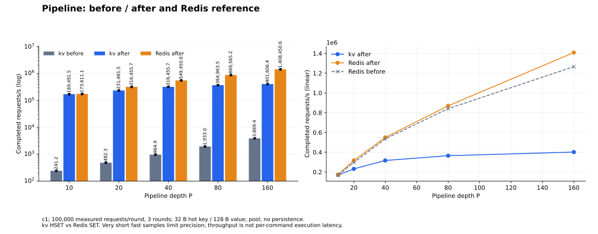
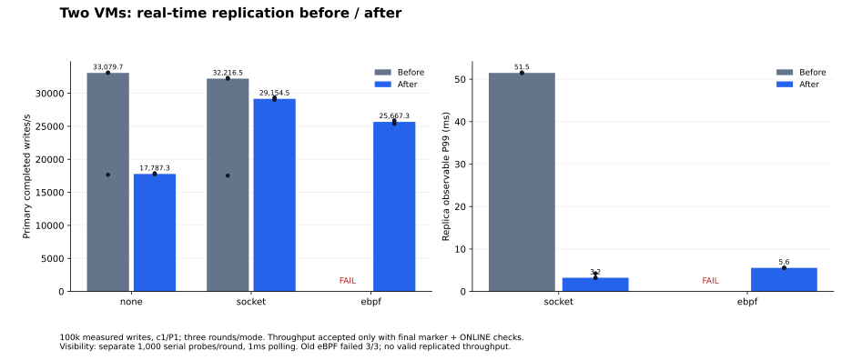
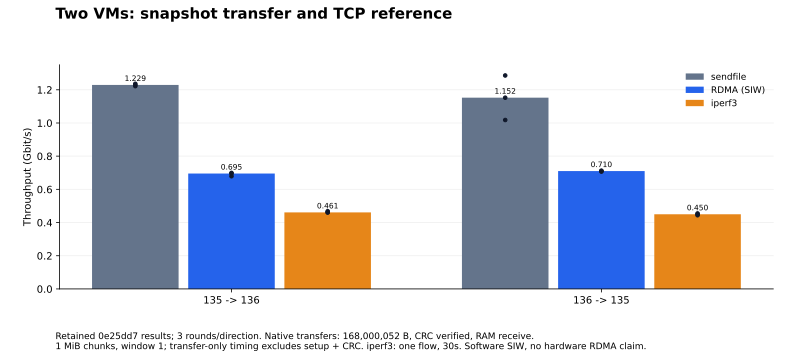

<p align="center">
  
</p>

**A persistent key-value store in C, built from engines to replication.**

`Linux` · `GNU C11` · `4 storage engines` · `NtyCo networking` · `AOF + Snapshot` · `Primary-Replica`

91kvstore 是一个用于学习数据库系统的键值存储项目。它不只实现单个数据结构，而是将 **TCP 字节流 → 命令解析 → 存储引擎 → 持久化 → 主从复制** 接成一条可运行、可测试的链路。

> 本项目用于学习和实验，不建议用于生产环境。它接受 RESP 风格的长度前缀**请求**，已验证 `redis-cli`、hiredis 与 redis-benchmark 的明确支持场景；它不是完整 Redis 实现，默认 `redis-benchmark -t ping` 仍未支持。详见[测试方案](docs/performance/TESTING.md)。

## 一分钟体验

### 1. 构建并启动

普通版需要 Linux、GCC、GNU Make、liburing、librdmacm/libibverbs，以及 NtyCo 子模块。以下是供复现的命令，本次文档整理没有执行安装或编译；全新安装流程未在本阶段重测。Ubuntu/Debian 依赖：

```bash
sudo apt update
sudo apt install -y build-essential git python3 liburing-dev netcat-openbsd \
    librdmacm-dev libibverbs-dev rdmacm-utils ibverbs-utils iproute2
```

```bash
git clone https://github.com/JasperStonnne/91kvstore.git
cd 91kvstore
git submodule update --init --recursive
make all

REPO="$PWD"
RUN_DIR=$(mktemp -d)
cd "$RUN_DIR"
"$REPO/bin/kvstore" "$REPO/config/standalone.conf"
```

服务在前台运行，示例配置监听 `127.0.0.1:29002`，使用独立 Snapshot 模式；另开终端发送命令。数据文件写入**进程工作目录**，所以每个实例使用独立目录。普通单机运行不需 root，但内核须允许所用 io_uring 系统调用。

已有仓库缺少子模块时，运行 `git submodule update --init --recursive`。

### 可选 eBPF 增量采集

Ubuntu/Debian 先安装可选采集程序的编译依赖：

```bash
sudo apt install -y clang libbpf-dev libelf-dev zlib1g-dev
make ebpf-capture
```

生成 `bin/kvstore-ebpf-capture` 和 `build/ebpf_capture.bpf.o`，启动参数见下方主从复制配置。

性能复现使用 `-O2 -g`，在仓库根目录强制重编译项目、NtyCo 和对照工具，避免复用默认构建的旧对象：

```bash
make -B -j4 CFLAGS='-std=gnu11 -Wall -Wextra -O2 -g' \
    all ebpf-capture benchmark-tools
```

### 2. 写入与读取

旧的行命令仍可使用：

```bash
printf 'HSET username jasper\r\n' | nc -N 127.0.0.1 29002
# OK

printf 'HGET username\r\n' | nc -N 127.0.0.1 29002
# jasper
```

长度前缀命令能保留字段中的空格。下面写入 key `user name` 和 value `hello world`：

```bash
printf '*3\r\n$4\r\nHSET\r\n$9\r\nuser name\r\n$11\r\nhello world\r\n' |
  nc -N 127.0.0.1 29002
# +OK
```

```bash
printf '*2\r\n$4\r\nHGET\r\n$9\r\nuser name\r\n' |
  nc -N 127.0.0.1 29002
# $11
# hello world
```

`$9` 和 `$11` 是后续字段的**字节长度**，不是命令语法中的固定数字；换成其他内容时也要相应修改。

## 系统如何工作

```text
                         TCP client
                             │
                             ▼
                    NtyCo TCP
                             │
                             ▼
                动态输入缓冲区
                             │
                             ▼
            行命令 / 长度前缀命令解析
                             │
                             ▼
                       命令执行
                  ┌──────────┴──────────┐
                  ▼                     ▼
          内存存储引擎          AOF 写入 / Snapshot
                  │                     │
                  └──────────┬──────────┘
                             ▼
                    动态输出缓冲区
                             │
                             ▼
                         TCP client

          Primary 临时快照 + 复制流
                    │
                    ▼
          Replica 全量同步 + 增量追赶
```

NtyCo 网络层负责连接、收发和缓冲区；长度前缀解析集中在协议模块。命令执行层根据命令前缀选择引擎，写命令按所选持久化模式保存。复制模块通过 RDMA 临时快照和内存增量流将 Primary 的状态传给 Replica。

| 层 | 位置 | 职责 |
| --- | --- | --- |
| 协议 | `src/protocol/` | 长度前缀命令解析与编码 |
| 网络 | `src/network/` | NtyCo 连接、动态缓冲区与 RDMA 传输 |
| 引擎 | `src/engines/` | Array、Hash、RBTree、Skip List |
| 持久化 | `src/persistence/` | AOF、Snapshot、启动恢复 |
| 复制 | `src/replication/` | 握手、全量同步、增量同步 |
| 内存池 | `src/memory/` | 统一分配入口、规格池与大对象映射 |

## 命令与协议

### 命令

命令前缀选择存储引擎。当前四个引擎的 `SET/RSET/HSET/SSET` 均为**键不存在则新增，已存在则覆盖 value**；`MOD/RMOD/HMOD/SMOD` **仅修改已有键**，未命中时不创建。

| 操作 | Array | Red-Black Tree | Hash Table | Skip List |
| --- | --- | --- | --- | --- |
| 新增或覆盖 | `SET` | `RSET` | `HSET` | `SSET` |
| 读取 | `GET` | `RGET` | `HGET` | `SGET` |
| 仅修改已有键 | `MOD` | `RMOD` | `HMOD` | `SMOD` |
| 删除 | `DEL` | `RDEL` | `HDEL` | `SDEL` |
| 判断存在 | `EXIST` | `REXIST` | `HEXIST` | `SEXIST` |

新增/覆盖、修改：`命令 key value`。读取、删除、判断存在：`命令 key`。`SAVE` 手动保存 Snapshot。

对 RESP 请求，重复 SET 成功返回 `+OK` 并覆盖旧值；MOD 未命中返回 `-ERR key not found`，不插入新键。插入测试使用不同 key，更新测试固定使用 MOD，这是负载分组约定，不是 SET 只能新增的协议限制。[实现与既有用例核对](docs/performance/REPORT.md#命令语义与测量约定)。

### 两种请求格式

**行命令**以换行结束，字段由现有文本命令处理器拆分：

```text
HSET username jasper\r\n
```

因此行命令不适合包含空格的 key/value。

**长度前缀命令**以 `*` 开头，每个字段携带字节长度：

```text
*3\r\n
$4\r\nHSET\r\n
$9\r\nuser name\r\n
$11\r\nhello world\r\n
```

解析器面对的是 TCP 字节流：一次 `recv` 可能只收到半条命令，也可能收到多条命令。它只在命令完整时交给执行层，并返回本次消费的字节数；未消费的字节继续留在连接的输入缓冲区。

**兼容性边界：** 已验证的子集包括 `redis-cli`、hiredis 的基本命令/特殊字符场景及 redis-benchmark 显式 RESP `PING`、`HGET`。默认 `-t ping` 的 inline 场景仍不兼容，不能标全兼容。四种 SET 命令均可新增或覆盖，MOD 只修改已有键。本项目 `HSET key value` 选择 Hash 引擎，不等同于 Redis 的哈希字段操作；支持这些场景不表示支持 Redis 全部语义。key/value 不支持嵌入 `\0`。详见[测试方案与可行性](docs/performance/TESTING.md)。

## 持久化

单机可选择 `snapshot`、`aof` 或 `none`。Primary 和 Replica 只接受 `none`。

| 配置 | 写入/恢复边界 |
| --- | --- |
| `none` | 从空引擎启动，不写本地 AOF，也不支持客户端 SAVE。主从全量仍使用复制专用临时快照。 |
| `snapshot` | 普通写入只更新内存；成功 `SAVE` 后保存二进制 `snapshot.bin`，重启只加载快照，不创建 AOF |
| `aof` | 成功写回复前完成 AOF 追加和同步；重启回放 `commands.aof`，不需要 SAVE，也不生成快照 |

### v3 快照与校验模式

单机 `SAVE` 和 RDMA 临时快照统一写 v3，加载端兼容 v1/v2。
四种引擎固定按 Array、RBTree、Hash、Skiplist 分段，各段的记录数位于段表，
记录只保存键值及长度。所有整数使用大端序，CRC 使用 CRC32/ISO-HDLC。

```ini
# 仅 standalone 且 persistence_mode=snapshot 可配置，默认 file。
snapshot_checksum = file
# 需要尽量恢复完好记录时可改为 record。
```

v3 字节布局如下。模式编号为 `file=0`、`record=1`，空段记录数为 0。

```text
偏移 0   magic[8] = 91KVSNAP
偏移 8   version[u32] = 3
偏移 12  checksum_mode[u8] | reserved[3] = 0
偏移 16  array_count[u64] | rbtree_count[u64] | hash_count[u64] | skiplist_count[u64]
偏移 48  Array 记录 → RBTree 记录 → Hash 记录 → Skiplist 记录
文件尾   CRC32[u32]

file 每条记录
  key_len[u32] | value_len[u32] | key | value
record 每条记录
  body_len[u32] | key_len[u32] | value_len[u32] | key | value | record_crc32[u32]
```

`file` 的文件尾 CRC 覆盖此前所有字节，校验失败则拒绝整份加载。
`record` 的记录 CRC 覆盖从 `key_len` 到 `value` 末尾的 body，`body_len` 包含两个长度字段。
此模式的文件尾保存结构 CRC，覆盖前 48 字节及依次出现的全部 `body_len` 字段。
加载先校验结构，再逐条校验和恢复。坏记录会记录段编号（1～4）、段内记录序号（从 0 开始）
和文件偏移，跳过后继续恢复。结构、边界或结构 CRC 损坏则拒绝整份加载。
恢复过程中不改写输入文件，重复键和引擎插入失败仍使本次加载失败。

配置决定下一次 `SAVE` 的模式，读取已有文件时按文件头标记解释。
Primary/Replica 固定写入和严格加载 `file`，显式配置 `snapshot_checksum` 会报错。
Replica 校验和加载成功后才发全量完成确认，失败会清空引擎、清理临时文件并取消本轮复制。
升级为 v3 写入后，读取端需使用支持 v3 的版本。

### AOF 校验模式

`standalone + persistence_mode=aof` 可显式配置 `aof_checksum = none | file`，默认 `none`。
配置层把枚举传给 AOF 的打开和恢复入口，AOF 模块自行持有本次打开所需的模式和 CRC 状态。

```ini
role = standalone
bind_ip = 127.0.0.1
service_port = 29002
persistence_mode = aof
aof_checksum = file
```

`none` 延续纯 RESP 命令流，启动时按顺序解析并回放。
`file` 使用以下容器，整数采用大端序，CRC 使用 CRC32/ISO-HDLC。

```text
偏移 0   magic[8] = 91KVAOF1
偏移 8   version[u32] = 1
偏移 12  reserved[u32] = 0
偏移 16  RESP 命令 1 | RESP 命令 2 | ……
文件尾   command_bytes[u64] | file_crc32[u32]
```

CRC 覆盖头部、全部命令和 `command_bytes`，空容器为 28 字节。
恢复先检查完整头尾、长度和 CRC，全部通过后才按命令顺序回放。
语法错误和命令执行失败仍使恢复失败。

追加位置指向旧文件尾起点，每次写入一段连续的“新命令＋新文件尾”，同步成功后才推进
内存里的写入位置和 CRC。缓存的 CRC 只包含头部和命令区，追加时处理新命令与新尾部的
8 字节长度；重新打开时校验现有文件并重建该状态。

`file` 写入或同步失败后停止当前写入器，服务沿用报错退出的行为。
覆盖尾部期间失败可能留下损坏文件，重启整份拒绝；完整命令和正确尾部已写入而同步返回
错误时，普通重启仍可能恢复这条未确认命令。恢复不自动修剪、跳过或改写原日志。

配置与已有格式必须匹配。已有纯 RESP 日志用 `none`，带 `91KVAOF1` 头的日志用 `file`。
更改配置不会自动转换已有文件。`file` 仅在路径尚不存在时初始化新容器，已有零字节文件
按缺少头尾拒绝恢复。Primary/Replica 的配置中出现 `aof_checksum` 会报错。

现场手动演示使用 `make all testcase` 构建 C 客户端，每次单独执行写入、读取校验、修改、删除或 SAVE；服务启动、宕机和重启由操作者控制。具体命令见[手动演示流程（HTML）](docs/MANUAL_DEMO.html)，可直接用浏览器打开。旧 `bin/testcase` 的数字模式已改为具名操作，使用 `bin/testcase --help` 查看参数。

当前 Snapshot 是带版本、记录长度和校验的**二进制格式**，不是旧的 `AOF_OFFSET` 文本首行。SAVE 路径为临时文件 → io_uring 写入/文件同步 → rename → 父目录同步。rename 后目录同步失败时可能“返回错误但文件已替换”，不承诺自动回滚。AOF 错误不回复成功并停止；残缺日志拒绝恢复，不自动跳过或修剪。失败回复也不承诺相关命令绝不在重启后出现。

单机 AOF/SAVE 的文件写入使用 io_uring，恢复使用 mmap；**Replica 接收临时快照仍使用 `write/fsync`**，不能写成所有落盘路径都已使用 io_uring。成功写入内存、AOF 同步、客户端回复与 Replica 应用是不同时间点。SIGKILL 恢复只验证进程异常退出，不等于断电或真实磁盘故障测试。[失败契约与现有测试](docs/performance/TESTING.md)。

## Primary-Replica 复制

Primary 接收客户端写入；Replica 可处理客户端读取，但拒绝客户端写入。复制是**异步**的：Primary 不等待 Replica 确认即可向客户端返回。

```text
CONNECTING
    │ 建立连接
    ▼
HANDSHAKE       PING / PONG / PSYNC
    │
    ▼
FULL_SYNC       RDMA 传输临时快照，Replica 校验并加载后确认
    │
    ▼
CATCH_UP        TCP 从快照记录的复制 offset 补齐内存缓存中的增量
    │
    ▼
ONLINE          继续从同一复制 offset 发送实时增量
```

当前通过配置文件启动，在两个独立工作目录运行 Primary 与 Replica。具体配置和启动步骤见下文及[复现说明](docs/performance/REPRODUCING.md)。

### RDMA 现状

- 已有数据的全量快照只走 RDMA；握手、控制通知和增量仍走 TCP。
- 无自动重连或断点续传；失败后需重新启动 Replica，从当前 Primary 重新全量，不接着半份快照传输。
- 开发机使用 Soft-iWARP（`siw0`），已有软件环境下的功能验收和整阶段测量，不代表物理 RDMA 网卡性能。
- 构建需安装 `librdmacm-dev libibverbs-dev`；验收还需 `rdmacm-utils ibverbs-utils iproute2`。
- Primary 配置 `role=primary`、iWARP IPv4 的 `bind_ip`、`service_port` 和必填 `rdma_port`。
- Replica 配置 `role=replica`、自身 `service_port`、Primary 的 IPv4 和 TCP `primary_port`。
- `rdma_port` 必须不同于 Primary 的 `service_port`，Replica 从通知获取该端口。
- 两端在独立工作目录运行 `/仓库绝对路径/bin/kvstore /配置绝对路径/server.conf`，配置样例见 `config/`。
- 本机复现：`RDMA_TEST_IP=172.16.145.135 make test`（替换为自己的 iWARP IPv4）。
- 架构、完整启动配置、失败场景和双机命令见 [RDMA 验收说明](tests/README_RDMA.md)。

### 增量模式

Primary 和 Replica 都用 `bin/kvstore`。两端可配 `persistence_mode = none`。只在 Primary 的配置中选择增量来源：

- `replication_incremental_mode = socket` 是默认值，由 Primary 持有 8 MiB 缓存。
- `replication_incremental_mode = ebpf` 由独立进程持有 8 MiB 缓存。Primary 还需设置 `replication_capture_socket = /绝对路径/capture.sock`，和采集进程使用相同的路径。把 socket 放在 Primary 用户可访问的私有目录中。

服务先启动 Primary，再启动采集进程。等采集进程输出已挂载的消息后，启动 Replica。采集进程提前暂存写入，Primary 处理 `PSYNC` 时自动发送本轮快照 offset。Replica 完成加载后，Primary 才从采集进程取数据，并通过原来的 TCP 连接发送。

```sh
make all ebpf-capture
sudo bin/kvstore-ebpf-capture "$PRIMARY_PID" build/ebpf_capture.bpf.o --socket "$CAPTURE_SOCKET"
```

Primary 和 Replica 需要使用同一版本的全量握手。当前通知格式为
`FULLRESYNC_RDMA <repl_id> <snapshot_bytes> <rdma_port> <sync_id> <stream_offset>`。

Primary 的发送临时文件在收到最终快照确认后删除，Replica 从接收临时文件加载后删除。缓存失效或采集进程退出时结束本轮复制，重启 Replica 后重新全量。eBPF 当前单个事件最多携带 4 KiB 编码命令。缺失事件导致进度无法追平时，本轮同步会报错结束。

在具备 iWARP 的开发机上，可以用同一个脚本验证两种模式。脚本以普通用户启动主从，仅采集进程使用 sudo。

```sh
make all ebpf-capture
sudo -v
RDMA_TEST_IP=172.16.145.135 python3 -B tests/test_capture_replication.py .
```


## 网络后端

当前客户端 TCP 网络层统一使用 **NtyCo**。Primary、Replica 和 standalone 的服务入口调用 `ntyco_start_listeners` / `ntyco_start_runtime`；Makefile 构建 `src/network/ntyco.c` 并链接 NtyCo 子模块。当前没有 `NETWORK_SELECT` 三后端切换，也没有可选的 Reactor/Proactor 服务入口。

客户端请求、复制控制和增量 TCP 收发由 NtyCo 路径承载；RDMA 全量传输由独立的 `rdma_transport` 模块负责。持久化使用的 io_uring 不代表当前还提供 Proactor 网络后端。

动态输入缓冲区容纳分段到达的长命令；动态输出缓冲区容纳较长的回复。网络层仍需要处理部分发送，不能假设一次发送就写完全部字节。

## 内存管理

当前四个引擎的动态 key/value、节点和容器缓冲区均通过统一的 `kvs_malloc/kvs_free` 入口；key/value 按 `strlen(...) + 1` 申请，**变长不等于绕过池后端**。统一入口再由 `kvs_allocator_alloc/free` 根据运行配置选择底层方式：

| 模式 | 统一入口的底层方式 | 覆盖范围 |
| --- | --- | --- |
| `system` | `malloc/free`；本批未预加载其他分配器，绑定 libc | 经统一入口的引擎分配及其他调用者 |
| `pool`（默认） | 请求1–4096字节按规格放入64KiB slab；更大请求独立 `mmap`，释放时 `munmap`，不回退 libc | 包括变长 key/value、节点、容器及通过该入口申请的网络缓冲等；不接管第三方直接分配 |
| `jemalloc`（benchmark模式） | 脚本选择 `allocator=system` 并用 `LD_PRELOAD` 替换动态堆分配 | 统一入口的 `malloc/free` 及进程中其他可被替换的同类动态调用；不是配置中的第三个后端，也不接管直接 `mmap` |

详见[四引擎分配与释放路径核对](docs/performance/REPORT.md#分配覆盖范围只读源码核对)。这三方案比较不是只替换固定大小节点。

空 slab 在最后一个对象释放后摘链并 `munmap`，大对象仍单独解除映射。2026-11-19 的 `-O2 -g` 百万条三轮实测：pool 起始 / 写满 / 删除核对后 RSS 为 2.660 / 274.930 / 2.680 MiB，结束比起始高 20 KiB；写满仍高于 system 的 237.066 MiB，不能称为全面省内存。删除后 RSS 保留不等于泄漏。VmSize 与物理 RSS 分开记录。[本批结果和口径](docs/performance/2026-11-19.md#分配器百万条-rss)；[历史分配覆盖与结果](docs/performance/REPORT.md)。

## 测试

测试分层，不要求每个单元用例都灌一万条。以下命令在仓库根目录执行，可能编译测试程序。本批性能测量前已完成 `-O2 -g` 正确性回归，包括单元/消毒器、真实 RDMA、单机持久化恢复、双机 10 万条与故障测试；真实 BPF 小负载专项由交互式 sudo 终端补跑通过。该验收不代替下述持续负载测试：修复前真实 eBPF 性能组三轮出现缓存溢出/事件缺口；修复后的正式三轮结果见下方对比。

| 入口 | 目标与规模 | 环境/判据 |
| --- | --- | --- |
| `make test-unit` | 协议、引擎、文件、配置、复制边界及采集事件 | 单机 Linux；无真实 BPF 附着，不需 sudo；包含 ASan/UBSan 测试程序 |
| `RDMA_TEST_IP=实际地址 make test` | 完整普通回归，含真实 RDMA | 单机 ACTIVE iWARP 与 io_uring；无设备明确失败，不是全都无需 RDMA |
| `make test-functional-bulk` | 10000 个不同 key × 8 个操作阶段 | 单机；写/读/MOD/存在/删除及未命中逐条断言，Array 1000、其余各3000 |
| `make test-persistence-100k` | Snapshot/AOF 各10万条 | 单机、独立临时目录；默认在成功边界 SIGKILL 后逐条读回；不是断电测试 |
| `make test-clients` | redis-cli/hiredis/benchmark 已列支持场景 | 可选依赖缺失标 SKIP，默认 PING 标 UNSUPPORTED，两者不计 PASS |
| `make test-clients-strict` | 严格客户端对照 | 任意 SKIP 或默认 PING 未支持均非零；当前不能期望全绿 |
| `tests/test_capture_replication.py` | 真实 RDMA 与两种增量模式字节对账 | 先普通用户构建，再以批准的 BPF 权限运行；需要 ACTIVE iWARP |
| `make test-capture-faults` | 独立采集缓存/IPC、缺口、溢出、退出和重新全量 | 真实 RDMA + 文件事件替身；含末条事件丢失且无后续写入，不证明真实内核压力下不丢事件 |
| `tests/test_two_vm_100k.py` | 先5万、从机同步后再5万，两端各10万读回 | 双VM、同程序/依赖指纹；客户端本身不启动/清理服务，必须落实实例归属及超时 |

详细的依赖、执行步骤、资源要求、正确性判据、历史通过范围及未验证项见[测试方案](docs/performance/TESTING.md)和[复现说明](docs/performance/REPRODUCING.md)。完整 `make test` 不含所有大数据、可选客户端或真实 BPF 专项；SKIP 不等于 PASS。新机器全套安装/构建未在本阶段重新验证。

## 性能结果

### 2026-11-19：最新正式数据

修复后版本为 `846c87d`，修复前为 `0e25dd7`，项目与 NtyCo 均以 `-O2 -g` 构建。两台 aarch64 VM 各 4 vCPU、约 8 GiB，共享 Mac；全量复制走软件 SIW RDMA，增量走 TCP。表中取三轮中位数，波动为 `(max-min)/median × 100%`；SAVE 的 1k 档仅一个完整样本。P1、Pipeline 与实时复制为修复后重测，SAVE、RSS 和传输沿用 `0e25dd7` 的正式结果。

本轮通过 TCP_NODELAY 消除 Pipeline 小回复固定等待，将复制输出/IPC 单次上限统一为 64 KiB、重试缩至 1ms、内核 ring 扩至 16 MiB，并补充失败计数日志。用户态缓存仍为 8 MiB，缺口/溢出仍明确失败；组合修复未逐开关隔离归因。

**SAVE：100 万条唯一 Hash 记录，key 32B / value 128B，pool、整文件校验。** 总耗时含串行写入与同步 SAVE，计时后各核对 100 万条。

| 每多少条 SAVE | 总耗时(s) | SAVE 累计(s) | 写 QPS | 轮次 |
| --- | ---: | ---: | ---: | ---: |
| 100 万 | 288.68 | 2.81 | 3,464.05 | 3 |
| 10 万 | 296.41 | 15.09 | 3,373.69 | 3 |
| 1 万 | 417.41 | 146.22 | 2,395.71 | 3 |
| 1 千 | 1713.18 | 1451.45 | 583.71 | 1 |


**P1：最新三轮中位数，每轮 10 万次、32B 热点键 / 128B 值覆盖写。** Redis 7.0.15 关闭 RDB；AOF 显式 `appendfsync always`、关闭自动 rewrite，与 kvstore 成功回复前同步的承诺对齐，kvstore 使用 `aof_checksum=none`。ECHO 为独立网络/协议参考程序。

| P1 场景 | QPS | P50 RTT(ms) | P99 RTT(ms) | 服务端 CPU/单核 | QPS 波动 |
| --- | ---: | ---: | ---: | ---: | ---: |
| echo | 17,953.32 | 0.055 | 0.087 | 31.2% | 11.19% |
| kv-none | 17,803.10 | 0.055 | 0.079 | 31.3% | 1.66% |
| kv-aof | 2,790.18 | 0.351 | 0.487 | 22.0% | 4.82% |
| redis-none | 19,029.50 | 0.055 | 0.071 | 27.3% | 4.96% |
| redis-aof | 3,661.39 | 0.263 | 0.391 | 15.4% | 0.55% |

**Pipeline：c1、每端每档3×10万请求、热点覆盖、无持久化。**

| P | kv 前 QPS | kv 后 QPS | kv 提升 | Redis 前 QPS | Redis 后 QPS | 新 kv/Redis |
| --- | --- | --- | --- | --- | --- | --- |
| 10 | 241.19 | 169,491.53 | 702.73× | 170,940.17 | 173,611.12 | 97.63% |
| 20 | 482.32 | 231,481.47 | 479.93× | 295,858.00 | 316,455.69 | 73.15% |
| 40 | 964.90 | 316,455.69 | 327.97× | 534,759.31 | 549,450.56 | 57.59% |
| 80 | 1,933.00 | 364,963.53 | 188.81× | 840,336.12 | 869,565.19 | 41.97% |
| 160 | 3,869.37 | 401,606.44 | 103.79× | 1,265,822.75 | 1,408,450.62 | 28.51% |



**三分配器：同一四引擎百万条，写入、读回、删除、未命中核对均通过。** RSS 单位 MiB，状态取五次采样中位数，再取三轮中位数；结束时服务仍运行，无强制 trim/decay 调优。

| 分配器 | 起始 RSS | 写满 RSS | 删除核对后 RSS | 结束−起始 |
| --- | ---: | ---: | ---: | ---: |
| system | 2.344 | 237.066 | 237.066 | +234.723 |
| pool | 2.660 | 274.930 | 2.680 | +0.020 |
| jemalloc | 4.738 | 245.512 | 6.527 | +1.789 |


**双机实时复制：c1/P1、3×10万请求/模式。**

| 模式 | 前 Primary QPS | 后 Primary QPS | 后通过轮数 | 前可见性 P99(ms) | 后可见性 P99(ms) | 后 QPS 波动 |
| --- | --- | --- | --- | --- | --- | --- |
| none | 33,079.72 | 17,787.26 | 3/3 | — | — | 0.84% |
| socket | 32,216.49 | 29,154.52 | 3/3 | 51.477 | 3.219 | 1.23% |
| ebpf | 3/3 失败，无有效复制成绩 | 25,667.35 | 3/3 | — | 5.557 | 2.07% |

三模式各三轮均通过；复制模式核对 ONLINE、最终标记及每轮 1000 次可见性探针，eBPF 三轮 oversize/ring_full/read_error 均为零。

`none`、`socket` 吞吐中位数分别下降 46.23% / 9.51%；旧 `none` 波动 46.82%，本轮 0.84%。差异原因尚未隔离定位，不能概括为所有模式吞吐均提升；逐轮原值见完整报告。

短时快速 Pipeline 样本受计时粒度与调度噪声限制；P/QPS 是批周期，非单条执行时间。复制QPS计量Primary回复，另核对ONLINE、最终标记和每轮1000次可见性探针；完整CPU、延迟、失败计数与每轮数据见报告。组合修复未逐开关隔离归因，旧eBPF缺口也不能追认一定由ring_full造成。



**相同 168,000,052 字节真实快照：热缓存、1 MiB 分块 / window=1、接收进内存，12 次正式文件传输均通过长度/CRC。** 只计首块到末 ACK，不含准备、CRC、落盘或加载。

| 方向 | sendfile(MiB/s) | RDMA(MiB/s) | iperf3 单流 30 秒(Gb/s) |
| --- | ---: | ---: | ---: |
| 135→136 | 146.52 | 82.87 | 0.461 |
| 136→135 | 137.38 | 84.66 | 0.450 |

iperf3 是独立负载参考，不能将其数值当作所有传输的链路上限。软件 SIW 结果不推导物理 RNIC 性能。



135 原校时设置已恢复，测试实例、采集进程及 socket 已清理。

[2026-11-19 完整报告：修复前基线、修复后对比及逐轮结果](docs/performance/2026-11-19.md) · [原始数值与环境](docs/performance/data/measurements-2026-11-19.json) · [工具与复现入口](tests/README_BENCHMARK_TOOLS.md)

[2026-11-09—10 历史结果与图表](docs/performance/REPORT.md)。历史版本的客户端、数据集和构建条件不同，不与本批数值混算。

## 项目结构

```text
91kvstore/
├── clients/                 多语言 TCP 客户端示例
├── include/                 公共头文件
├── src/
│   ├── engines/             四种内存引擎
│   ├── memory/              内存池
│   ├── network/             NtyCo TCP / 缓冲区
│   ├── persistence/         AOF / Snapshot
│   ├── protocol/            长度前缀编解码
│   ├── replication/         主从复制
│   └── kvstore.c            命令执行与程序入口
├── tests/                   测试与基准测试
├── third_party/NtyCo/       Git 子模块
└── Makefile
```

## 当前限制

- 仅保证已列客户端子集，不完整兼容 Redis 命令语义；默认 redis-benchmark `-t ping` 未支持
- key/value 不支持嵌入 `\0`；行命令也不支持字段中包含空格
- Replica 尚无断线自动重连、复制 backlog 或部分重同步
- 当前主要面向单 Replica 场景；已有 RDMA 快照累计 ACK，尚无增量 ACK、心跳和自动故障转移
- Snapshot、AOF 的同步文件操作可能阻塞事件处理
- 尚未提供认证、访问控制或 TLS

## 许可证

仓库目前未声明开源许可证。在发布许可证前，保留所有权利。
