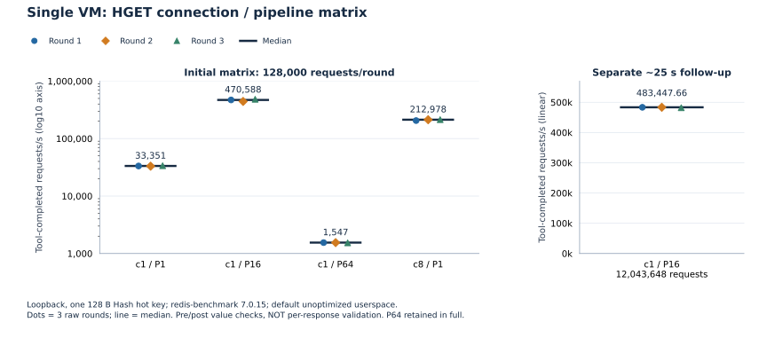
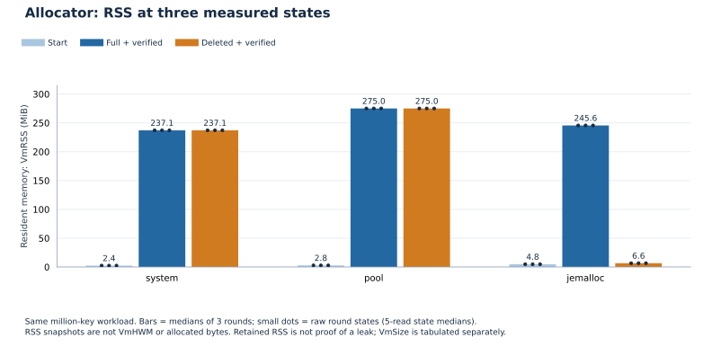

<p align="center">
  
</p>

**A persistent key-value store in C, built from engines to replication.**

`Linux` · `GNU C11` · `4 storage engines` · `NtyCo networking` · `AOF + Snapshot` · `Primary-Replica`

91kvstore 是一个用于学习数据库系统的键值存储项目。它不只实现单个数据结构，而是将 **TCP 字节流 → 命令解析 → 存储引擎 → 持久化 → 主从复制** 接成一条可运行、可测试的链路。

> 本项目用于学习和实验，不建议用于生产环境。它接受 RESP 风格的长度前缀**请求**，已验证 `redis-cli`、hiredis 与 redis-benchmark 的明确支持场景；它不是完整 Redis 实现，默认 `redis-benchmark -t ping` 仍未支持。详见[测试方案](docs/performance/TESTING.md)。

## 一分钟体验

### 1. 构建并启动

普通版需要 Linux、GCC、GNU Make、liburing、librdmacm/libibverbs，以及 NtyCo 子模块。以下是供复现的命令，本次文档整理没有执行安装或编译；全新安装流程未在本阶段重测。Ubuntu/Debian 依赖：

```bash
sudo apt update
sudo apt install -y build-essential git python3 liburing-dev netcat-openbsd \
    librdmacm-dev libibverbs-dev rdmacm-utils ibverbs-utils iproute2
```

```bash
git clone https://github.com/JasperStonnne/91kvstore.git
cd 91kvstore
git submodule update --init --recursive
make all

REPO="$PWD"
RUN_DIR=$(mktemp -d)
cd "$RUN_DIR"
"$REPO/bin/kvstore" "$REPO/config/standalone.conf"
```

服务在前台运行，示例配置监听 `127.0.0.1:29002`，使用独立 Snapshot 模式；另开终端发送命令。数据文件写入**进程工作目录**，所以每个实例使用独立目录。普通单机运行不需 root，但内核须允许所用 io_uring 系统调用。

已有仓库缺少子模块时，运行 `git submodule update --init --recursive`。

### 可选 eBPF 版

普通版和 eBPF 版保留两个不同文件。额外需要有 BPF 后端的 Clang 和 libbpf 开发包：

```bash
# 仅供复现；需要管理员安装权限，本轮没有执行。
sudo apt install -y clang libbpf-dev libelf-dev zlib1g-dev
# 在仓库根目录，以普通用户构建：
make ebpf-startup
```

产物是 `bin/kvstore-ebpf` 和 `build/ebpf_capture.bpf.o`。主程序默认参数为 `-std=gnu11 -Wall -Wextra -g`，没有 `-O`；BPF 对象按 Makefile 单独用 `-O2 -g`，不要混为整个程序都未优化。

在独立工作目录准备 Primary 配置（复制 `config/primary.conf`，将 `bind_ip` 改为 ACTIVE iWARP 地址，确认端口空闲），再启动：

```bash
# REPO 为仓库路径，RUN_DIR 为本实例工作目录；先完成上述配置。
cd "$RUN_DIR"
sudo env KVS_EBPF_OBJECT="$REPO/build/ebpf_capture.bpf.o" \
  "$REPO/bin/kvstore-ebpf" "$RUN_DIR/primary.conf"
```

本实验环境用 sudo 加载本项目 BPF；非 root capability 组合未验证，不要求修改 sysctl。仅 Primary 分支加载 BPF，Replica 可用同一二进制普通权限启动。日志必须显示 `ONLINE source=eBPF`，AOF 降级不能算 eBPF 验收通过。[完整构建、启动和复现说明](docs/performance/REPRODUCING.md)。

### 2. 写入与读取

旧的行命令仍可使用：

```bash
printf 'HSET username jasper\r\n' | nc -N 127.0.0.1 29002
# OK

printf 'HGET username\r\n' | nc -N 127.0.0.1 29002
# jasper
```

长度前缀命令能保留字段中的空格。下面写入 key `user name` 和 value `hello world`：

```bash
printf '*3\r\n$4\r\nHSET\r\n$9\r\nuser name\r\n$11\r\nhello world\r\n' |
  nc -N 127.0.0.1 29002
# +OK
```

```bash
printf '*2\r\n$4\r\nHGET\r\n$9\r\nuser name\r\n' |
  nc -N 127.0.0.1 29002
# $11
# hello world
```

`$9` 和 `$11` 是后续字段的**字节长度**，不是命令语法中的固定数字；换成其他内容时也要相应修改。

## 系统如何工作

```text
                         TCP client
                             │
                             ▼
                    NtyCo TCP
                             │
                             ▼
                动态输入缓冲区
                             │
                             ▼
            行命令 / 长度前缀命令解析
                             │
                             ▼
                       命令执行
                  ┌──────────┴──────────┐
                  ▼                     ▼
          内存存储引擎          AOF 写入 / Snapshot
                  │                     │
                  └──────────┬──────────┘
                             ▼
                    动态输出缓冲区
                             │
                             ▼
                         TCP client

          Primary Snapshot + AOF
                    │
                    ▼
          Replica 全量同步 + 增量追赶
```

NtyCo 网络层负责连接、收发和缓冲区；长度前缀解析集中在协议模块。命令执行层根据命令前缀选择引擎，写命令按所选持久化模式保存。复制模块复用 Snapshot 和 AOF，将 Primary 的状态传给 Replica。

| 层 | 位置 | 职责 |
| --- | --- | --- |
| 协议 | `src/protocol/` | 长度前缀命令解析与编码 |
| 网络 | `src/network/` | NtyCo 连接、动态缓冲区与 RDMA 传输 |
| 引擎 | `src/engines/` | Array、Hash、RBTree、Skip List |
| 持久化 | `src/persistence/` | AOF、Snapshot、启动恢复 |
| 复制 | `src/replication/` | 握手、全量同步、增量同步 |
| 内存池 | `src/memory/` | 统一分配入口、规格池与大对象映射 |

## 命令与协议

### 命令

命令前缀选择存储引擎。当前四个引擎的 `SET/RSET/HSET/SSET` 均为**键不存在则新增，已存在则覆盖 value**；`MOD/RMOD/HMOD/SMOD` **仅修改已有键**，未命中时不创建。

| 操作 | Array | Red-Black Tree | Hash Table | Skip List |
| --- | --- | --- | --- | --- |
| 新增或覆盖 | `SET` | `RSET` | `HSET` | `SSET` |
| 读取 | `GET` | `RGET` | `HGET` | `SGET` |
| 仅修改已有键 | `MOD` | `RMOD` | `HMOD` | `SMOD` |
| 删除 | `DEL` | `RDEL` | `HDEL` | `SDEL` |
| 判断存在 | `EXIST` | `REXIST` | `HEXIST` | `SEXIST` |

新增/覆盖、修改：`命令 key value`。读取、删除、判断存在：`命令 key`。`SAVE` 手动保存 Snapshot。

对 RESP 请求，重复 SET 成功返回 `+OK` 并覆盖旧值；MOD 未命中返回 `-ERR key not found`，不插入新键。插入测试使用不同 key，更新测试固定使用 MOD，这是负载分组约定，不是 SET 只能新增的协议限制。[实现与既有用例核对](docs/performance/REPORT.md#命令语义与测量约定)。

### 两种请求格式

**行命令**以换行结束，字段由现有文本命令处理器拆分：

```text
HSET username jasper\r\n
```

因此行命令不适合包含空格的 key/value。

**长度前缀命令**以 `*` 开头，每个字段携带字节长度：

```text
*3\r\n
$4\r\nHSET\r\n
$9\r\nuser name\r\n
$11\r\nhello world\r\n
```

解析器面对的是 TCP 字节流：一次 `recv` 可能只收到半条命令，也可能收到多条命令。它只在命令完整时交给执行层，并返回本次消费的字节数；未消费的字节继续留在连接的输入缓冲区。

**兼容性边界：** 已验证的子集包括 `redis-cli`、hiredis 的基本命令/特殊字符场景及 redis-benchmark 显式 RESP `PING`、`HGET`。默认 `-t ping` 的 inline 场景仍不兼容，不能标全兼容。四种 SET 命令均可新增或覆盖，MOD 只修改已有键。本项目 `HSET key value` 选择 Hash 引擎，不等同于 Redis 的哈希字段操作；支持这些场景不表示支持 Redis 全部语义。key/value 不支持嵌入 `\0`。详见[测试方案与可行性](docs/performance/TESTING.md)。

## 持久化

单机持久化可独立选择；Primary/Replica 当前要求 `legacy_hybrid`：

| 配置 | 写入/恢复边界 |
| --- | --- |
| `snapshot` | 普通写入只更新内存；成功 `SAVE` 后保存二进制 `snapshot.bin`，重启只加载快照，不创建 AOF |
| `aof` | 成功写回复前完成 AOF 追加和同步；重启回放 `commands.aof`，不需要 SAVE，也不生成快照 |
| `legacy_hybrid` | 快照带 AOF 检查点，恢复快照后回放后续 AOF；用于当前主从。存在快照却缺 AOF，或已知边界错位时拒绝启动 |

现场手动演示使用 `make all testcase` 构建 C 客户端，每次单独执行写入、读取校验、修改、删除或 SAVE；服务启动、宕机和重启由操作者控制。具体命令见[手动演示流程（HTML）](docs/MANUAL_DEMO.html)，可直接用浏览器打开。旧 `bin/testcase` 的数字模式已改为具名操作，使用 `bin/testcase --help` 查看参数。

当前 Snapshot 是带版本、记录长度和校验的**二进制格式**，不是旧的 `AOF_OFFSET` 文本首行。SAVE 路径为临时文件 → io_uring 写入/文件同步 → rename → 父目录同步。rename 后目录同步失败时可能“返回错误但文件已替换”，不承诺自动回滚。AOF 错误不回复成功并停止；残缺日志拒绝恢复，不自动跳过或修剪。失败回复也不承诺相关命令绝不在重启后出现。

单机 AOF/SAVE 的文件写入使用 io_uring，恢复使用 mmap；**Replica 接收临时快照仍使用 `write/fsync`**，不能写成所有落盘路径都已使用 io_uring。成功写入内存、AOF 同步、客户端回复与 Replica 应用是不同时间点。SIGKILL 恢复只验证进程异常退出，不等于断电或真实磁盘故障测试。[失败契约与现有测试](docs/performance/TESTING.md)。

## Primary-Replica 复制

Primary 接收客户端写入；Replica 可处理客户端读取，但拒绝客户端写入。复制是**异步**的：Primary 不等待 Replica 确认即可向客户端返回。

```text
CONNECTING
    │ 建立连接
    ▼
HANDSHAKE       PING / PONG / PSYNC
    │
    ▼
FULL_SYNC       RDMA 发送并安装二进制 Snapshot
    │
    ▼
CATCH_UP        TCP 从 Snapshot 的边界 O 补齐 AOF 增量
    │
    ▼
ONLINE          普通版 AOF；eBPF 版事件 payload + AOF 补偿
```

当前通过配置文件启动，在两个独立工作目录运行 Primary 与 Replica。具体配置和启动步骤见下文及[复现说明](docs/performance/REPRODUCING.md)。

### RDMA 现状

- 已有数据的全量快照只走 RDMA；握手、控制通知和 AOF 追赶/ONLINE 增量仍走 TCP。
- 无自动重连或断点续传；失败后需重新启动 Replica，从当前 Primary 重新全量，不接着半份快照传输。
- 开发机使用 Soft-iWARP（`siw0`），已有软件环境下的功能验收和整阶段测量，不代表物理 RDMA 网卡性能。
- 构建需安装 `librdmacm-dev libibverbs-dev`；验收还需 `rdmacm-utils ibverbs-utils iproute2`。
- Primary 配置 `role=primary`、iWARP IPv4 的 `bind_ip`、`service_port` 和必填 `rdma_port`。
- Replica 配置 `role=replica`、自身 `service_port`、Primary 的 IPv4 和 TCP `primary_port`。
- `rdma_port` 必须不同于 Primary 的 `service_port`，Replica 从通知获取该端口。
- 两端在独立工作目录运行 `/仓库绝对路径/bin/kvstore /配置绝对路径/server.conf`，配置样例见 `config/`。
- 本机复现：`RDMA_TEST_IP=172.16.145.135 make test`（替换为自己的 iWARP IPv4）。
- 架构、完整启动配置、失败场景和双机命令见 [RDMA 验收说明](tests/README_RDMA.md)。

### eBPF ONLINE 增量

可选构建使用 make ebpf-startup，生成 bin/kvstore-ebpf 和 BPF 对象。
三路分工为 RDMA 传全量、TCP + AOF 追赶和补缺口、eBPF 提供正常 ONLINE 的完整命令。
跨机发送仍由用户态通过现有 TCP 完成。事件附带 AOF offset，超限或丢失有明确计数和补偿。
BPF 加载或消费失败会明确记录降级到 AOF；普通构建继续使用 AOF ONLINE。
无逐条增量 ACK，不宣称端到端 exactly-once。
构建、v1 事件格式、失败策略和故障验收见 [eBPF 验收说明](tests/README_EBPF.md)。

## 网络后端

当前客户端 TCP 网络层统一使用 **NtyCo**。Primary、Replica 和 standalone 的服务入口调用 `ntyco_start_listeners` / `ntyco_start_runtime`；Makefile 构建 `src/network/ntyco.c` 并链接 NtyCo 子模块。当前没有 `NETWORK_SELECT` 三后端切换，也没有可选的 Reactor/Proactor 服务入口。

客户端请求、复制控制和增量 TCP 收发由 NtyCo 路径承载；RDMA 全量传输由独立的 `rdma_transport` 模块负责。持久化使用的 io_uring 不代表当前还提供 Proactor 网络后端。

动态输入缓冲区容纳分段到达的长命令；动态输出缓冲区容纳较长的回复。网络层仍需要处理部分发送，不能假设一次发送就写完全部字节。

## 内存管理

当前四个引擎的动态 key/value、节点和容器缓冲区均通过统一的 `kvs_malloc/kvs_free` 入口；key/value 按 `strlen(...) + 1` 申请，**变长不等于绕过池后端**。统一入口再由 `kvs_allocator_alloc/free` 根据运行配置选择底层方式：

| 模式 | 统一入口的底层方式 | 覆盖范围 |
| --- | --- | --- |
| `system` | `malloc/free`；本批未预加载其他分配器，绑定 libc | 经统一入口的引擎分配及其他调用者 |
| `pool`（默认） | 请求1–4096字节按规格放入64KiB slab；更大请求独立 `mmap`，释放时 `munmap`，不回退 libc | 包括变长 key/value、节点、容器及通过该入口申请的网络缓冲等；不接管第三方直接分配 |
| `jemalloc`（benchmark模式） | 脚本选择 `allocator=system` 并用 `LD_PRELOAD` 替换动态堆分配 | 统一入口的 `malloc/free` 及进程中其他可被替换的同类动态调用；不是配置中的第三个后端，也不接管直接 `mmap` |

详见[四引擎分配与释放路径核对](docs/performance/REPORT.md#分配覆盖范围只读源码核对)。这三方案比较不是只替换固定大小节点。

百万条三轮中，pool 四阶段合计耗时低于 system，但装满 RSS 更高（275.043 对 237.117 MiB），不能称为全面省内存。删除后 RSS 保留不等于泄漏。VmSize 是虚拟地址空间，另表列出，不混作物理内存。[结果和口径](docs/performance/REPORT.md)。

## 测试

测试分层，不要求每个单元用例都灌一万条。以下命令在仓库根目录执行，可能编译测试程序；本次仅核实入口和既有记录，没有运行它们。

| 入口 | 目标与规模 | 环境/判据 |
| --- | --- | --- |
| `make test-unit` | 协议、引擎、文件、配置、复制边界及模拟 eBPF | 单机 Linux；无真实 BPF 附着，不需 sudo；包含 ASan/UBSan 测试程序 |
| `RDMA_TEST_IP=实际地址 make test` | 完整普通回归，含真实 RDMA | 单机 ACTIVE iWARP 与 io_uring；无设备明确失败，不是全都无需 RDMA |
| `make test-functional-bulk` | 10000 个不同 key × 8 个操作阶段 | 单机；写/读/MOD/存在/删除及未命中逐条断言，Array 1000、其余各3000 |
| `make test-persistence-100k` | Snapshot/AOF 各10万条 | 单机、独立临时目录；默认在成功边界 SIGKILL 后逐条读回；不是断电测试 |
| `make test-clients` | redis-cli/hiredis/benchmark 已列支持场景 | 可选依赖缺失标 SKIP，默认 PING 标 UNSUPPORTED，两者不计 PASS |
| `make test-clients-strict` | 严格客户端对照 | 任意 SKIP 或默认 PING 未支持均非零；当前不能期望全绿 |
| `make test-ebpf-replication` | 真实 eBPF、RDMA、补偿专项 | 先普通用户构建，再以批准的 BPF 权限运行；需要 ACTIVE iWARP |
| `tests/test_two_vm_100k.py` | 先5万、从机同步后再5万，两端各10万读回 | 双VM、同程序/依赖指纹；客户端本身不启动/清理服务，必须落实实例归属及超时 |

详细的依赖、执行步骤、资源要求、正确性判据、历史通过范围及未验证项见[测试方案](docs/performance/TESTING.md)和[复现说明](docs/performance/REPRODUCING.md)。完整 `make test` 不含所有大数据、可选客户端或真实 BPF 专项；SKIP 不等于 PASS。新机器全套安装/构建未在本阶段重新验证。

## 性能结果

2026-11-09—10；基线 `719836e9`，使用现有默认未优化主程序。两台 aarch64 Linux VM 各4 vCPU、约8 GiB，共享 Mac，软件 SIW。正式成绩与诊断分开；每项三轮，取中位数；波动为 `(max-min)/median × 100%`。不同客户端、数据集和同步承诺不混算。

| 场景 | 三轮中位数 | 波动 | 口径 |
| --- | ---: | ---: | --- |
| 单机 HGET c1/P16 追加长轮次 | 483447.66 次/秒 | 0.31% | 本机128B热点，redis-benchmark 工具完成吞吐；非随机百万条、非逐响应内容校验 |
| Snapshot 10万条写入 | 3.275 秒 | 1.19% | 写内存；另需成功 SAVE（中位0.171秒） |
| AOF 10万条写入 | 20.527 秒 | 2.02% | 成功回复前追加/同步，与 Snapshot 写入不是同耐久性比较 |
| allocator system / pool / jemalloc | 202.766 / 182.998 / 179.696 秒 | 3.43 / 5.17 / 2.90% | 百万条四阶段合计，含生成、客户端、协议和网络 |
| 双机 ONLINE 后第二批5万 | 4021.56 条/秒 | 1.32% | 现有串行 Python 客户端整阶段；无 AOF 对照，不能宣称 eBPF 加速 |



P64 中位仅1546.94次/秒，未隐藏。诊断只观察到等待线索，**未证明 delayed ACK 或 NtyCo 是根因**；没有生成或虚构火焰图。



双机正式三轮两端各10万条逐条匹配、快照 SHA 相同，既有日志补偿均为0；热身有3段/837字节补偿且最终一致。末轮客户端和数据验证通过，但外部收尾检查误判正常退出，Primary 编排退出1、Replica编排退出0，**不能写整个流程全绿**。

纯 RDMA 吞吐、精确初始化耗时、逐请求复制延迟、ONLINE 独立计数未测。没有逐条增量 ACK，不保证端到端 exactly-once。重启耗时止于**端口可连接**，全量恢复校验另计；软件 SIW 成绩不推导硬件 RDMA 性能。

[总报告：四类结果、全部轮次和其余图表](docs/performance/REPORT.md) · [复现命令与边界](docs/performance/REPRODUCING.md) · [数值数据](docs/performance/data/measurements.json) · [原始证据哈希索引](docs/performance/data/evidence-index.json)

## 项目结构

```text
91kvstore/
├── clients/                 多语言 TCP 客户端示例
├── include/                 公共头文件
├── src/
│   ├── engines/             四种内存引擎
│   ├── memory/              内存池
│   ├── network/                    NtyCo TCP / 缓冲区
│   ├── persistence/         AOF / Snapshot
│   ├── protocol/            长度前缀编解码
│   ├── replication/         主从复制
│   └── kvstore.c            命令执行与程序入口
├── tests/                   测试与基准测试
├── third_party/NtyCo/       Git 子模块
└── Makefile
```

## 当前限制

- 仅保证已列客户端子集，不完整兼容 Redis 命令语义；默认 redis-benchmark `-t ping` 未支持
- key/value 不支持嵌入 `\0`；行命令也不支持字段中包含空格
- Replica 尚无断线自动重连、复制 backlog 或部分重同步
- 当前主要面向单 Replica 场景；已有 RDMA 快照累计 ACK，尚无增量 ACK、心跳和自动故障转移
- Snapshot、AOF 的同步文件操作可能阻塞事件处理
- 尚未提供认证、访问控制或 TLS

## 许可证

仓库目前未声明开源许可证。在发布许可证前，保留所有权利。
