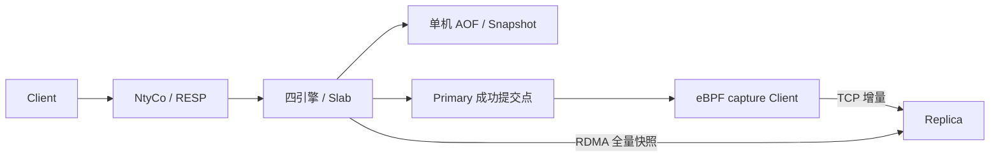

<p align="center">
  
</p>

# 91kvstore

**用 C 实现从存储引擎、持久化到主从复制的键值数据库。**

GNU C11 · Linux · NtyCo · io_uring · RDMA · eBPF · [MIT License](LICENSE)

## 1. 项目简介与架构

91kvstore 用于学习和实验数据库系统：将 TCP 字节流、RESP 解析、命令执行、持久化和复制连接成可运行、可测试的链路。

| 组件 | 实现 |
|---|---|
| 四种引擎 | Array、Hash（32位 FNV-1a）、Red-Black Tree、Skip List |
| Slab 内存池 | 16–4096B 规格、64KiB slab；空 slab 立即 munmap，大对象独立映射 |
| 网络与协议 | NtyCo 协程、输入缓冲游标、64KiB 批量读取、RESP 请求与回复 |
| 持久化 | io_uring AOF（LINK WRITE+DATASYNC）、fork+COW 后台 Snapshot |
| 主从复制 | RDMA 全量；普通 socket 增量或 eBPF 采集器主动 TCP 推流 |



eBPF 保留成功提交点探针，直接引用原始 RESP 切片；Replica 全量完成后触发独立就绪事件，由采集器主动连入从机。完整握手、快照边界 S、资源清理与方案取舍见 **[主从时序与架构](docs/REPLICATION.md)**。

## 2. 环境依赖与编译步骤

需要 Linux、GCC、GNU Make、Python 3，以及 NtyCo 子模块。Ubuntu/Debian 对应依赖包：

- 服务端：`build-essential`、`git`、`liburing-dev`、`librdmacm-dev`、`libibverbs-dev`。
- eBPF 构建：`clang`、`libbpf-dev`、`libelf-dev`、`zlib1g-dev`。
- 客户端与设备检查：`redis-tools`、`rdmacm-utils`、`ibverbs-utils`、`iproute2`。

在仓库根目录构建，默认 `OPT=-O2`：

```bash
git submodule update --init --recursive
make -B OPT=-O2 all ebpf-capture benchmark-tools
```

生成 `bin/kvstore`、`bin/ebpf_capture`（采集器入口）、`build/ebpf_capture.bpf.o`，以及 ECHO/传输对照工具。普通服务无需 root；运行环境需允许 io_uring，真实 RDMA 测试还需 ACTIVE iWARP 设备。

启动单机服务，每个实例使用独立工作目录：

```bash
REPO="$PWD"
RUN_DIR=$(mktemp -d)
cd "$RUN_DIR"
"$REPO/bin/kvstore" "$REPO/config/standalone.conf"
```

默认监听 `127.0.0.1:29002`，数据留在 `RUN_DIR`。另开终端：

```bash
redis-cli -h 127.0.0.1 -p 29002 SET greeting hello
redis-cli -h 127.0.0.1 -p 29002 GET greeting
redis-cli -h 127.0.0.1 -p 29002 HSET 中文键 value
redis-cli --raw -h 127.0.0.1 -p 29002 HGET 中文键
```

`SET/RSET/HSET/SSET` 分别选择四种引擎，键存在时覆盖；`MOD/RMOD/HMOD/SMOD` 只修改已有键。对应读取为 `GET/RGET/HGET/SGET`。本项目 `HSET key value` 不是 Redis 的哈希字段命令。

## 3. 测试方案与可行性

先完成构建，再在仓库根目录运行：

```bash
make test-unit
python3 -B tests/test_standalone.py
make test-background-save test-persistence-100k
```

Hash 单测已固定启用 **`-fsanitize=address,undefined -fsigned-char`**，即使 ARM64 默认无符号 char，也覆盖中文、高位字节和碰撞链：

```bash
make -B OPT=-O2 test-hash-memory-pool
```

具备 ACTIVE SIW 设备时，可运行真实 RDMA 和不需 BPF 权限的增量替身测试；将 IP 换成设备上的本机 IPv4：

```bash
RDMA_TEST_IP=172.16.145.135 python3 -B tests/test_rdma_replication.py .
make bin/test_capture_mock
RDMA_TEST_IP=172.16.145.135 python3 -B tests/test_capture_replication.py . \
  --mock-collector "$PWD/bin/test_capture_mock"
```

| 测试范围 | 跑法与要求 |
|---|---|
| 单机协议/引擎 | `make test-unit`、`test_standalone.py`；含 Pipeline、半包、大 value、非法命令 |
| 持久化 | `test-background-save`、`test-persistence-100k`；验证 SAVE 接力、退出等待和 Snapshot/AOF 重启读回 |
| 真实 RDMA | 上述 `test_rdma_replication.py`；无 ACTIVE 设备不能计作通过 |
| 真实 eBPF | [RDMA/BPF 验收步骤](tests/README_RDMA.md)；需 sudo/BPF 权限，替身通过不能代替真实挂载 |
| 135↔136 双机 | [双机验收入口](tests/run_two_vm_acceptance.py)与[固定性能对照工具](docs/performance/STAGE5-REPRODUCING.md)；两端版本/ELF一致、端口可达、独立运行目录 |

详细命令、判据和历史通过范围见 [测试方案](docs/performance/TESTING.md)；手动操作见 [演示流程](docs/MANUAL_DEMO.md)。

### 已知边界 / Known Limitations

- **固定结构规模**：Hash 为 1024 桶链表，不自动扩桶；Array 容量 1024；Skip List 最大 level=6（另含 level 0）。
- **协议子集**：key/value 为 C-string，不支持嵌入 `\0`；支持已列 RESP 场景，不完整实现 Redis 命令与语义，默认 benchmark inline PING 不能视为兼容。
- **SAVE 是后台保存**：`+OK` 仅表示接受 fork+COW 任务，语义类似 Redis BGSAVE；必须用 `SAVEINFO` 确认完成。重复请求可能合并，AOF 逐写同步和 Primary 复制快照生成仍可能阻塞。
- **软件 RDMA 环境**：开发验收使用 SIW，不代表硬件 RNIC 的吞吐、时延或 CPU 卸载性能。
- **复制边界**：当前面向单 Replica；异步复制，8MiB 用户态缓存内可续传，缺口/溢出或5秒接入超时重全量。eBPF 单命令事件上限4KiB；没有持久化复制 backlog 或自动故障转移。
- 尚未提供认证、访问控制或 TLS；本项目不承诺生产环境可用性。

## 4. 核心性能数据摘要

以下成绩来自 **49b8d3d 及明确标注的历史阶段，均为 `-O2` 系列测量**。本次 FNV-1a 修复只做正确性回归，未重测性能，不把旧成绩标为新 Hash 实现的结果。

| 场景 | 核心结果 | 负载与样本 |
|---|---|---|
| 单请求参考 | ECHO 18,365；kv-none 18,208；redis-none 19,286 QPS | 保留 Stage 1；c1/P1、100000请求、固定 hotkey、128B value，各3轮 |
| 严格 AOF | kv-aof 2,780.87→3,052.04 QPS（+9.75%）；Redis 3,771.73 | 保留 Stage 1，各3轮；LINK+DATASYNC，对照 Redis appendfsync always |
| Pipeline P160 | **kv 2,941,176 vs Redis 2,631,579 QPS（+11.76%）** | 49b8d3d；单连接固定 hotkey、128 ASCII x、100000请求；每档交替3轮 |
| 后台 SAVE | 并发 SET+GET 整组 P99 0.153ms；百万条1k频率277.613s | 保留 Stage 2；频率各1轮，1000次触发合并为230次保存 |
| 公平回收 RSS | system-malloctrim 2.398MiB；pool 2.707MiB | 保留 Stage 3.1；百万条、删除核对后，同轮各1次 |
| 双向传输 | sendfile约147–149MiB/s；SIW约84MiB/s | 保留 Stage 3.2，各3轮；168000052B、1MiB/window1，排除setup/CRC/落盘/加载 |


双机满载对照：135→136，49b8d3d，`-c 8 -P 1 -n 100000`，HSET、32B唯一key/128B value，各3轮中位数：

| 模式 | Primary QPS | QPS波动率 | 可见性 P50/P99 ms |
|---|---:|---:|---:|
| none | 122,850 | 1.68% | — |
| ebpf-capture-only | 106,098 | 1.20% | — |
| socket | 122,242 | 0.69% | 0.939/1.230 |
| ebpf | 98,863 | 0.34% | 1.994/2.304 |

复制档每轮100000条逐条一致；采集相对none QPS−13.64%，ebpf相对socket−19.12%。可见性为独立HMOD/HGET探测，包含查询RTT，不是持续HSET满载期间的延迟。


完整版本、轮次、CPU/perf证据、历史对照及所有SVG见 **[正式性能报告](docs/performance/REPORT.md)**；[原始数据](docs/performance/data/measurements-2026-11-26.json)与[离线绘图/复现命令](docs/performance/STAGE5-REPRODUCING.md)可独立核对。不混算历史版本、单轮/三轮或不同客户端成绩。
