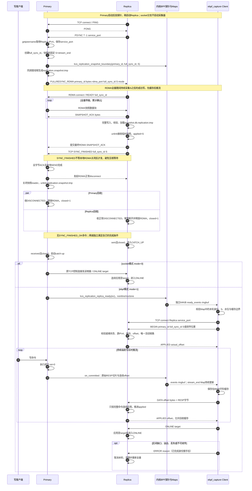

# 主从复制架构：49b8d3d

[README](../README.md) · [性能报告](performance/REPORT.md) · [RDMA验收](../tests/README_RDMA.md)

本文件按49b8d3d实际实现描述。Primary接收客户端写入，Replica只接受普通客户端读取；复制异步，Primary成功回复不等待Replica应用。TCP控制和RDMA全量均由Replica主动连Primary；**eBPF增量的数据连接方向相反，由采集器主动连Replica**。

## 当前完整时序

`FULLRESYNC_RDMA`末字段固定`0=socket/1=ebpf`。兼容无端口旧`PSYNC ? -1`仅用于socket；ebpf必须有有效service_port。peer IPv4从控制连接取得，不接受客户端随意提供的目标地址。两端CM事件先后可以交错：Primary只等自己的closed+SYNC_FINISHED；Replica只等自己的closed+sent。就绪探针不承诺Replica的CM已经先到；暂未就绪的主动接入会被拒绝，采集器按退避重试。

### 正常结束与异常断连

| 情形 | 状态与清理 |
|---|---|
| Replica全量成功 | 完整校验/加载→删除接收.tmp→最终ACK已提交→发SYNC_FINISHED→正常CM断开→释放RDMA→sent&&closed进入CATCH_UP |
| Primary全量成功 | 最终ACK且本地SEND完成→disconnect→关闭reader并删除发送.tmp→等DISCONNECTED释放RDMA→received&&closed启动catch-up |
| RDMA提前断开 | 未传完、缺最终ACK、仍有SEND在途或不符合正常断开标志，一律失败；清理.tmp和RDMA，不进入增量 |
| 等SYNC_FINISHED超时或TCP控制提前断开 | 5秒结束等待超时/控制失效，取消本轮，清理资源，不提供旧会话在线态 |
| ebpf首次接入或恢复等待超时 | 5秒未成功接入/无所需进展，清理本轮并重新PSYNC；不会静默改成socket模式 |
| 采集瞬断 | 保留最后完整applied，25–500ms退避重连；超时或缓存不覆盖则重全量 |

关键实现：[完成握手和正常/异常CM处理](../src/replication/replication.c)、[动态连接与流控调度](../src/network/ntyco.c)、[主动推流客户端](../src/replication/capture_server.c)。网络层独占TCP关闭权，回调只请求关闭；不会由两个所有者重复close同一fd。

## 为什么Primary当RDMA服务端

Primary生命周期长，单个固定rdma_port接受Replica重连；控制TCP与RDMA都保持Replica→Primary发起，部署地址和防火墙方向一致，不需要每轮让Primary寻找从机的临时RDMA端口。固定服务端也便于后续聚合多个从机重连。

这是角色选择与扩展依据，**不是已经支持多从并行全量**：当前replication_manager只管理一轮快照/一个Replica会话；第二个并行PSYNC不能覆盖已有任务。控制端口和rdma_port必须不同。SIW只验证软件协议与资源生命周期，不能外推硬件RNIC吞吐或CPU卸载收益。

## 为什么eBPF采集器改为Client

- 旧Server方式需要额外采集监听端口和Replica主动发现；现在PSYNC提供从机业务端口，Primary完成全量后发布就绪事件，采集器可直接推入现有服务端口。
- 好处是删除replication_capture_port依赖与额外监听，不再经.sock中转；采集器不负责RDMA全量，Primary也不在ebpf模式分配自己的增量缓存。
- 代价是多一个从Primary所在主机→Replica业务端口的建连方向，需要防注入和5秒兜底。BEGIN协议识别不是认证：只在预期会话内校验源IP、40字符primary_id/full_sync_id、偏移和唯一活跃链路。
- `--listen`只保留兼容诊断；不属于默认推流路径。旧`replication_capture_port`可解析但不用，旧`.sock`配置已不支持。

首次BEGIN通常从S开始；断线时采集器可能只知道较旧的已确认位置。Replica允许声明位置在S与本地actual_applied之间，回传实际APPLIED；采集器验证它在完整命令边界且缓存覆盖后从实际位置续传。大于已应用位置、错ID/源IP、非就绪状态及第二条活动链路均拒绝。它不是任意offset跳转，也不重新应用已确认命令。

## 三种缓冲的边界

| 缓冲/状态 | 大小/职责 | 不能承诺什么 |
|---|---|---|
| BPF `events` ringbuf | 16MiB，搬运成功提交命令，单事件最多4KiB | 不等于可靠持久化日志，队列满/读取失败会记丢失 |
| BPF `ready_events` ringbuf | 独立64KiB，传递Replica就绪身份/地址/S | 不被命令队列挤占；自身满仍可能丢事件，由超时重全量兜底 |
| 用户态复制环形缓存 | 8MiB连续字节区间，连接前滚动保留，连接后按APPLIED回收 | 不覆盖任意长断连；持续写入速率高于追赶速率会溢出并要求重全量 |
| `snapshot_boundary` / `stream_end` Maps | 核对本轮身份、固定S、连续提交水位和失败计数基线 | Map水位正确也不代表事件缓存必然完整 |

缓存缺口、事件超长/丢失、身份失效、无法覆盖请求位置均不能跳过后继续ONLINE；ERROR后重新全量。采集器重启失去8MiB缓存，必须等新边界；不承诺跨进程持久续传，也无自动主从选举/故障转移。

## 提交点探针与原始RESP切片

解析器取得单条标准RESP的`msg/parsed_bytes`，沿执行链传给kvs_execute_tokens。只有Primary上的CLIENT写命令**执行成功ret==0**后才推进流、触发提交点；优先引用原始`*`开头的字节切片，省掉再次算长度、临时堆申请、编码和释放。inline或未提供切片时仍编码成标准RESP。uprobe同步读取仍有效的输入内存；随后BPF事件与用户缓存各有拷贝，不能称端到端零复制。

不能把探针简单前移到nty_recv，至少有三个正确性约束：

1. **多协程乱序交织**：网络到达/recv顺序不等于执行成功顺序，分片和Pipeline也不保证一次recv一条命令；原始流无法直接当连续提交序列。
2. **命令筛选与结果**：recv同时包含读、写、非法/失败、控制命令；接收时无法确定只有成功写应复制。复制失败写或读会破坏语义。
3. **快照边界S**：S属于同调度线程固定的成功提交字节边界，必须准确区分快照前已包含与快照后增量。网络观测字节数不能天然对齐这个边界，可能重放或漏掉命令。

保留提交点不是因为原报文不可引用，而是为了保持上述顺序/筛选/边界。单次uprobe、ringbuf和后续缓存依然有CPU代价，最终c8对照并未显示eBPF吞吐优于socket。

## 非阻塞 SAVE

standalone且persistence_mode=snapshot时，本项目`SAVE`等价于后台保存（Redis BGSAVE语义），不是Redis的同步SAVE：

1. 无子进程时记录fork前后单调时钟；子进程仅调用snapshot_store保存，独立初始化/关闭io_uring，用mkstemp文件、同步、原子rename及目录同步，最后_exit。它不运行父进程网络循环、不读写客户端/监听fd、不执行父进程atexit/stdio flush。
2. 父进程立即回复+OK；已有子进程时设置唯一save_pending并仍立即+OK，不并行fork第二个。多次触发可能只完成较少次快照。
3. NtyCo的10ms后台任务调用waitpid(WNOHANG)，SAVE/SAVEINFO也推动回收；完成时记录子进程实际保存时间与成功/失败计数，有pending则接力fork最新状态。
4. SIGINT/SIGTERM优雅退出等待活动子进程和最后pending，不让尚未完成的后台保存被进程退出截断。

`SAVEINFO`返回in_progress/pending/completed/failed/triggered、fork与save累计/末次耗时。调用者在SAVE之前取completed，发SAVE后轮询completed增加、failed未增加且in_progress=0 pending=0，才能确认请求对应的收尾完成；不能以+OK或临时文件出现代替完成判据。

该语义仅用于独立持久化；**Primary复制快照仍在当前控制调度线程生成**，固定S与快照之间没有并发写。AOF逐写同步仍可能阻塞事件处理。非snapshot模式SAVE保持错误语义。
