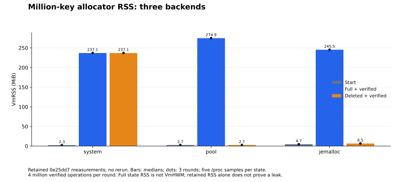
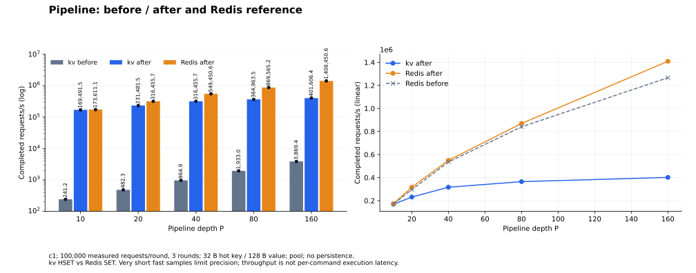
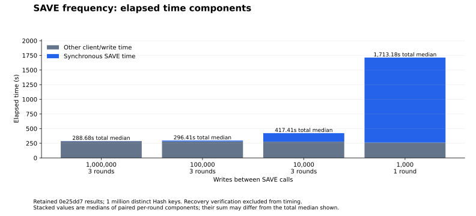
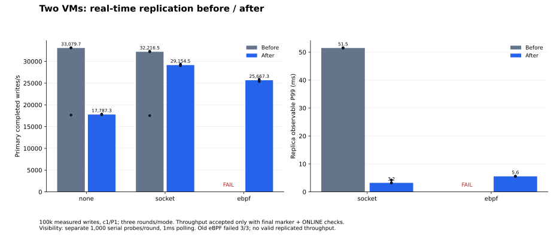
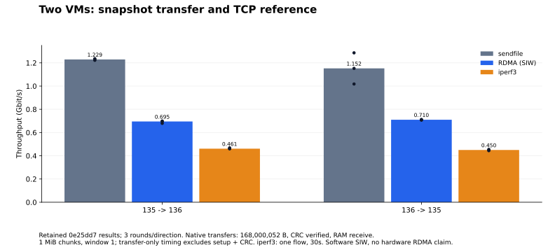

# 2026-11-19 性能矩阵与调优闭环

> 后续直连 eBPF 单轮重测见 [2026-11-20 报告](2026-11-20-direct-ebpf.md)。本文三轮历史原值保留，未用新单轮覆盖。

以下“修复前基线”部分保留原始测量与当时诊断。修复后正式对比见文末。

本批基线为 `0e25dd71f8ae49bbb5c8a6905e14506355951059`。服务端和项目对照工具以 `-O2 -g` 构建，NtyCo 同样重建；两台 aarch64 Ubuntu VM 各 4 vCPU、约 8 GiB，共享 Mac 宿主机，RDMA 为软件 SIW。

数值来自实际完成且通过验证的负载；复制失败轮次单列，Primary 回复 QPS 不充当有效复制吞吐。除 SAVE 的 1k 档按用户要求仅保留一个完整样本，其余项目各三轮，表中取中位数。波动定义为 `(max-min)/median × 100%`，单轮不计算波动。热身、验证和异常诊断不混入正式性能样本。

## 修复前基线

## SAVE 频率

Hash 引擎 100 万个唯一键，key 32B、value 128B，一条持久连接、一个在途请求；`snapshot_checksum=file`，`allocator=pool`。总耗时包含数据生成、逐条 HSET 和同步 SAVE。恢复及逐条核对放在计时后，10 个完整样本各核对 100 万条。

| 每多少条 SAVE | 总耗时中位数(s) | SAVE 累计中位数(s) | 写 QPS 中位数 | 总耗时波动 |
| --- | --- | --- | --- | --- |
| 1,000,000（3轮） | 288.68 | 2.81 | 3,464.05 | 2.84% |
| 100,000（3轮） | 296.41 | 15.09 | 3,373.69 | 6.51% |
| 10,000（3轮） | 417.41 | 146.22 | 2,395.71 | 6.20% |
| 1,000（1轮） | 1713.18 | 1451.45 | 583.71 | 单轮，不计算 |

1k 档累计快照文件字节数为 84,084,052,000（约 78.31 GiB）；这是各次快照文件大小之和，不是设备物理写入量。最终单份快照 168,000,052 字节。初始四档三轮排程在首轮 1k 完整核对后按用户要求调整；旧排程的有意中断和可能的未完成片段留作诊断，不纳入正式样本。

## 单机 QPS 与 Pipeline

Redis 7.0.15，源码 `OPTIMIZATION=-O2 MALLOC=jemalloc`，关闭周期 RDB。AOF 对照显式使用 `appendfsync always`，禁用自动 rewrite，单 I/O 线程；kvstore AOF 使用默认 `aof_checksum=none`，成功回复前完成追加和同步。kvstore 为 pool 后端。

两端均为同一个 32B 热点键的 128B 值覆盖写：kvstore 使用 `HSET`，Redis 使用 `SET`，逻辑语义一致。ECHO 为独立网络/协议参考程序，返回 128B bulk，不能拿它和写命令 QPS 的差值直接估算引擎开销。所有场景 `-c 1`，正式每轮 100,000 次完成请求，热身至少 10,000 次（向完整 Pipeline 批次取整，P160 为 10,080）。

| 场景 c1/P1 | QPS 中位数 | P50 RTT(ms) | P99 RTT(ms) | 服务端 CPU/单核 | QPS 波动 |
| --- | --- | --- | --- | --- | --- |
| echo | 17,889.09 | 0.055 | 0.079 | 31.0% | 9.44% |
| kv-none | 17,844.40 | 0.055 | 0.079 | 31.4% | 25.26% |
| kv-aof | 2,518.76 | 0.351 | 0.735 | 22.3% | 4.45% |
| redis-none | 18,761.73 | 0.055 | 0.079 | 27.2% | 5.83% |
| redis-aof | 3,520.01 | 0.271 | 0.543 | 15.5% | 2.31% |

| Pipeline | kv none QPS | Redis 无 AOF QPS | kv/Redis | kv 波动 | Redis 波动 |
| --- | --- | --- | --- | --- | --- |
| 10 | 241.19 | 170,940.17 | 0.141% | 0.10% | 3.79% |
| 20 | 482.32 | 295,858.00 | 0.163% | 0.21% | 8.99% |
| 40 | 964.90 | 534,759.31 | 0.180% | 0.12% | 1.61% |
| 80 | 1,933.00 | 840,336.12 | 0.230% | 0.03% | 2.46% |
| 160 | 3,869.37 | 1,265,822.75 | 0.306% | 0.15% | 3.95% |

`kv-none` 单机一轮较慢，25.26% 波动如实保留，不能据此判定几个百分点的差距。Pipeline 的快速 Redis 样本不足一秒，工具计时粒度与调度噪声限制小差异解读。Pipeline 表只比较完成吞吐，不将其首回复采样的延迟直当逐条独立请求耗时。

当前 kvstore Pipeline 具有约 41.4ms 的整批完成周期（由深度/QPS 推得）。只读观测记录了 1024B 初始输入缓冲、TCP 未确认/未发送的小回复及 40ms ACK 计时线索；未做隔离 A/B 验证，不把这些线索直接写成已证明的根因，也未为测试修改网络选项或业务代码。

## 分配器百万条 RSS

同一程序、同一四引擎数据集：Array 1,024、Hash/RBTree/Skiplist 各 332,992。每轮均完成百万条写入、存在核对、删除及未命中核对，共 9 个样本、3,600 万次成功操作。既有脚本配置 snapshot，但不调用 SAVE，隔离目录内没有生成持久化文件或启用复制。

| 分配器 | 起始 RSS(MiB) | 写满 RSS(MiB) | 删除核对后 RSS(MiB) | 结束−起始(MiB) |
| --- | --- | --- | --- | --- |
| system | 2.344 | 237.066 | 237.066 | +234.723 |
| pool | 2.660 | 274.930 | 2.680 | +0.020 |
| jemalloc | 4.738 | 245.512 | 6.527 | +1.789 |

每个状态取五次 `/proc/PID/status` 采样中位数，再对三轮取中位数。写满点在插入和读回核对后；结束点在删除及未命中核对后，非进程退出，也不是最后一次 DEL 的瞬间。未强制 trim，也未调 jemalloc decay。脚本核验真实服务的后端初始化、符号提供者与映射；pool 的受管对象仍走 slab/mmap。jemalloc 用 `allocator=system` 加 `LD_PRELOAD`，并验证真实服务符号绑定和映射；它不是配置的第三种 allocator。

RSS 包含引擎容器、连接/协程缓冲和分配器元数据；删除记录不销毁这些结构，分配器还可能保留空闲页。结束相对起始的差额是这些因素的合计，未按对象逐页归因，不能单凭 RSS 判定泄漏。VmSize 和 VmRSS 分开记录；pool 峰值高于 system，不能概括为全面省内存。

## 双机实时复制

135 为 Primary，136 使用独立测试副本，原工作区不写入。两端二进制与 HEAD 一致，全部 `persistence_mode=none`。表中 `none` 是相同 Primary 角色未连接 Replica，不是 `replication_incremental_mode` 的配置值；另外两种仅切换增量来源/缓存位置，Primary→Replica 都使用 TCP，全量均为 RDMA 临时快照。

每轮同一热点 HSET 负载 `c1/P1`、预热 10,000、正式 100,000 次。QPS 和写 RTT 是 Primary 成功回复窗口，不是 Replica 逐条 ACK 吞吐。另做 1,000 次串行可见性探针，包含 Primary 提交、Replica 读回和 1ms 轮询间隔，不是被动单向链路延迟。

| 模式 | Primary QPS | 写 RTT P99(ms) | Primary CPU | 采集 CPU | Replica CPU | 独立可见性探针 P99(ms) |
| --- | --- | --- | --- | --- | --- | --- |
| none | 33,079.72 | 0.047 | 30.0% | 0.0% | 0.0% | — |
| socket | 32,216.49 | 0.047 | 32.7% | 0.0% | 2.6% | 51.477 |
| ebpf | 无有效复制吞吐（3/3 轮失败） | — | — | — | — | — |

eBPF 三轮全部失败：第 1 轮在 `[8451135,8451324)` 事件处触发 8 MiB 用户态缓存溢出；第 2 轮期望 offset 82593，却收到 `[96390,96579)`；第 3 轮期望 48195，却收到 `[56511,56700)`，后两轮为事件缺口。失败后会话取消、Replica 退回 LOADING，不能将仍成功的 Primary 写回复计为复制完成。当前日志没有保留缺口发生时的内核失败计数，不能据此判定是内核 ring 满或其他采集环节丢失。静态核查发现 BPF 定义了 oversize/ring_full/read_error 计数及用户态查询接口，但独立采集主循环没有读取这些计数；后续需单独评审可观测性补充，不能把已有测试替身验收当作真实压力下采集不丢失的证明。根因尚未通过隔离实验最终确认。

静态走查发现 Unix socket 非阻塞响应未就绪会返回 KVS_STREAM_WAIT，网络层按固定 50ms 重试；初始输出缓冲 1024B，与首轮仅推进约 63KiB 就缓存溢出的现象吻合。这是后续独立修复/验证的线索，本轮没有扩大缓存、限速生产者或修改复制代码来消除失败。

CPU 为进程累计 CPU 秒除以观测墙钟窗口，100% 表示占满一个逻辑核；采集进程单列，Replica 窗口含前后控制查询的少量边界开销。源 VM 整体 CPU、客户端 CPU 与各进程 CPU 秒也保留于数据文件，不能将应用进程百分比称为全系统开销。

## 相同快照的 RDMA / sendfile 与 iperf3

使用同一份真实百万条 v3/file 快照，两端源文件 SHA-256 相同。每次固定 1 MiB 分块、window=1、TCP 逐块确认，接收进入内存；两种路径都在计时外预读源文件计算 CRC，属于相同热页缓存口径。表采用发送端传输秒数（首块前至末块 ACK），不含准备、CRC、落盘或加载。

| 方向 | 路径 | 传输(s) | MiB/s | Gb/s | 吞吐波动 |
| --- | --- | --- | --- | --- | --- |
| 135→136 | sendfile | 1.093481 | 146.52 | 1.229 | 1.16% |
| 135→136 | rdma | 1.933286 | 82.87 | 0.695 | 2.90% |
| 136→135 | sendfile | 1.166250 | 137.38 | 1.152 | 23.28% |
| 136→135 | rdma | 1.892539 | 84.66 | 0.710 | 0.75% |

| iperf3 方向 | 单流30秒 Gb/s | 波动 |
| --- | --- | --- |
| 135→136 | 0.461 | 1.58% |
| 136→135 | 0.450 | 2.40% |

每个方向/路径先独立热身，再各三轮；CRC32 与长度均验证通过。工具使用既有 RDMA transport，不代表物理 RNIC、无限窗口或完整生产全量同步的上限。iperf3 3.16 单流、目标每轮 30 秒，采用接收端报告值，原始计时秒数保留在 JSON 中。iperf3 使用独立默认块大小与缓冲策略，不与带校验/逐块确认的文件传输混算，也不能将其数值当作所有负载的链路上限。

## 计时质量、证据与限制

原版 redis-benchmark 用 gettimeofday。首批观测到 NTP 将实时时钟前调 1.067897 秒，导致客户端用时大于外层单调计时。整批保留作诊断并重跑，没有选择较好的时钟值替换结果。经用户授权，正式 QPS/Pipeline 与复制测量阶段暂停 135 的 NTP、VMware 周期校时；每个采用的正式 benchmark 记录实时时钟和单调时钟端点，净调整超过 20ms 或客户端区间超出外层区间则拒收样本。

助手生命周期修正在 RSS 阶段进行，没有中断其子进程测量，不在上述 benchmark 的计时窗口内。测试完成后恢复原校时设置，恢复状态与分段时钟轨迹留档。136 的系统设置未修改；其文件传输工具使用单调时钟。

完整数值、三轮原始值和环境见 [JSON](data/measurements-2026-11-19.json)。原始日志、命令数组、配置、下载与编译信息保留在 135 `/home/jaspersao/dev/91kvstore-performance-20261119` 及本次工作区同名结果目录，未把大型数据文件放入 Git。旧测试条件和本批不同，不据此宣称跨版本整体性能提升；软件 SIW 不推导硬件 RDMA 性能。全量恢复、精确字节/边界和故障语义的正确性验收与性能测试分开。

## 修复后正式三轮重测（846c87d）

`TCP_NODELAY=1` 覆盖服务端接收的客户端/复制连接及主动复制连接；复制输出与 IPC 单次上限从 1 KiB 输出 / 4 KiB IPC 统一为 64 KiB，`KVS_STREAM_WAIT` 从 50ms 缩为 1ms；采集端空闲 poll 从 10ms 缩为 1ms；内核 ring 从 1 MiB 调到 16 MiB。每秒及退出打印 oversize/ring_full/read_error 累计计数和缓存边界。用户态缓存仍为 8 MiB，未限速生产者，仍保留缺口/溢出明确失败的契约。

先完成修复提交、合并 main 并核对 GitHub/GitLab 同 SHA，再在更新后的 main 全量重编译项目、NtyCo 和工具（`-O2 -g`）。仅重跑单机 QPS/Pipeline 和双机实时复制，SAVE、分配器 RSS、RDMA/sendfile/iperf3 沿用 0e25dd7 样本。真实 eBPF 边界专项由用户在 135 sudo 终端补跑通过；make test、采集故障及新增 64 KiB IPC 跨环绕回归通过。

### P1 修复前后

| P1 场景 | 修复前 QPS | 修复后 QPS | 变化 | 前波动 | 后波动 |
| --- | --- | --- | --- | --- | --- |
| echo | 17,889.09 | 17,953.32 | +0.36% | 9.44% | 11.19% |
| kv-none | 17,844.40 | 17,803.10 | -0.23% | 25.26% | 1.66% |
| kv-aof | 2,518.76 | 2,790.18 | +10.78% | 4.45% | 4.82% |
| redis-none | 18,761.73 | 19,029.50 | +1.43% | 5.83% | 4.96% |
| redis-aof | 3,520.01 | 3,661.39 | +4.02% | 2.31% | 0.55% |

| 场景 | 新 P50 RTT(ms) | 新 P99 RTT(ms) | 新服务端 CPU/单核 | 新三轮 QPS |
| --- | --- | --- | --- | --- |
| echo | 0.055 | 0.087 | 31.2% | 16,795.43, 17,953.32, 18,804.06 |
| kv-none | 0.055 | 0.079 | 31.3% | 17,803.10, 17,873.10, 17,577.78 |
| kv-aof | 0.351 | 0.487 | 22.0% | 2,676.73, 2,790.18, 2,811.20 |
| redis-none | 0.055 | 0.071 | 27.3% | 18,096.27, 19,029.50, 19,040.37 |
| redis-aof | 0.263 | 0.391 | 15.4% | 3,673.23, 3,653.10, 3,661.39 |

### Pipeline 修复前后及 Redis 对照

| P | kv 前 QPS | kv 后 QPS | kv 提升 | Redis 前 QPS | Redis 后 QPS | 新 kv/Redis |
| --- | --- | --- | --- | --- | --- | --- |
| 10 | 241.19 | 169,491.53 | 702.73× | 170,940.17 | 173,611.12 | 97.63% |
| 20 | 482.32 | 231,481.47 | 479.93× | 295,858.00 | 316,455.69 | 73.15% |
| 40 | 964.90 | 316,455.69 | 327.97× | 534,759.31 | 549,450.56 | 57.59% |
| 80 | 1,933.00 | 364,963.53 | 188.81× | 840,336.12 | 869,565.19 | 41.97% |
| 160 | 3,869.37 | 401,606.44 | 103.79× | 1,265,822.75 | 1,408,450.62 | 28.51% |

| P | 前批周期(ms) | 后批周期(ms) | 新 kv 波动 | 新 Redis 波动 | 新 kv 三轮 QPS |
| --- | --- | --- | --- | --- | --- |
| 10 | 41.461 | 0.059 | 2.83% | 1.71% | 165,562.92, 170,357.75, 169,491.53 |
| 20 | 41.466 | 0.086 | 0.23% | 1.27% | 231,481.47, 231,481.47, 232,018.56 |
| 40 | 41.455 | 0.126 | 0.32% | 0.55% | 317,460.31, 316,455.69, 316,455.69 |
| 80 | 41.386 | 0.219 | 0.73% | 0.86% | 364,963.53, 366,300.38, 363,636.34 |
| 160 | 41.350 | 0.398 | 1.61% | 1.43% | 404,858.31, 398,406.41, 401,606.44 |

批周期为 `P / QPS`，适用于单连接、同一时刻一个 Pipeline 批次；包含客户端及收发开销，不是单条命令服务端执行时间。正式样本均为每端每档三轮、每轮 100000 请求，热身至少10000，P160向完整批次取整为10080，固定32B键覆盖128B值。旧慢轮全部保留。快速样本仍短于一秒，几百分点差异受工具计时粒度和调度噪声限制。修复是组合改动：Pipeline 结果支持去掉小包固定等待的诊断，但未单独切换每个开关做因果拆分；eBPF 不把消费缓冲、轮询和内核 ring 的收益逐项归因。

### 双机实时复制修复前后

| 模式 | 前 Primary QPS | 后 Primary QPS | 后通过轮数 | 前可见性 P99(ms) | 后可见性 P99(ms) | 后 QPS 波动 |
| --- | --- | --- | --- | --- | --- | --- |
| none | 33,079.72 | 17,787.26 | 3/3 | — | — | 0.84% |
| socket | 32,216.49 | 29,154.52 | 3/3 | 51.477 | 3.219 | 1.23% |
| ebpf | 3/3 失败，无有效复制成绩 | 25,667.35 | 3/3 | — | 5.557 | 2.07% |

| 模式 | 新写 RTT P99(ms) | 新 Primary CPU | 新采集 CPU | 新 Replica CPU | 新三轮 QPS |
| --- | --- | --- | --- | --- | --- |
| none | 0.079 | 31.4% | 0.0% | 0.0% | 17,787.26, 17,743.08, 17,892.29 |
| socket | 0.071 | 99.3% | 0.0% | 5.5% | 29,368.58, 29,154.52, 29,010.73 |
| ebpf | 0.087 | 99.4% | 3.8% | 5.2% | 25,367.83, 25,667.35, 25,900.03 |

| eBPF 轮次 | 通过 | oversize | ring_full | read_error | 失败原因 |
| --- | --- | --- | --- | --- | --- |
| 1 | True | 0 | 0 | 0 | — |
| 2 | True | 0 | 0 | 0 | — |
| 3 | True | 0 | 0 | 0 | — |

三轮均通过；最终标记、ONLINE、1000 次可见性探针及内核三项失败计数均验证。

本轮 none 的 Primary QPS 中位数从 33,079.72 降到 17,787.26（-46.23%）；基线三轮为 17,658.48 / 33,079.72 / 33,145.51，波动 46.82%，新三轮约 1.78 万且波动 0.84%。socket 中位数也从 32,216.49 降至 29,154.52（-9.51%）。这些差异完整保留，不能概括成所有模式吞吐均提升；尚未隔离定位其原因，现有数据也不能把差异单独归因于本次某一开关。单机 kv-none/P1 中位数基本不变（-0.23%）。

QPS 是 Primary 回复吞吐，只有最终标记和 ONLINE 检查通过才作为成功复制场景的成绩；不等于每条命令被 Replica ACK 的吞吐。`none` 是未连接 Replica 的相同 Primary。可见性为计时窗口外每轮1000次串行提交到读回探针，含1ms轮询，不是单向链路延迟。CPU 100% 代表一个逻辑核。新旧 eBPF 失败计数可观测性不同，旧事件缺口没有内核计数，不能追认其一定是 ring_full。

### 核心图表

五张图由 `plot_results.py --data data/measurements-2026-11-19.json` 离线生成，原始点与中位数同时保留；不启动服务、不重跑任何基准。

### 重测证据和校时恢复

两台 HEAD/二进制 SHA256 已核对一致，见 JSON retune.source。正式QPS与复制样本逐一记录实时时钟和单调时钟端点，净偏差超过20ms拒收。三轮真实BPF日志与退出清理均保留。测试完成后，特权助手恢复原 VMware 校时与 systemd-timesyncd，恢复无错误；见 JSON retune.clock_restored。新原始日志、参数、配置及构建记录位于135 `/home/jaspersao/dev/91kvstore-performance-fix-20261119`，旧结果目录保持原样。传输图使用旧版本原生工具数据，不声称修复后已重测传输性能。
