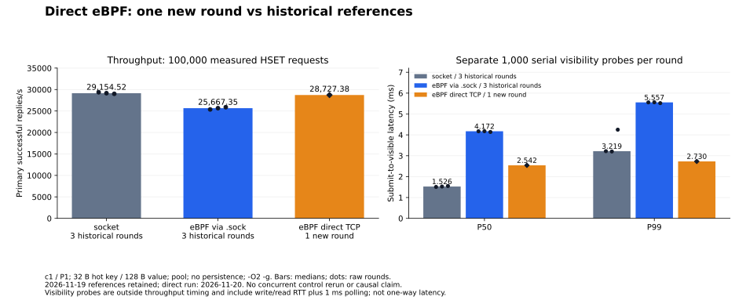

# 2026-11-20：直连 eBPF 双机性能单轮复测

本轮只测当前直连版 eBPF，不重测 socket、无复制基线、SAVE、Pipeline、RSS 或传输矩阵。性能指标复用 2026-11-19 修复后测试的实现与口径；不能与更早三轮失败的 eBPF 数据混为一谈。

## 配置与计量

- 拓扑：客户端与 Primary 位于 172.16.145.135，Replica 位于 172.16.145.136；两台 aarch64 VM，各 4 vCPU，共享 Mac 宿主机。
- 项目、NtyCo 及采集端强制重编译为 `-std=gnu11 -Wall -Wextra -O2 -g`；BPF 对象仍为 `-O2 -g`。没有调整复制代码、缓存容量或额外限速来影响成绩。
- 两端配置 `allocator=pool`、`persistence_mode=none`、`log_level=info`；Primary 设置 `replication_incremental_mode=ebpf` 和 `replication_capture_port`。全量仍使用 SIW RDMA；加载确认后 Replica 直连采集端，Primary 控制连接不发送增量。
- `redis-benchmark 7.0.15`，`-c 1 -P 1 -n 100000 -e HSET`，固定 32B 热键、128B 值覆盖。先做 1 次准备写和全量同步，确认 ONLINE 后热身 10,000 次，再正式测量 100,000 次。
- QPS 计量 **Primary 成功回复吞吐**；通过 ONLINE、最终标记和最终应用进度核对后才作为有效复制场景成绩。它不是每条命令等到 Replica ACK 后的吞吐，也不是唯一键插入吞吐。
- QPS 结束后独立采样 1,000 次串行可见性探针：135 提交唯一值，136 读回匹配为止，未匹配时休眠 1ms。使用同一个 135 单调时钟；不相减两台 VM 的时钟。
- P50/P99 排序后分别取第 500/990 个样本，与旧脚本相同。可见性包括写请求往返、复制、轮询和读请求往返；是空闲串行探针，不是同时持续压测下的复制延迟或纯单向传输延迟。

两端二进制 SHA-256 相同：`c0bcfa35fa7966dba4bc55dbba143a61cb11021f320df0c3e18fd0dd7b83c412`。采集端 SHA-256 为 `4bc91c2ffa04109f1acf4136a43f277af4e6f51f7f90b89408a1eb44073ba0e2`；BPF 对象为 `bf9779d7b5f2bfde32e6819300417a001eaaf34b59b7d32811a5520ae6ce8b85`。分支 `feat/ebpf-snapshot-boundary` 的基准 HEAD 是 `903d64aadd1af66a966d72bef0a5ed263969ad58`，本轮测量的是含未提交直连改动的工作区，不能只靠该 HEAD 复现；源文件逐项 SHA 与源码树指纹保存在 JSON `source`。

## 成绩与历史对照

| 模式 | 样本 | Primary QPS | 可见性 P50(ms) | 可见性 P99(ms) |
| --- | --- | ---: | ---: | ---: |
| 普通 socket（历史） | 3 轮中位数 | 29,154.52 | 1.526 | 3.219 |
| 旧 `.sock` eBPF（历史） | 3 轮中位数 | 25,667.35 | 4.172 | 5.557 |
| 直连 eBPF（本轮） | 1 轮实测 | 28,727.38 | 2.542 | 2.730 |

历史两组来自 [2026-11-19 原始 JSON](data/measurements-2026-11-19.json) 的 `retune.replication.results`（修复后 `846c87d`，均 3/3 通过），没有覆盖或重新计算历史原值。表中历史分位数是各轮分位数的中位数，不是把三轮样本合并再算分位数。本轮是 1 轮，没有轮间波动或置信区间。

| 相对历史中位数 | QPS 变化 | 可见性 P50 变化 | 可见性 P99 变化 |
| --- | ---: | ---: | ---: |
| 普通 socket | -1.47% | +66.57% | -15.20% |
| 旧 `.sock` eBPF | +11.92% | -39.08% | -50.88% |

变化按 `(本轮 / 历史中位数 − 1) × 100%` 计算；延迟的负数表示降低。直连版相对历史 `.sock` eBPF 的吞吐与可见性均改善；相对历史普通 socket，吞吐略低、P50 更高、P99 更低。旧 socket 三轮 QPS 为 29,368.58 / 29,154.52 / 29,010.73，旧 `.sock` eBPF 为 25,367.83 / 25,667.35 / 25,900.03。



图中柱为中位数（单轮时就是该值），圆点为旧原始三轮，菱形为新单轮；零起点坐标，没有把历史三轮误画成新测数据。

## 写回复 RTT 与 CPU

本轮写回复 RTT P50 **0.039 ms**、P99 **0.055 ms**，与上表可见性延迟分别计量。

| 模式 | Primary CPU/单核 | 采集端 CPU/单核 | Replica CPU/单核 |
| --- | ---: | ---: | ---: |
| 普通 socket（历史 3 轮中位数） | 99.3% | 0.0% | 5.5% |
| 旧 `.sock` eBPF（历史 3 轮中位数） | 99.4% | 3.8% | 5.2% |
| 直连 eBPF（本轮 1 轮） | 34.1% | 3.1% | 37.5% |

CPU 100% 为一个逻辑核，来自进程 jiffies 差值除以正式请求的外层单调计时。Replica 延续原实现，由 SSH 在正式窗口前后取样，包含少量编排边界，数值为近似。直连版 Primary CPU 降低，Replica CPU 增加；不能只呈现 Primary 的下降而忽略工作分布改变。没有同时运行 perf、消毒器或另一套压测。

## 采集完整性、时钟与清理

- 本轮从快照边界 S=189 起同步。准备 1 条 + 热身 10,000 条 + 正式 100,000 条 + 可见性 1,000 条，共 111,001 条成功提交，每条编码长度 189 字节。
- 最终 `APPLIED = cache_start = cache_end = stream_end = 20,979,189`；最终可见性值为 `visibility_00000999_` 开头的 128B 标记，Replica 仍为 ONLINE。
- 真实采集日志全程 `oversize=0 / ring_full=0 / read_error=0`，无缓存缺口或溢出。进度核对与标记验证不等同于把全部 10 万条同值覆盖逐条读取；无重复/乱序的确定性验收另见前一轮直连正确性记录。
- 与旧正式测量一样，sudo 助手临时暂停 135 的 VMware 周期校时和 systemd-timesyncd，结束后恢复原来的 Enabled/active，恢复无错误。正式窗口实时与单调时钟净差为 `0.000000529573` 秒，低于 20ms 拒收阈值；工具耗时 3.48s，没有超过外层 3.520269s。
- **清理告警原样保留**：测量、1,000 次探针和最终进度已通过后，旧 `stop` 辅助脚本在 SIGTERM 后的退出轮询中报 `process ownership changed`，导致原编排 `success=false`。堆栈位置及随后 PID 消失与退出竞态相符，但没有额外插桩证明瞬间状态。没有删掉告警或把原 JSON 的 false 改成 true。
- 随后独立检查确认 Primary 551126、Replica 128820、采集端 551348 均已退出，双方测试端口及临时快照释放，校时恢复。因此新汇总分别记录 `measurement_passed=true` 和 `cleanup_verified=true`，同时完整保存 `direct.success=false`、原错误和独立清理证据。

## 数据文件与复现

[本轮 JSON](data/measurements-2026-11-20-direct-ebpf.json) 含 1,000 个可见性样本、原生 benchmark 输出、参数、配置、服务及 BPF 日志、完整构建记录、源码/二进制指纹、原脚本和清理告警。`run_single_qps.py` 与上次正式脚本逐字节相同，`visibility` 分支也逐字节相同；仅编排目录、采集端端口配置和 sudo 采集启动方式适配直连。

本轮已执行的原生命令（端口来自每次实验的空闲端口选择）：

```sh
# 仓库根目录，强制包含 NtyCo 重编译。
make -B -j4 CFLAGS='-std=gnu11 -Wall -Wextra -O2 -g' all ebpf-capture

# 普通用户启动 Primary；采集助手由用户交互式 sudo 启动，自动恢复校时。
sudo python3 -u -B /home/jaspersao/dev/91kvstore-performance-direct-20261120/run_privileged_capture.py

# 确认真实 Replica ONLINE 后执行；KEY 为 32 个 k，VALUE 为 128 个 v。
/home/jaspersao/dev/91kvstore-tools/bin/redis-benchmark -h 172.16.145.135 -p 36953 -c 1 -P 1 -n 10000 -e HSET "$KEY" "$VALUE"
/home/jaspersao/dev/91kvstore-tools/bin/redis-benchmark -h 172.16.145.135 -p 36953 -c 1 -P 1 -n 100000 -e HSET "$KEY" "$VALUE"
```

完整编排脚本保存在 JSON `scripts`，不能只执行上述 benchmark 两行就声称复现了全量、真实 BPF、可见性及清理。原始实验目录为两端 `/home/jaspersao/dev/91kvstore-performance-direct-20261120`；136 使用该私有目录内的二进制，未改原仓库已有文件。

只从 JSON 重画本轮图表，不启动服务或测试；使用已有 matplotlib，不安装新依赖：

```sh
python3 -B docs/performance/plot_results.py \
  --direct-data docs/performance/data/measurements-2026-11-20-direct-ebpf.json
```

单轮且跨日，没有同期重跑 socket 对照。共享宿主机调度、VM 负载和整体代码变化均可能影响数字；不能把差异全部归因于取消 Unix socket，也不能据此宣称稳定提升 11.92%。本轮没有改动其他性能矩阵，没有提交或推送。
