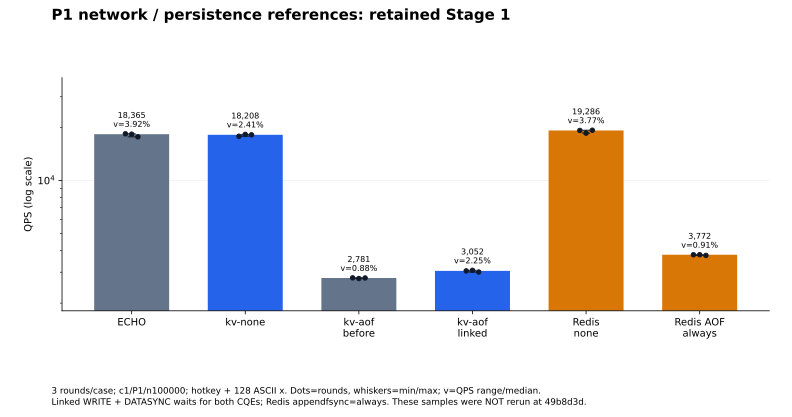
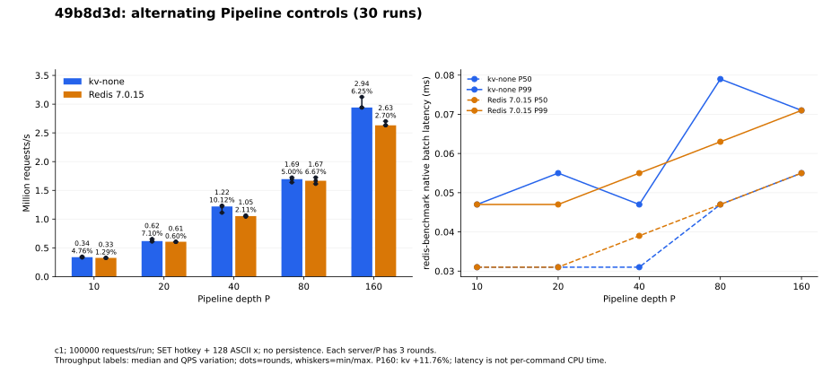
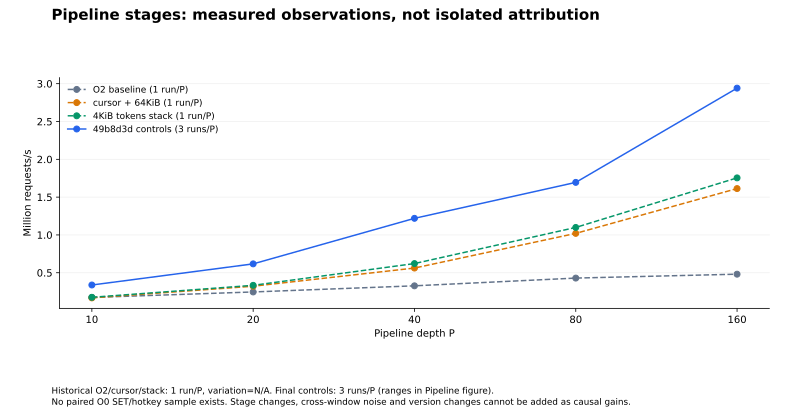
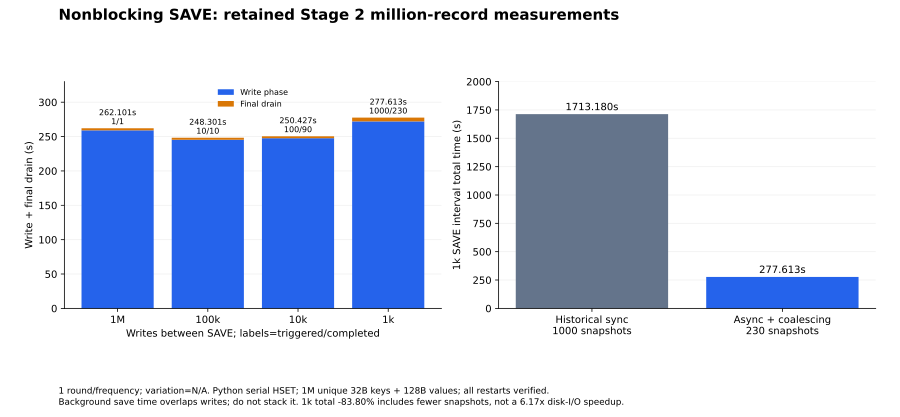
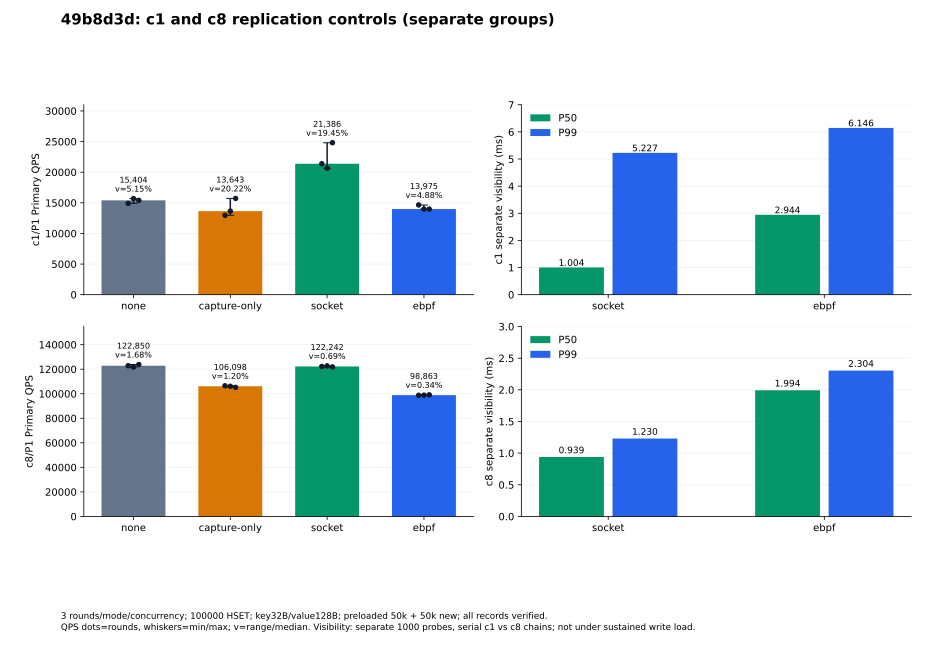
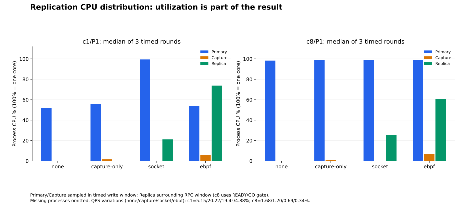
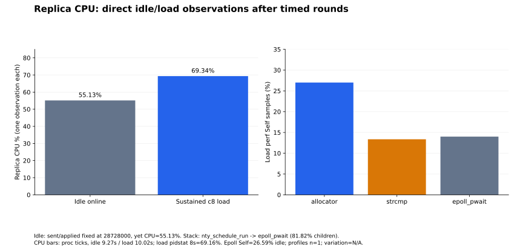
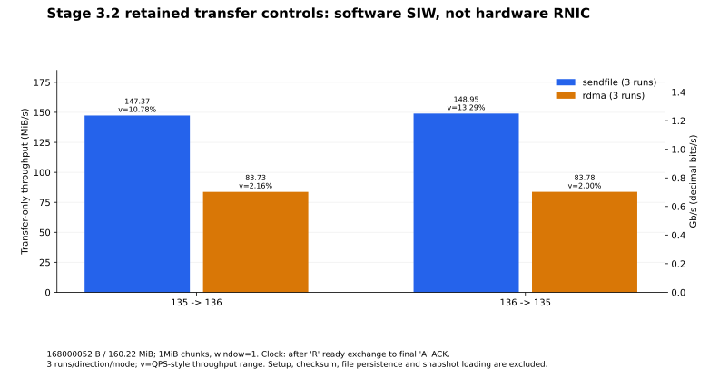
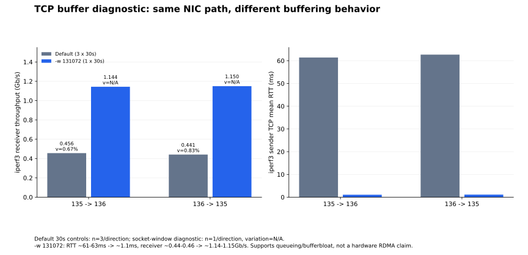
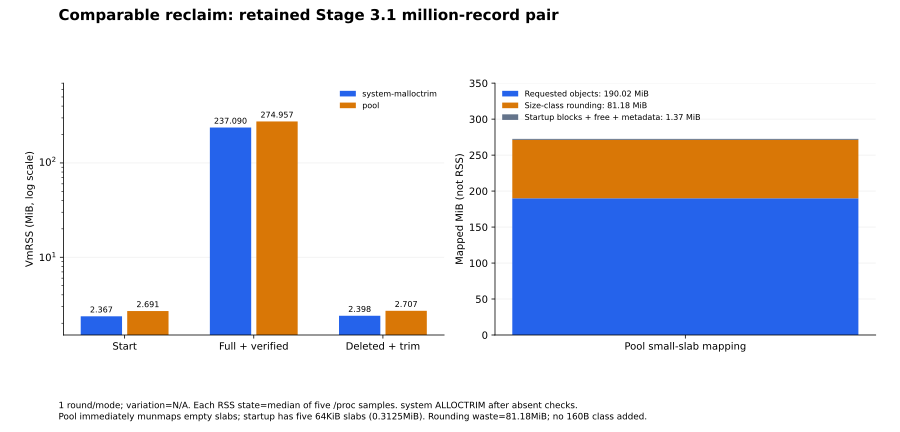

# 最终性能报告：Stage 5 / 49b8d3d

[首页](../../README.md) · [复制架构与时序](../REPLICATION.md) · [本轮数据](data/measurements-2026-11-26.json) · [复现与离线制图](STAGE5-REPRODUCING.md)

归档日期：2026-11-26（Asia/Shanghai）。最终代码基线 **49b8d3d0ce1f8f9895900fb357c431c1d9697752**，项目 `-std=gnu11 -O2 -Wall -Wextra -g`；NtyCo 固定 72ab5fd、沿用第三方原有优化参数。图表在已有Mac matplotlib3.9.4环境离线生成（135未安装该库，本阶段不安装）。本阶段只核对源码、汇集既有测量、离线制图，没有重新运行性能负载或修改业务 C 代码。

## 数据身份与统计规则

两台 aarch64 Ubuntu Linux 6.8.0-147 VM，各 4 vCPU、约 8 GiB，135=172.16.145.135、136=172.16.145.136，共享 Mac 宿主机。双机最终被测 ELF SHA256 为 `1c7a98f88c29096a65656e1a7c8fd24a683d7f362ad44543a55381fe616d6e27`；136 使用独立、干净的 49b8d3d 副本及相同 ELF，原仓库的旧版本和既有改动不参与成绩。

| 证据组 | 实际版本/阶段 | 样本范围 | 是否最终版本重测 |
|---|---|---|---|
| 单请求/AOF；游标、栈缓冲阶段 | Stage 1 工作区，后归入 e9584bb | P1 各3轮；早期每档 Pipeline 1轮 | 否，保留阶段证据 |
| Pipeline 交替对照 | 49b8d3d | 5深度×2服务×3轮=30次 | 是 |
| 非阻塞 SAVE 与百万条频率 | Stage 2 工作区，后归入 02805d7 | 并发验收1次；各频率1轮 | 否，保留阶段证据 |
| ALLOCINFO / ALLOCTRIM 百万条 | Stage 3.1，后归入 d7f3547 | 五模式1轮；trim/pool另同轮各1次 | 否，分组保留 |
| RDMA/sendfile/iperf3 | d7f3547 的 Stage 3.2 | 原生传输各3轮/方向；诊断各1轮 | 否；相关3份源码与最终版本哈希一致 |
| c1/P1 与 c8/P1 四档复制 | 49b8d3d | 每种并发每模式3轮，共24轮 | 是；两组分别统计 |
| Replica CPU idle/load | 49b8d3d | 正式成绩之外各一次8秒采样 | 是，单次诊断 |

三轮的每项指标各取中位数；波动率为 `100*(max-min)/median`，不是标准差或显著性检验。单轮不计算轮间波动，图上标 N/A。各版本、客户端、连接数、数据集、计时和耐久性契约分开，绝不拼成更多轮次。源文件摘要、原始轮次、完整命令/参数与部分诊断文本保存在本轮 JSON 和 [perf 证据](data/20261126-replica-profile.txt)；不将临时 RPC 令牌归档。

## 1. 单请求与严格 AOF（保留 Stage 1）

`redis-benchmark 7.0.15`，127.0.0.1:29191，`-c 1 -P 1 -n 100000 --precision 3`。SET 固定 `hotkey`（6B），value 是128个 ASCII x；ECHO 为128B payload。每项三轮，AOF 每轮从空目录启动。此组不是32B key，也未在最终版本重新跑。

| 场景 | 三轮 QPS | QPS 中位数 | P50 / P99 ms | QPS波动 |
|---|---|---|---|---|
| echo | 18,456.99 / 18,365.47 / 17,736.79 | 18,365.47 | 0.055 / 0.071 | 3.92% |
| kv-none | 17,873.10 / 18,311.66 / 18,208.30 | 18,208.30 | 0.055 / 0.071 | 2.41% |
| kv-aof-before | 2,785.36 / 2,760.75 / 2,780.87 | 2,780.87 | 0.343 / 0.631 | 0.88% |
| kv-aof | 3,052.04 / 3,075.41 / 3,006.89 | 3,052.04 | 0.311 / 0.551 | 2.25% |
| redis-none | 19,286.40 / 18,618.51 / 19,346.10 | 19,286.40 | 0.047 / 0.071 | 3.77% |
| redis-aof | 3,771.73 / 3,773.87 / 3,739.72 | 3,771.73 | 0.263 / 0.343 | 0.91% |

kv-aof **2,780.87 → 3,052.04 QPS，+9.75%**；P99 中位数0.631→0.551ms。旧 AOF 对照用旧 aof.c 与相同其余对象重链接；是当时受控阶段对照，不把今天整版代码差异归为 AOF 单项收益。

严格路径为 `WRITE --IOSQE_IO_LINK--> FSYNC(IORING_FSYNC_DATASYNC)`，通常一次 submit，等两个 CQE 均完成才成功回复；短写先回收已链接同步 CQE，再续写与同步。短命令用4KiB栈缓冲，超长回退堆。`io-wq` 是内核 io_uring 可能使用的工作线程执行路径，不是“WRITE CQE 成功即可回复”的替代耐久性契约；链接提交也不保证消除内核 offload/调度开销。没有逐开关的 io-wq 对照，不能将+9.75%写成完全消除了 io-wq，或把不同 flush 策略混在一起。

Redis-none：`--save "" --appendonly no`。Redis-aof：`--save "" --appendonly yes --appendfsync always --auto-aof-rewrite-percentage 0`；kv-aof：`persistence_mode=aof, aof_checksum=none`。这是逐写等待同步的对照，不是 Redis 默认 everysec；仍不是硬件断电耐久性实验。

## 2. 最终 Pipeline：同轮交替30次

49b8d3d、`-O2`；127.0.0.1:29191；`redis-benchmark -c 1 -P 
 -n 100000 --precision 3 SET hotkey <128B x>`。kv-none 与 Redis 7.0.15 none 在同一窗口逐个新启实例；第1/3轮 kv→Redis，第2轮 Redis→kv，各深度每端3轮。无并发压测。

| P | kv QPS中位数 | Redis QPS中位数 | kv相对差异 | kv P50/P99 ms | Redis P50/P99 ms | kv/Redis QPS波动 |
|---|---|---|---|---|---|---|
| 10 | 337,837.84 | 325,732.88 | 3.72% | 0.031/0.047 | 0.031/0.047 | 4.76% / 1.29% |
| 20 | 617,283.94 | 606,060.56 | 1.85% | 0.031/0.055 | 0.031/0.047 | 7.10% / 0.60% |
| 40 | 1,219,512.12 | 1,052,631.62 | 15.85% | 0.031/0.047 | 0.039/0.055 | 10.12% / 2.11% |
| 80 | 1,694,915.25 | 1,666,666.75 | 1.69% | 0.047/0.079 | 0.047/0.063 | 5.00% / 6.67% |
| 160 | 2,941,176.25 | 2,631,579.00 | 11.76% | 0.055/0.071 | 0.055/0.071 | 6.25% / 2.70% |

**P160：2,941,176.25 vs 2,631,579.00 QPS，+11.76%。** P20/P80的差值小于观测波动，不能据三轮认定稳定领先。100000次高Pipeline轮次很短，存在毫秒计时粒度和VM调度影响；不能将短轮吞吐外推为长时稳定容量。

延迟保留 redis-benchmark 的批次发送/首读事件口径，不是每条命令完整执行时间，不除以P得到“单命令延迟”，也不跨轮合成新的总体P99。

### 分阶段贡献：机制与已测数值分开

| 变化 | 实际改动 | 可归档的证据 |
|---|---|---|
| 默认未优化（等效O0）→O2 | `OPT ?= -O2` | 同SET/hotkey负载缺少O0配对成绩，收益百分比N/A |
| O2→输入游标/64KiB | consume只推进offset，接收前compact，批量读64KiB | 各P一轮的跨阶段变化，不能拆出游标与读块各自贡献 |
| →tokens栈缓冲 | 字段总长≤4096B不再逐token堆分配 | 各P一轮；P160阶段变化+8.77% |
| →最终49b8d3d对照 | 当前整版代码、不同测量窗口 | 本轮3轮，不能把相对上一阶段的差全部算给某一优化 |

| P | O0 | O2（1轮） | 游标/64KiB（1轮） | 栈缓冲（1轮） | 游标阶段变化 | 栈缓冲阶段变化 |
|---|---|---|---|---|---|---|
| 10 | 未测 | 173,010.38 | 167,224.08 | 175,131.36 | —% | 4.73% |
| 20 | 未测 | 245,700.25 | 321,543.41 | 333,333.31 | 30.87% | 3.67% |
| 40 | 未测 | 326,797.41 | 561,797.75 | 621,118.00 | 71.91% | 10.56% |
| 80 | 未测 | 429,184.56 | 1,020,408.19 | 1,098,901.12 | 137.76% | 7.69% |
| 160 | 未测 | 480,769.22 | 1,612,903.25 | 1,754,386.00 | 235.48% | 8.77% |

11月19日 846c87d 的记录明确写了强制 `-O2 -g`；不能把那组较低成绩冒充O0，也不能把历史HGET与本轮SET混算。分阶段图展示观测轨迹，没有独立开关消融、没有O0配对值，不提供可相加的因果“贡献率”。

## 3. 非阻塞 SAVE 与百万条四档（保留 Stage 2）

本项目 `SAVE` 在 standalone/snapshot 模式下是 **fork()+COW 后台保存**，语义相当于 Redis BGSAVE。`+OK`只表示已接受；以 `SAVEINFO` 的completed增加且`in_progress=0 pending=0`确认完成。已有子进程时只设置一个save_pending，合并重复请求，子进程退出后接力保存最新状态；10ms协程周期回收，优雅退出等待最后一轮。详情见[状态机与约束](../REPLICATION.md#非阻塞-save)。

30,000条并发验收：SAVE接受回复1.137ms，另一连接完成2073组SET+GET；**P50=0.111ms、P99=0.153ms、max=1.089ms，统计对象是整组SET+GET往返**，不是单个SET。11次触发合并完成2次，重启逐条一致；不是百万条并发P99测量。

百万条：唯一Hash key32B/value128B、pool、snapshot_checksum=file；每档一个串行Python客户端、一轮。write包括生成key/value、编码、HSET完整往返和SAVE接受回复；drain从最后接受回复至SAVEINFO无活动/无pending；total=write+drain，不含启动、SHA、重启与逐条校验。HSET延迟包围Client.command，不含生成和SAVE。

| 每多少条SAVE | write s | drain s | total s | 写QPS | HSET P50/P99/max ms | 触发/完成 | 前台fork ms | 后台save ms |
|---|---|---|---|---|---|---|---|---|
| 1000000 | 259.103 | 2.998 | 262.101 | 3,859.47 | 0.210/0.691/41.284 | 1/1 | 7.478 | 2,984.512 |
| 100000 | 245.394 | 2.907 | 248.301 | 4,075.08 | 0.186/0.691/11.292 | 10/10 | 43.647 | 15,451.062 |
| 10000 | 247.619 | 2.807 | 250.427 | 4,038.46 | 0.183/0.735/89.059 | 100/90 | 345.182 | 155,480.636 |
| 1000 | 272.119 | 5.494 | 277.613 | 3,674.86 | 0.206/0.792/48.795 | 1000/230 | 498.273 | 274,644.171 |

各档total **248.301–277.613s**（不是上界277整秒）；所有档verified=1000000、failed=0，重启前后snapshot SHA256相同：`49fe962a54f72160692841b7a1b5472380276db4f6587d697dccd2d3631e50a0`，文件168000052B。后台total_save_ms与写入重叠，不与write/fork相加。

1k档：历史同步SAVE **1713.18s → 277.613s**，约6.17倍、减少83.80%；1000次请求被save_pending合并为**230次完整保存**。这改变了调度与保存次数，不是同样1000次全量落盘的纯IO加速。各档只有1轮，轮间波动N/A。Python写入约3.7–4.1k QPS，包含生成/编码/逐请求开销；不能与C redis-benchmark固定hotkey约18k直接当作服务器退化。

## 4. 双机主从：c1和c8分别完整呈现

两组均为49b8d3d、相同ELF、-O2；每模式三轮、每轮100000次HSET、32B唯一key/128 ASCII x，Primary135:29191、Replica136:29192。都先写50000条，复制档等待ONLINE且逐条校验全量，再预热1000次，正式100000次包含50000次覆盖与50000条新增。QPS计成功完整回复，建连/全量/预热/校验均排除。

所有24轮成功；复制档每轮Primary和Replica最终100000条逐条匹配、只有一次FULL_SYNC与ONLINE。capture-only只挂载采集器，不接Replica；采到151000×189B完整流，cache有效。CPU 100%=单核。P/C为正式写入窗口ticks；R为包围写入的远端窗口，c8用READY/GO排除预生成与CSV写出，仍含少量边界RPC和tick量化误差。

### -c 1 -P 1：每模式3轮

| 模式 | QPS中位数 | P50/P99 ms | QPS波动 | CPU P/C/R % | 可见性P50/P99 ms |
|---|---|---|---|---|---|
| none | 15,403.86 | 0.059292/0.177500 | 5.15% | 52.10/—/— | —/— |
| ebpf-capture-only | 13,643.27 | 0.064583/0.205791 | 20.22% | 55.80/1.64/— | —/— |
| socket | 21,385.54 | 0.037541/0.148125 | 19.45% | 99.44/—/21.16 | 1.004/5.227 |
| ebpf | 13,975.40 | 0.064500/0.178958 | 4.88% | 53.79/6.01/73.78 | 2.944/6.146 |

### -c 8 -P 1：每模式3轮

| 模式 | QPS中位数 | P50/P99 ms | QPS波动 | CPU P/C/R % | 可见性P50/P99 ms |
|---|---|---|---|---|---|
| none | 122,849.88 | 0.061709/0.136875 | 1.68% | 98.28/—/— | —/— |
| ebpf-capture-only | 106,097.99 | 0.072917/0.141208 | 1.20% | 98.90/1.06/— | —/— |
| socket | 122,241.66 | 0.062875/0.121625 | 0.69% | 98.70/—/25.41 | 0.939/1.230 |
| ebpf | 98,863.36 | 0.078458/0.142708 | 0.34% | 98.77/6.91/60.82 | 1.994/2.304 |

c1中socket Primary约99.4%单核，而none/ebpf约52–56%；socket约21.4k反而高于none约15.4k，不应概括为“复制加速了数据库”。源码流控重试为1ms并显式yield，这种持续唤醒与调度状态/利用率差异有关；没有只切换1ms参数的隔离对照，不能把全部QPS差异因果归给它。c8时四档Primary都约98–99%，不再由单连接休眠利用率差主导。

c8拆解：none→capture-only QPS **−13.64%**，Primary CPU/请求约8.0→9.3us，含采集器约8.0→9.4us；捕获代价主要反映在Primary路径，不能只看采集器1.07% CPU。capture-only→ebpf再降**6.82%**，P+C约9.4→10.6us/请求；另消耗Replica约60.82%单核。socket相对none −0.50%，在本批波动内；ebpf相对socket **−19.12%**，Replica25.41→60.82%，可见性1.994/2.304ms。以上是整档边际差，不是某个函数的孤立成本。

可见性均另测1000次HMOD→Replica HGET，计客户端收到Primary成功ACK到首次完整读回新值，含查询RTT，是上界。c1串行；c8是8条并发链（8写连接+8观察连接，每连接P1），不是持续HSET满载期间的无干扰延迟。两组探测并发不同，不直接用其差值评价版本改进。

### Replica CPU：直接perf证据与源码解释

正式测试结束后，额外观察一次idle、一次持续c8写入，各用8秒perf/pidstat，不混入上表成绩。

- **idle总CPU=55.13%**，9.27s观察窗口；前后sent/applied/cache_end/stream_end均为28728000，没有新命令推进。perf 880样本、丢0，调用栈`main → ntyco_start_runtime → nty_schedule_run → epoll_pwait`，epoll路径Children为81.82%；**epoll_pwait Self是26.59%采样CPU时间，不是55.13%**。这直接确认了无流量时调度/事件等待路径的高CPU基线。
- 持续写入pidstat的8秒CPU=69.16%（usr47.82%、system21.35%），同次/proc周边10.02秒窗口为69.34%；图中两根CPU柱统一使用/proc口径（idle55.13%、load69.34%），不混同窗口。主动切换273.53/s，非主动2.25/s。perf Self：`kvs_allocator_alloc`27.00%（pool_alloc_small/slab_alloc_block），`strcmp`13.36%（关联kvs_hash_set），`epoll_pwait`14.00%。Children和Self不能重复相加，采样占比也不等于整机CPU百分比。
- 源码机制：NtyCo按微秒算下次唤醒，再在`nty_epoller_wait`换算为整数毫秒传给epoll_wait；小于1ms的剩余量可截断为0。结合本项目1ms重试定时器，这是与频繁epoll/时钟热点一致的空转机制解释；本阶段未改调度器、未逐次记录epoll参数，也未单独计数APPLIED发送，所以不把“每次必为0ms”或“逐批APPLIED是主因”写成已证实。

## 5. RDMA / sendfile / iperf3（保留 Stage 3.2）

真实快照 **168000052B = 160.217335MiB（约160.22MiB）**，1MiB分块、window=1、一次只在途一块；文件热缓存，接收进内存，两端验长度/CRC。计时严格按benchmark_transfer.c：完成`'R'`就绪交换**之后**记started，至最后一块`'A'` ACK收发完成；**不是建连到落盘总耗时**。

setup_seconds从TCP socket调用前计起：含控制建连/头交换、接收内存分配、RDMA建连和就绪交换；输入open/mmap、发送CRC及RDMA监听创建在它之前，不能把setup+transfer+checksum当完整进程时间。checksum_seconds独立；发送预校验与接收末尾CRC均不计transfer_seconds。原生测试不做接收文件落盘与数据库加载，不能把它写成已计入或当端到端复制耗时。`MiB/s = bytes/seconds/2^20`，`Gb/s = bytes*8/seconds/1e9`，故`1MiB/s=0.008388608Gb/s`。

| 方向 | 模式 | 轮次 | transfer s | MiB/s | Gb/s | 吞吐波动 | setup发送/接收s | CRC发送/接收s |
|---|---|---|---|---|---|---|---|---|
| 135→136 | sendfile | 3 | 1.087170 | 147.37 | 1.236237 | 10.78% | 0.000433/0.441082 | 0.280537/0.279272 |
| 135→136 | rdma | 3 | 1.913575 | 83.73 | 0.702351 | 2.16% | 0.002448/0.478513 | 0.284144/0.282026 |
| 136→135 | sendfile | 3 | 1.075629 | 148.95 | 1.249501 | 13.29% | 0.000458/0.469376 | 0.301303/0.293565 |
| 136→135 | rdma | 3 | 1.912261 | 83.78 | 0.702833 | 2.00% | 0.002580/0.477445 | 0.298909/0.298121 |

iperf3为3.16、同enp2s0虚拟网卡路径，独立连续TCP参考，与1MiB/ACK/window1的原生协议不同，不能拿默认iperf单流当所有传输的链路上限。

| 方向 | 参数组 | 轮次 | 秒 | 流数 | sender MiB/s | receiver MiB/s | sender Gb/s | receiver Gb/s | mean RTT ms |
|---|---|---|---|---|---|---|---|---|---|
| 135→136 | iperf3 | 3 | 30 | 1 | 54.41 | 54.37 | 0.456460 | 0.456056 | 61.401 |
| 135→136 | iperf3-W128K30 | 1 | 30 | 1 | 136.27 | 136.32 | 1.143145 | 1.143528 | 1.065 |
| 135→136 | iperf3-W128K-P4 | 1 | 10 | 4 | 186.22 | 185.45 | 1.562165 | 1.555649 | 3.297 |
| 136→135 | iperf3 | 3 | 30 | 1 | 52.58 | 52.60 | 0.441086 | 0.441268 | 62.674 |
| 136→135 | iperf3-W128K30 | 1 | 30 | 1 | 136.71 | 137.06 | 1.146781 | 1.149735 | 1.128 |
| 136→135 | iperf3-W128K-P4 | 1 | 10 | 4 | 188.10 | 187.54 | 1.577917 | 1.573177 | 3.358 |

默认单流30s三轮：RTT约61–63ms；单独`-w 131072`的30s单轮：RTT降至1.065/1.128ms，吞吐约1.14–1.15Gb/s。限制socket缓冲反而降低RTT并提高吞吐，支持排队/Bufferbloat诊断，背景负载与不同参数不混算；不是0.45Gb/s网卡硬上限，也不是单轮诊断的统计显著性结论。历史11月19日的参数/网卡路径与本次核对见原文；已确认传输协议与iperf负载形态不同，不能将差异全部归因于RDMA硬件。

**SIW为软件Soft-iWARP模拟验证路径，不能外推硬件RNIC性能。** 本环境下sendfile约147–149MiB/s、SIW约84MiB/s，不证明硬件RDMA不如sendfile，也不承诺零CPU或线速。

## 6. 内存池百万条：明细与公平回收（保留 Stage 3.1）

四引擎，32B key/128B value：Array1024，其余各332992；写入、读回、删除、不存在核对各100万次。各RSS状态取5次/proc采样中位数。各模式仅1轮，无轮间波动；peak是写满并核对后的状态，不是VmHWM。POOL空slab立即munmap；SYS默认free不强制trim，两者原本回收策略不同。

### 默认/积极回收五模式（独立一轮）

| 模式 | 起始RSS MiB | 写满RSS MiB | 删除核对后RSS MiB | 结束−起始MiB |
|---|---|---|---|---|
| system | 2.371094 | 237.093750 | 237.093750 | 234.722656 |
| system-trim | 2.371094 | 237.093750 | 237.093750 | 234.722656 |
| pool | 2.695312 | 274.960938 | 2.710938 | 0.015625 |
| jemalloc | 4.769531 | 245.535156 | 6.863281 | 2.093750 |
| jemalloc-decay0 | 4.773438 | 245.539062 | 6.867188 | 2.093750 |

system-trim配置GLIBC_TUNABLES的trim_threshold=0，但本负载小块仍留在arena，实际RSS未下降；jemalloc-decay0设置dirty/muzzy_decay_ms=0，该单轮未看到比默认更低的结束RSS。不能把“设置了参数”当作已达到同等回收。

### ALLOCTRIM同轮公平对照（另组各一轮）

system-malloctrim在删除且不存在核对后，显式ALLOCTRIM调用glibc malloc_trim(0)；pool照常立即munmap，默认路径没有被改成自动trim。

| 模式 | 起始RSS MiB | 写满RSS MiB | 删除核对后RSS MiB | 结束−起始MiB |
|---|---|---|---|---|
| system-malloctrim | 2.367188 | 237.089844 | 2.398438 | 0.031250 |
| pool | 2.691406 | 274.957031 | 2.707031 | 0.015625 |

公平回收后 **system-malloctrim=2.398438MiB，pool=2.707031MiB**，pool高0.308594MiB（316KiB）；pool写满RSS也更高。池优势是明确的按空slab归还策略与统计可解释性，不是所有条件下RSS最小。2.710938MiB来自前一组五模式，不能替换本同轮2.707031。

### ALLOCINFO精确分解

| block_size | slab_count | used_blocks | capacity_blocks | mapped_bytes | 保留对象 |
|---|---|---|---|---|---|
| 16 | 1 | 2 | 4059 | 65536 | 跳表header两个空字符串 |
| 32 | 1 | 1 | 2037 | 65536 | 跳表header节点 |
| 48 | 1 | 1 | 1360 | 65536 | RB nil哨兵 |
| 64 | 1 | 1 | 1020 | 65536 | 跳表header forward数组 |
| 1024 | 1 | 1 | 63 | 65536 | 网络输出缓冲 |

合计 **5×65536=327680B=0.3125MiB**。历史所称约0.316MiB额外RSS主要由这五个slab解释，但mmap不等于RSS，不能把它们与libc/驻留页差强行完全对齐。另3个大映射：Array20480B、Hash桶12288B、输入缓冲69632B，合计102400B；当前总mapped_bytes=430080B，累计mapped_bytes_total=495616B（96档曾建过1个slab，当前已回收）。

| 规格 | 起始slab | 写满slab | 写满used | 写满capacity | 写满mapped B | 删除后slab | 删除后used |
|---|---|---|---|---|---|---|---|
| 16 | 1 | 62 | 249725 | 251658 | 4063232 | 1 | 2 |
| 32 | 1 | 358 | 728444 | 729246 | 23461888 | 1 | 1 |
| 48 | 1 | 992 | 1348658 | 1349120 | 65011712 | 1 | 1 |
| 64 | 1 | 6 | 5146 | 6120 | 393216 | 1 | 1 |
| 96 | 0 | 0 | 0 | 0 | 0 | 0 | 0 |
| 192 | 0 | 2942 | 1000000 | 1000280 | 192806912 | 0 | 0 |
| 1024 | 1 | 1 | 1 | 63 | 65536 | 1 | 1 |

删除后回到同样5个slab与3个大映射；已创建过不等于仍持有。原规格16..4096不变：工作负载请求199250104B，占规格块284370560B，差 **85120456B=81.177193MiB** 是规格取整内碎片。启动块1200B、空闲块258352B、slab元数据/位图/对齐/尾部1172384B单列，总小slab映射285802496B；这些不是同一种碎片，也不是RSS。

33B key进48档、129B value进192档；单key/value取整已浪费78000000B，其中129→192贡献63000000B。为这个固定128B字符串基准新增160B档会过拟合：真实请求尺寸分布、规格数/复用率/元数据代价尚未验证，因此保留通用规格表，而不通过专用档位美化单一成绩。

### 分配覆盖范围（只读源码核对）

四引擎的动态key/value、节点、容器经kvs_malloc/kvs_free进入当前后端；strlen+1的变长对象只要≤4096仍可进规格池，第三方直接malloc不在该入口覆盖范围。jemalloc为allocator=system加LD_PRELOAD，不是第三个内置后端。详见[历史逐引擎入口核对](REPORT-719836e-legacy.md#分配覆盖范围只读源码核对)；该历史文中的“空slab留到销毁”仅属于旧版本，当前已立即munmap。

## 命令语义与测量约定

SET/RSET/HSET/SSET均可新增或覆盖；MOD/RMOD/HMOD/SMOD只改已有键。HSET key value在本项目选择Hash引擎，不是Redis HSET hash field value。单机SET热键与双机HSET唯一键不混为同一种负载；默认redis-benchmark PING兼容性也不因这些测试自动扩大。

## 历史归档与复核入口

- [719836e原报告](REPORT-719836e-legacy.md)：初期HGET/持久化等，旧默认构建与旧客户端数据集，不并入最终样本。
- [2026-11-19 / 0e25dd7与846c87d](2026-11-19.md)：保留同步SAVE、旧复制、三轮内存与传输；不得把其强制O2构建改标O0。
- [2026-11-20直连eBPF单轮](2026-11-20-direct-ebpf.md)：单轮历史，不并入最终三轮。
- 本报告原始逐轮值见[2026-11-26数据](data/measurements-2026-11-26.json)，包含P1的18条、Pipeline的30条、c1/c8各12条、四档SAVE与内存/传输独立分组。图均离线从此文件生成，不启动服务。
- [复现与校验命令](STAGE5-REPRODUCING.md)；Stage 5只执行文档/图表校验，没有新增性能成绩或扩大测试通过范围。
