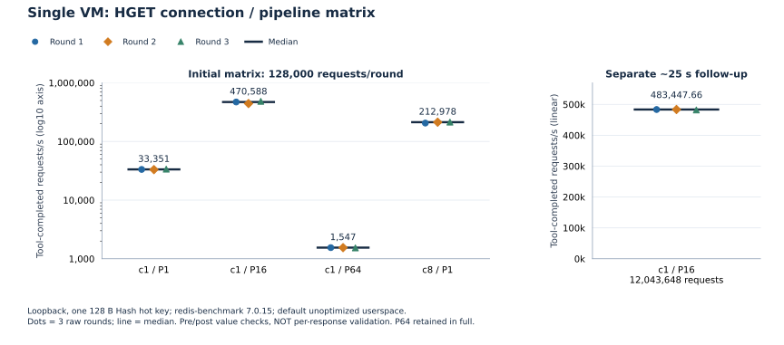
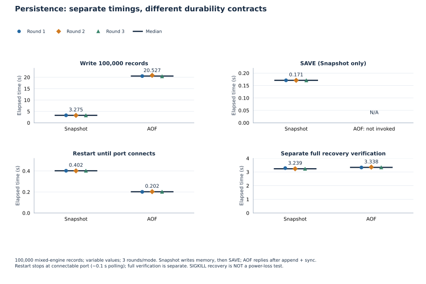
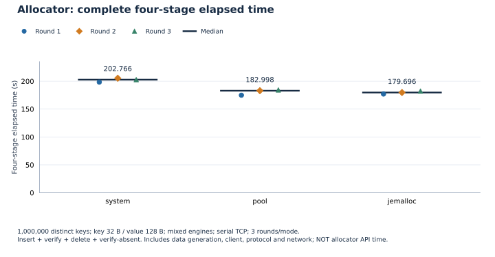
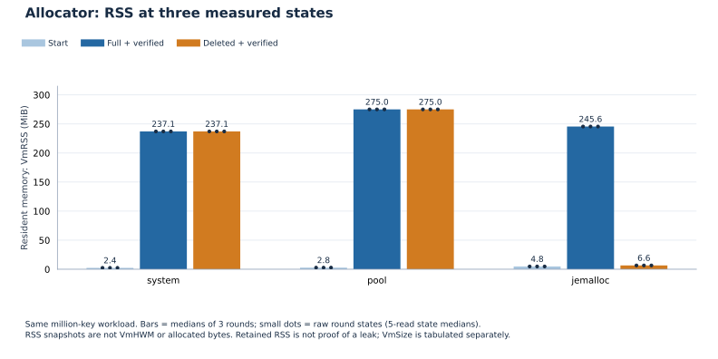
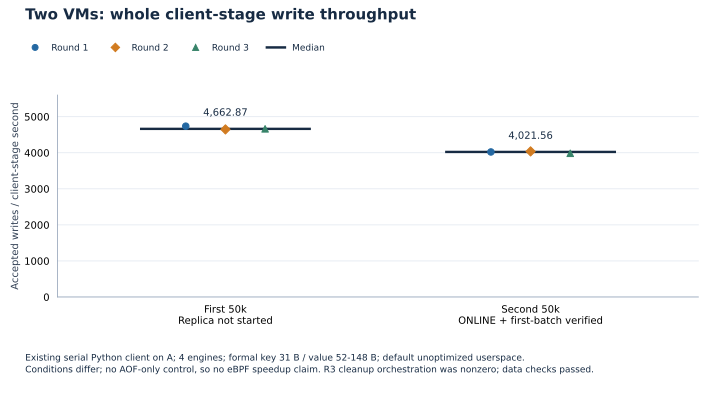

# 性能测量总报告

[首页](../../README.md) · [测试方案](TESTING.md) · [复现命令](REPRODUCING.md) · [数值](data/measurements.json) · [证据索引](data/evidence-index.json)

本阶段已停止负载、诊断和调优。本次只整理既有证据并离线制图，四类测量分开统计，不混算客户端、数据集、计时或耐久性承诺。图中的点是原始轮次，线或柱是中位数；不虚构误差线、分位数或火焰图。

## 环境、程序与数据选择

- 基线main：`719836e9f83651af7bea88b7dae63b686ada576d`；主程序默认 `-std=gnu11 -Wall -Wextra -g`、未优化，BPF对象单独 `-O2 -g`。本阶段未重新编译，系统/第三方库全部原始编译参数未穷举。
- 普通程序SHA：`a379b6605c6d09d0aaaecccd859ae897d582caec71399d81400722900e79eb82`。
- eBPF程序SHA：`312724f6d89ab956a4373f6a24e40946c62db1add35f14477e0671e6bb985d4b`。
- BPF对象SHA：`a9b65313e85f3393e6f6de8619cccfafc8edc07f96cebc4d8380c662ffd3c2b2`。
- 对应关系依据已有构建/交付记录及指纹，不把HEAD相同或工作区干净当作二进制来源证明。
- 两VM均aarch64、Linux6.8.0-147-generic、4 vCPU、MemTotal7919MiB，共享Mac，SIW ACTIVE。B原仓库仍为旧HEAD207f4ef，实际用A的独立运行副本；现有程序、入口和11项ldd依赖/loader SHA一致，不声称两端正式仓库HEAD相同。
- redis-benchmark/redis-cli7.0.15，sysstat12.6.1，perf6.8.12，bpftrace0.20.2；离线绘图用已有matplotlib3.9.4，无安装。
- 正式成绩无perf/bpftrace/sanitizer同时诊断；双机业务eBPF是被测路径，不是附加诊断。guest steal样本为0不能排除Mac竞争，宿主机观测未取得。

时段（Asia/Shanghai）：初批单机/持久化为11月9日约21:55–22:15；P16追加和诊断亦在当日。百万条为11月9日23:48:44至10日00:17:09；双机首组启动至末次校验为11月10日09:13:31至09:32:18。编排/审批等待不当作负载或初始化时间。

| 数据组 | 本报告采用范围 | 保留但不混入的记录 |
| --- | --- | --- |
| 单机 | 初始五场景各3轮；P16长轮次另组3轮 | 不把短/长合成六轮，不称为优化收益 |
| 持久化 | 预先声明采用resource-complete两模式各3轮 | 初组计时/数据有效但pidstat仅表头；原样保留，不按成绩筛选 |
| allocator | 百万条三模式各3轮，原轮换顺序 | 万条单次仅试测，旧阶段八程序不混入 |
| 双机 | 热身另列、正式3轮 | 旧审批中止热身排除；末轮收尾非零保留 |

所有三轮统计为中位数、最小/最大和 **100×(max−min)/median**，不是标准差或置信区间。三次样本不证明显著性；表/图显示值四舍五入，完整精度在JSON/CSV。

## 1. 单机：本机128B热点

客户端/服务端在VM-A回环，standalone/snapshot/pool/error。一个Hash key，128个ASCII字节；HGET固定热点，不代表百万条随机访问。插入使用不同key，更新组先确认key存在，每轮以HMOD恢复a后修改b；这只定义测量负载，SET本身仍允许覆盖已有key。每组独立热身，正式交错顺序见复现说明。

| 场景 | 每轮请求数 | 三轮工具完成 req/s | 中位数 | 波动 |
| --- | ---: | --- | ---: | ---: |
| HGET c1/P1 初始 | 128000 | 33350.70 / 33100.59 / 33719.70 | 33350.70 | 1.86% |
| HGET c1/P16 初始 | 128000 | 470588.22 / 442906.56 / 483018.91 | 470588.22 | 8.52% |
| HGET c1/P64 初始 | 128000 | 1546.94 / 1547.20 / 1532.27 | 1546.94 | 0.97% |
| HGET c8/P1 初始 | 128000 | 205787.78 / 212978.36 / 213689.48 | 212978.36 | 3.71% |
| HMOD c1/P1 初始 | 128000 | 33507.86 / 33844.53 / 33773.09 | 33773.09 | 1.00% |
| HGET c1/P16 追加 | 12043648 | 483447.66 / 483525.28 / 482015.84 | 483447.66 | 0.31% |

每组工具完成数、错误/超时检查和测前/后值校验通过，**没有逐响应内容验证**。约48.3万次/秒是工具完成吞吐。初始P16仅约0.27秒；长轮24.912/24.908/24.986秒，分别成组，不称数值变化为代码优化。P64三轮1532.27–1547.20，图完整保留。

初始服务CPU中位：c1/P1约30.73%、c8/P1约97.86%、P64约0.47%单核；P16长轮约36.29%。短窗口CPU为近似，不与整机利用率混用。

redis-benchmark7.0.15延迟按批次发送至首个read事件统计，不保证完整响应解析边界。P16/P64不除以深度当单请求延迟，不与P1的p99混比。各轮工具分位数仅原样保留在数据文件，不平均成合并请求p99；本报告无逐请求完成延迟。

### 命令语义与测量约定

当前四个引擎的 SET 都是新增或覆盖；MOD 只修改已有键。依据是 [Array SET](../../src/engines/kvs_array.c#L49)、[Hash SET](../../src/engines/kvs_hash.c#L148)、[RBTree SET](../../src/engines/kvs_rbtree.c#L512)、[Skiplist SET](../../src/engines/kvs_skiplist.c#L127) 的已有键分支，以及[客户端执行与回复](../../src/kvstore.c#L875)；没有增加“重复键拒绝”的前置限制。对 RESP 重复 SET，覆盖成功返回`+OK`；MOD 未命中返回`-ERR key not found`，不创建键。

既有 [test_standalone.py](../../tests/test_standalone.py#L506) 明确断言：同一key第二次SET返回`+OK`，随后GET读到新值。这个用例直接覆盖Array的重复RESP SET；其余引擎的覆盖行为本次来自只读源码检查，没有新增或执行动态测试，不能写成本次新测试通过。

“插入用唯一key、更新组用MOD”是性能测试的分组约定，不是协议不允许SET更新。重复key会把新增负载变为覆盖负载，不能将其计成不同key的插入吞吐；原有测量确实采用不同key和对应MOD分组，数值不变，也不重跑。

### 独立诊断，不进入成绩

- P64 perf stat约20.001秒，task-clock91.21ms、483次上下文切换、12次迁移，CPU约0.456%。只能说明on-CPU时间少。
- c8/P1 perf record1957样本、丢0；Self内核75.57%、libc16.35%、主程序7.92%。内核函数符号未解析、栈完整性未证明，不能称75.57%就是TCP或NtyCo根因。首次root perf report因所有权检查退出255，文件所有者普通权限读取成功，未强制绕过。
- off-CPU另实例19.180秒：457完整区间落在[32768,65536)微秒桶，458次切出状态1对应TASK_INTERRUPTIBLE。不能生成精确40ms、均值或p99，也不是协程/请求延迟。
- TCP另实例37组快照，服务端36/37 Send-Q8704、unacked1、notsent3808。ATO40ms不证明实际被其阻塞，未输出retrans字段没有填0。两窗口不能逐事件对齐；首次过滤分词失败退出1、0快照，修正后新实例记录保留。
- 仅有等待线索，**delayed ACK、NtyCo及具体阻塞调用均未证明**。未获取/安装FlameGraph，未生成火焰图，不追加诊断或调优。

## 2. 持久化：四项计时分别呈现

既有test_persistence_100k.py，单机每模式10万不同key：Array1000、其余各33000；串行Python/RESP、变长value含空格/CRLF。Snapshot写内存→成功SAVE→SIGKILL；AOF写回复前追加/同步，全部成功后SIGKILL，不发SAVE。两者不是同耐久性吞吐比较。

| 模式/项目 | 三轮秒 | 中位数秒 | 波动 |
| --- | --- | ---: | ---: |
| snapshot/写入 | 3.294 / 3.255 / 3.275 | 3.275 | 1.19% |
| snapshot/SAVE | 0.171 / 0.171 / 0.171 | 0.171 | 0.00% |
| snapshot/重启至端口 | 0.402 / 0.401 / 0.402 | 0.402 | 0.25% |
| snapshot/随后全量校验 | 3.283 / 3.239 / 3.235 | 3.239 | 1.48% |
| aof/写入 | 20.527 / 20.836 / 20.421 | 20.527 | 2.02% |
| aof/SAVE | N/A（未调用） | N/A | N/A |
| aof/重启至端口 | 0.201 / 0.203 / 0.202 | 0.202 | 0.99% |
| aof/随后全量校验 | 3.331 / 3.360 / 3.338 | 3.338 | 0.87% |

六次初停退出均-9，每轮10万条逐条匹配、模式文件独立且恢复前后SHA不变。Snapshot文件5527156字节、AOF7426110字节。重启计时止于**端口可连接**，轮询约0.1秒，不是已读回校验key的时刻，三位小数不代表毫秒精度。全量校验独立，不拼成纯恢复总耗时；未清缓存/断电。

写入实例1秒采样CPU三轮：Snapshot33.57/29.33/25.50%，AOF22.60/22.19/22.60%，含整个实例启动及SAVE边界；Snapshot仅3/3/4个样本。进程I/O记账不是物理磁盘带宽，Snapshot采样0不说明没有SAVE I/O。独立SAVE I/O和冷盘恢复未测。

## 3. 百万条allocator

同一普通程序；system/pool控制统一入口下的key/value、节点等动态对象，jemalloc由既有脚本以system后端加LD_PRELOAD选择（具体范围见下节）。key32B/value128B，Array1024、其余各332992；插入、精确读回、删除、未命中四阶段各百万次。九次3600万次检查全部成功；守卫未触发。

### 分配覆盖范围（只读源码核对）

统一入口与底层方式是两层：`kvs_malloc(size)` / `kvs_free(ptr)` 在 [kvstore.c](../../src/kvstore.c#L40) 转交 `kvs_allocator_alloc/free`；后者才按当前后端选择分配/释放方式。不能把函数名 `kvs_malloc` 解读成“必定调用 libc malloc”，也不能按“key/value 长度可变”判断它不进池。

| 当前服务路径 | key/value | 其他动态对象及释放 |
| --- | --- | --- |
| [Array](../../src/engines/kvs_array.c#L66) | `kvs_malloc(strlen+1)` 复制字符串；MOD先申请新value，再`kvs_free`旧值 | 数组表也经统一入口；DEL释放key/value，销毁还释放数组表 |
| [Hash](../../src/engines/kvs_hash.c#L63) | 当前`ENABLE_KEY_POINTER=1`分支分别通过统一入口申请key/value；MOD同样重新分配 | 节点与桶数组也经该入口；节点销毁先释放key/value再释放节点 |
| [RBTree](../../src/engines/kvs_rbtree.c#L529) | 当前字符key分支通过统一入口申请key/value；MOD先申请新值再释放旧值 | 节点与nil哨兵也经该入口；文件中直接malloc的旧main位于`#if 0`，不是服务路径 |
| [Skiplist](../../src/engines/kvs_skiplist.c#L32) | key/value均为`kvs_malloc(strlen+1)`；MOD先申请新值再释放旧值 | 节点、header及按层数分配的forward数组也经该入口，分别`kvs_free` |

当前[头文件](../../include/kvstore.h#L67)启用`ENABLE_KEY_CHAR=1`和`ENABLE_KEY_POINTER=1`；此处结论针对当前服务分支，不泛化到未启用的教学示例。

- **system**：[分配器实现](../../src/memory/kvs_allocator.c#L128)调用普通`malloc/free`。本批脚本清除预加载变量，验证绑定libc；因此此组是libc路径，不是由统一API名字推断。
- **pool**：同一入口按请求字节数选择最小可容纳规格，规格16至4096字节；小对象来自64KiB的mmap slab，大于4096字节走独立mmap映射，不回退libc malloc。变长key/value和可变长度forward等只要经该入口，按大小同样处理。小对象释放归还空闲链表，slab留到销毁；大对象释放munmap。这是源码行为，不是从RSS曲线反推的泄漏结论。
- **jemalloc**：[既有脚本](../../tests/benchmark_memory.py#L239)把服务配置为`allocator=system`，再设置`LD_PRELOAD`指向jemalloc；初始化接口仍只有SYSTEM/POOL，配置不接受`allocator=jemalloc`。它替换可动态截获的普通堆分配，包含统一入口和第三方同类调用，但不拦截直接mmap。不能把pool覆盖的业务入口范围等同于进程所有分配。

作为大小示例，本批32B key加NUL申请33字节，在pool选48字节规格；128B value加NUL申请129字节，选192字节规格。它们确实进入pool小对象路径。规格内取整、slab管理信息和其他分配也占空间，不能据这两项直接重建全进程RSS。三方案测量并非“仅节点分配器”对比，数值无需重跑或更改。

源码还确认[网络缓冲](../../src/network/buffer.c#L37)等也调用统一入口；pool只控制这些调用者。NtyCo、libc及其他第三方直接进行的分配不自动由pool接管；jemalloc对第三方的范围仅限可被预加载替换的动态调用，不声称逐个验证了所有第三方分配点。

原轮换：system/pool/jemalloc → pool/jemalloc/system → jemalloc/system/pool。合计包含生成数据、Python、协议、客户端和网络，不是纯allocator API时间。

| 模式 | 三轮四阶段合计秒 | 中位数秒 | 波动 |
| --- | --- | ---: | ---: |
| system | 198.368 / 205.320 / 202.766 | 202.766 | 3.43% |
| pool | 174.878 / 182.998 / 184.343 | 182.998 | 5.17% |
| jemalloc | 177.014 / 179.696 / 182.221 | 179.696 | 2.90% |

pool本轮比system快，但装满RSS更高；不能称全面省内存或普遍排名。jemalloc合计中位数略低，三轮小样本不作显著性结论。四阶段各轮完整时间见[allocator.csv](data/allocator.csv)。

### RSS：三轮中位数，MiB

每状态先取5次/proc中位数，再取三轮中位数；不是allocated/active指标。原脚本peak字段是装满并读回后的采样，改称full。

| 模式 | 起始RSS MiB | 装满RSS MiB | 删除后RSS MiB |
| --- | ---: | ---: | ---: |
| system | 2.395 | 237.117 | 237.117 |
| pool | 2.773 | 275.043 | 275.043 |
| jemalloc | 4.793 | 245.563 | 6.578 |

删除后system/pool RSS较高，jemalloc降到约6.578MiB；没有内部active/allocated、重插复用或泄漏检测，**RSS保留不等于泄漏**。

### VmSize：虚拟地址空间，单独列出

| 模式 | 起始VmSize三轮 MiB | 装满VmSize三轮 MiB | 删除后VmSize三轮 MiB |
| --- | --- | --- | --- |
| system | 19.906 / 19.906 / 19.906 | 254.645 / 254.645 / 254.645 | 254.645 / 254.645 / 254.645 |
| pool | 20.313 / 20.313 / 20.313 | 292.563 / 292.563 / 292.563 | 292.563 / 292.563 / 292.563 |
| jemalloc | 40.609 / 40.609 / 40.609 | 321.109 / 325.109 / 321.109 | 321.109 / 325.109 / 321.109 |

原始RSS及外部VmHWM/VmPeak见[allocator.csv](data/allocator.csv)。后两项来自内核历史字段，截止最后有效约1秒样本，不保证退出前最后不足1秒没有增长。没有把装满RSS叫真正峰值，验证子实例不混入。

## 4. 双VM：整阶段写入与最终一致性

客户端全部在A，既有test_two_vm_100k.py串行TCP_NODELAY；每批Array500、其余各16500。正式key31B、value52–148B；热身key29B、value50–146B，前缀较短而另列。固定pool/info/legacy_hybrid，A业务source=eBPF。

首批无Replica，随后启动B、确认两端ONLINE并精确校验B首批。每次先另一次只读读回complete事件、matched50000、错误0和退出0，展示后才申请第二批。

| 组 | 首批秒/条每秒 | ONLINE后第二批秒/条每秒 | B首批/A最终/B最终校验秒 |
| --- | --- | --- | --- |
| warmup | 10.452 / 4783.77 | 11.715 / 4268.03 | 21.454 / 3.489 / 42.768 |
| round-01 | 10.555 / 4737.09 | 12.433 / 4021.56 | 19.572 / 3.489 / 42.766 |
| round-02 | 10.760 / 4646.84 | 12.384 / 4037.47 | 21.290 / 3.479 / 42.408 |
| round-03 | 10.723 / 4662.87 | 12.549 / 3984.38 | 21.849 / 3.509 / 41.310 |

| 正式指标 | 中位数条/秒 | 范围条/秒 | 波动 |
| --- | ---: | --- | ---: |
| 首批 | 4662.87 | 4646.84–4737.09 | 1.94% |
| ONLINE后第二批 | 4021.56 | 3984.38–4037.47 | 1.32% |

accepted/原生seconds含连接、生成、编解码、Python、网络、服务端、回复与进度检查，到complete事件；不含后续全量验证和编排等待。约4022条/秒不是纯eBPF性能，**没有AOF-only对照，不能宣称eBPF加速**。两条件不同，差异不能直接归因。

| 组 | 快照字节 | payload事件/字节 | 补偿段/字节 |
| --- | ---: | --- | --- |
| warmup | 6798116 | 49994/7770948 | 3/837 |
| round-01 | 6998116 | 50000/7972815 | 0/0 |
| round-02 | 6998116 | 50000/7972815 | 0/0 |
| round-03 | 6998116 | 50000/7972815 | 0/0 |

正式三轮每端10万条逐条匹配，另有每轮首批5万校验，错误均0；含热身20个客户端阶段退出0。正式快照6998116字节，AOF逻辑长度15945630字节；每轮两端快照SHA相同，详见[dual.csv](data/dual.csv)。本轮初始追赶[7972815,7972815)为空，不冒充非空追赶；第十/十一阶段旧证据单独保留。

正式三轮loss日志ring_full49746含从机启动前旧事件积压，不是最终丢失条数；oversize/read_error均0。summary每轮payload50000/7972815、补偿0、duplicates254，是既有汇总，不是严格ONLINE独立计数。热身3段837字节补偿后最终一致，不替代故障注入。

A第二批写阶段CPU均值28.64/28.73/27.83%单核（11/11/12个约1秒样本），选A本机标记内完整窗口，不是请求CPU成本。B全实例CPU含初始化、校验和等待，不称ONLINE活跃CPU，不跨VM对齐。A root进程I/O为-1记未测；RSS/Size及停止前历史HWM/Peak见[dual-resources.csv](data/dual-resources.csv)。

### 末轮收尾误判：不掩盖、不补跑

末轮五个客户端阶段均成功。B记录快照SHA、停止后正常结束并写controller.exit=0；外层先检查文件存在，误当失败而返回1、发abort。A随后按身份复核停止，controller.exit=1，B=0，原状态未改写。

没有重跑或修脚本消掉错误。只补读A已生成快照SHA并与B一致，再独立确认进程退出、端口释放、资产和依赖未变。末轮客户端/数据证据完整且无数据错误，保留其数字参与三轮统计，但**整个编排不能标全绿**。与之前审批中止的旧热身不同，旧组未计成绩。

## 未测项与语义边界

| 项目 | 状态/原因 |
| --- | --- |
| 纯RDMA吞吐、精确初始化时间 | 现有入口无严格时间边界，不以快照大小除以含追赶/等待的总时间 |
| 逐请求复制延迟/分位数、ONLINE独立计数 | 没有对应入口；未核实跨VM时钟误差，不相减；summary不冒充独立计数 |
| AOF字节区间逐字节比较 | 本轮入口验证最终值/回复，offset及逻辑大小不替代内容比较 |
| A进程I/O、独立SAVE I/O、冷盘恢复 | 权限/采样不足，不扩权或重跑补值 |
| 单机逐响应内容验证吞吐、百万随机访问 | benchmark仅工具完成统计/前后检查，本轮非该数据集 |
| 磁盘故障、断电、硬件RDMA | 未实测；SIGKILL与软件SIW不能外推 |
| 火焰图、完整内核栈、P64根因 | 无火焰图，符号/因果证据不足 |
| 宿主机竞争、旧版本回归/加速比例 | 宿主机观测缺失，无同条件旧版本或AOF-only对照 |

Snapshot仅以成功SAVE为保存边界；AOF同步成功才回复成功，但失败回复不保证命令绝不在重启后出现。rename后目录同步失败可能报错但已替换文件。Replica临时快照仍write/fsync，不能声称所有落盘都io_uring。

没有自动重连/续传、逐条增量ACK、选主或exactly-once。Primary成功不证明当时Replica已应用/持久化；本轮只证明最终一致。SIW历史偶发Address already in use根因未确认，本次未出现不等于修复。默认benchmark -t ping未支持，只承诺显式RESP子集。

旧第十一阶段轻量基线和阶段八旧指纹allocator的客户端/规模/版本不同，不算提升百分比。没有提出或实施调优。

## 数据与证据

轻量逐轮CSV：[单机初始](data/single-initial.csv)、[P16追加](data/single-p16-followup.csv)、[持久化](data/persistence.csv)、[allocator](data/allocator.csv)、[双机](data/dual.csv)、[双机资源](data/dual-resources.csv)。已与原JSON/CSV逐条核对，原始证据保持原样。

[证据索引](data/evidence-index.json)含83份源报告/JSON/CSV和14个归档的逻辑名称、字节数、SHA。逻辑标识不是仓库下载链接，完整私有原始包由交付方留存；不向Git加入大型归档、运行数据、密钥或个人路径。公开数值可就地复核，不依赖私有文件系统。

[复现说明](REPRODUCING.md)保留现有入口命令与门槛；原始包含每组配置、stdout/stderr、退出码、指纹和生命周期命令。[测试方案](TESTING.md)区分历史通过、静态核对和未验证步骤。[plot_results.py](plot_results.py)只离线读数绘图，无服务、测试、sudo或依赖安装。

本次只修改README和新增本专用文档目录，未提交、合并或推送，等待审阅。
